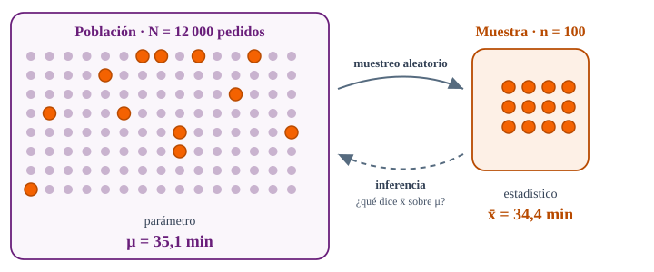
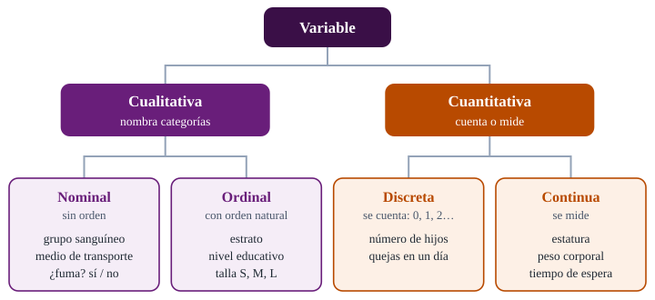

<!--
  Sesión 1 (2 h): bienvenida 8 min · diagnóstico 15 · conceptos 45 · Python 15 ·
  práctica 30 · cierre 7. Las diapositivas de código corresponden a las celdas
  del notebook (mismo identificador entre corchetes); las salidas son las de
  precalculo/salidas_sesion1.json, ejecutadas con Python 3.13 y pandas 2.2.3.
  Si el tiempo aprieta, se saltan dos adelantos: «El tipo de variable decide el
  resumen y el gráfico» y «Contar categorías» (está en el notebook).
-->

# Bienvenida {icono=fa-door-open}

> Tener muchos datos no es lo mismo que saber qué dicen.

???
Arrancar con la frase. El syllabus abre igual: la era digital produce más información, que a veces se interpreta mal y termina distrayendo de los objetivos. Este curso trata de interpretarla bien. Pedir desde ya que abran el notebook de la sesión (botón «Abrir en Colab» de la portada del curso, o el enlace de la diapositiva de Colab) y ejecuten la primera celda: lo usaremos en la segunda hora.

## El curso recorre cuatro etapas, del diagnóstico al tablero

::: tarjetas {columnas=4}
### Reconocimiento
**Etapa 0** · diagnóstico sin nota: hoy
### Contextualización
**Etapa 1** · análisis exploratorio y muestreo
### Profundización
**Etapa 2** · regresión lineal simple y múltiple
### Transferencia
**Etapa 3** · visualización de datos e inteligencia de negocios
:::

**24 horas** con el docente y **72** de trabajo independiente: por cada hora de clase, tres por tu cuenta.

???
Son las cuatro etapas de la metodología y de los contenidos del syllabus. Dos créditos son 96 horas en total. El trabajo independiente no es opcional: lecturas, talleres y la práctica de cada sesión. Todo el curso se hace en Python, en Google Colab, sin instalar nada.

## Tres criterios valoran tu desempeño, y hoy empezamos por el primero

| Criterio | Qué pide |
|---|---|
| **CR1** | Clasificar los datos y su fuente para tomar decisiones |
| **CR2** | Comparar técnicas de minería de datos y elegir un modelo adecuado |
| **CR3** | Interpretar los resultados en distintos contextos |

Tres miradas en la evaluación: **autoevaluación**, **coevaluación** y **heteroevaluación**.

???
Los criterios de realización son la base de las rúbricas. Hoy trabajamos CR1 de principio a fin: clasificar variables, escalas y fuentes. CR2 y CR3 llegan con la regresión y la visualización. La autoevaluación empieza en cinco minutos, con el diagnóstico.

## Dos horas en seis momentos

::: flujo
1. **Bienvenida** — 8 min
2. **Diagnóstico** — 15 min, sin nota
3. **Conceptos** — 45 min
4. **Python** — 15 min en Colab
5. **Práctica guiada** — 30 min
6. **Cierre** — 7 min
:::

Los conceptos de hoy: estadística, población y muestra, tipos de variable y fuentes de datos.

???
Si el diagnóstico se alarga, se saltan dos diapositivas que son adelantos de la próxima sesión: «El tipo de variable decide el resumen y el gráfico» y «Contar categorías» (que queda en el notebook). La práctica no se recorta: ahí se ve si CR1 quedó.

# Diagnóstico {icono=fa-stethoscope}

> Sin nota: sirve para saber desde dónde arrancamos, no para calificar.

???
Etapa 0 del syllabus: reconocimiento. Seis preguntas, un minuto cada una. Pedir que anoten sus respuestas (en papel, o en un mensaje sin enviar) y que no las busquen: el diagnóstico solo sirve si es honesto. Las respuestas se muestran todas juntas al final.

## ¿Qué tipo de variable es el estrato socioeconómico (1 a 6)? {.pregunta etiqueta="Diagnóstico · 1 de 6"}

- **A.** Cuantitativa continua
- **B.** Cuantitativa discreta
- **C.** Cualitativa ordinal
- **D.** Cualitativa nominal

???
No dar pistas. Esta y la 6 son las que resolvemos hoy mismo.

## 20, 22, 25, 27 y 150 minutos: ¿qué describe mejor el tiempo típico? {.pregunta etiqueta="Diagnóstico · 2 de 6"}

Son los tiempos de entrega de cinco pedidos.

- **A.** La media: 48,8 min
- **B.** La mediana: 25 min
- **C.** El rango: 130 min
- **D.** La desviación estándar

???
Medidas de tendencia central y datos atípicos.

## Misma media, distinta desviación estándar: ¿qué cambia? {.pregunta etiqueta="Diagnóstico · 3 de 6"}

En la ciudad A los pedidos tardan en promedio 35 min, con desviación estándar de 4 min. En la ciudad B, también 35 min, pero con desviación de 15 min.

- **A.** En B se entrega más rápido
- **B.** B tiene más pedidos
- **C.** Nada: con la misma media, el servicio es igual
- **D.** En B los tiempos son menos predecibles

???
Medidas de dispersión.

## Juzgar la satisfacción solo con las reseñas: ¿cuál es el problema? {.pregunta etiqueta="Diagnóstico · 4 de 6"}

Para saber qué tan satisfechos están **todos** sus clientes, una empresa analiza solo las reseñas que algunos dejan en la app.

- **A.** Quienes escriben reseñas pueden no parecerse al resto
- **B.** La muestra es muy pequeña
- **C.** Ninguno, si las reseñas son muchas
- **D.** Habría que usar la mediana

???
Muestreo: sesgo de selección.

## Una regresión estima tiempo = 12 + 3 × distancia. ¿Qué dice el 3? {.pregunta etiqueta="Diagnóstico · 5 de 6"}

El tiempo está en minutos y la distancia en kilómetros.

- **A.** Que un pedido tarda 3 minutos
- **B.** Que la distancia explica el 3 % del tiempo
- **C.** Que cada kilómetro adicional suma, en promedio, 3 minutos
- **D.** Que la distancia promedio es de 3 km

???
Regresión lineal: interpretación de la pendiente.

## En pandas, ¿qué hace `pedidos["ciudad"].value_counts()`? {.pregunta etiqueta="Diagnóstico · 6 de 6"}

- **A.** Cuenta las columnas de la tabla
- **B.** Cuenta cuántos pedidos hay de cada ciudad
- **C.** Ordena la tabla por ciudad
- **D.** Borra las ciudades repetidas

???
Nivel de Python. Si muchos fallan esta, dedicar más tiempo a la demostración en Colab.

## Respuestas del diagnóstico: cuenta tus aciertos

| Pregunta | Respuesta | Lo trabajamos en |
|---|---|---|
| 1 · Estrato | **C** · cualitativa ordinal | Hoy |
| 2 · Cinco tiempos | **B** · la mediana: el 150 arrastra la media | Tendencia central y atípicos |
| 3 · Misma media | **D** · menos predecibles | Medidas de dispersión |
| 4 · Solo reseñas | **A** · quien opina no representa a todos | Muestreo |
| 5 · El 3 | **C** · 3 min más por kilómetro | Regresión |
| 6 · `value_counts()` | **B** · pedidos por ciudad | Hoy, en Python |

???
Pedir que escriban en el chat cuántas acertaron, solo el número: con eso se ajusta el ritmo del curso. Es su primera autoevaluación. No explicar ahora las preguntas 2 a 5: cada una tiene su sesión. La 2 sí merece una frase: la media (48,8) no se parece a ningún pedido; la mediana (25), a casi todos.

# Estadística para decidir {icono=fa-compass}

> Tingua Domicilios tiene 12 000 pedidos del semestre y una gerencia con preguntas.

???
Presentar el caso como una empresa de domicilios: el tipo de servicio que todos han usado alguna vez.

## Tingua Domicilios: el caso que nos acompaña todo el curso

::: tarjetas
### 12 000 pedidos
Todos los domicilios entregados entre enero y junio de 2026.
### 5 ciudades
Bogotá, Medellín, Cali, Barranquilla y Bucaramanga.
### 15 columnas
De la ciudad y el estrato a la distancia, la lluvia y la calificación.
:::

Tingua es una empresa **ficticia**: sus datos se generan con una semilla fija y no corresponden a personas ni a empresas reales.

???
Decir explícitamente que es ficticia. Los mismos datos sirven para todo el curso: hoy los clasificamos; en las próximas sesiones los resumimos, sacamos muestras, ajustamos regresiones y armamos un tablero.

## Cuatro preguntas de la gerencia ordenan el curso

1. ¿Cuánto tarda un pedido **típico**, y qué tan variable es? → *análisis exploratorio*
2. ¿Qué tan **satisfechos** están los clientes, si no todos califican? → *muestreo e inferencia*
3. ¿Cuántos minutos añade cada **kilómetro**, o la **lluvia**? → *regresión*
4. ¿Cómo se lo **mostramos** a la gerencia cada semana? → *visualización e inteligencia de negocios*

???
Volveremos a estas preguntas al final del curso. La segunda ya trae trampa: el 40,8 % de los pedidos no tiene calificación, y no faltan completamente al azar. Lo retomamos en fuentes de datos y, a fondo, en muestreo.

## Describir lo que hay; inferir lo que no vemos

::: definicion Análisis estadístico
La ciencia de recolectar, explorar y presentar grandes cantidades de datos para descubrir patrones y tendencias, y así decidir con más fundamento.
:::

- **Descriptiva** — resume lo observado: «el 24,1 % de los pedidos del semestre se entregó con lluvia»
- **Inferencial** — generaliza más allá: «con 400 encuestas estimamos la satisfacción de todos los clientes»

???
La definición es la del glosario del syllabus (*statistical analysis*), traducida. La distinción entre descriptiva e inferencial ordena las dos primeras etapas del curso: análisis exploratorio, y después muestreo.

## Un estudio estadístico empieza por la pregunta, no por los datos

::: flujo
1. **Problema** — ¿qué queremos saber, y para decidir qué?
2. **Plan** — qué medir, a quién y cómo
3. **Datos** — recolectar, organizar y depurar
4. **Análisis** — resumir, graficar y modelar
5. **Conclusión** — responder, y decir con cuánta incertidumbre
:::

Es el ciclo **PPDAC**, que difundieron Wild y Pfannkuch (1999): cada conclusión abre una pregunta nueva.

???
Hoy estamos al comienzo de «Datos»: antes de calcular hay que saber qué es cada columna. El título de la sesión, «del dato a la pregunta», recorre el ciclo al revés, que es lo que pasa en las empresas: llegan los datos y hay que averiguar qué preguntas pueden responder. El ciclo se debe a MacKay y Oldford; lo difundieron Wild, C. J. y Pfannkuch, M. (1999), *Statistical thinking in empirical enquiry*, International Statistical Review, 67(3).

## ¿Descriptiva o inferencial? {.pregunta}

1. «El tiempo medio de los 12 000 pedidos del semestre fue 35,1 min».
2. «Con una muestra de 400 clientes, estimamos que el 80 % recomendaría Tingua».
3. «En julio, los pedidos con lluvia tardarán unos 8 minutos más».

::: respuesta
**1, descriptiva**: resume todos los pedidos. **2 y 3, inferenciales**: la 2 va de una muestra a todos los clientes; la 3, del semestre observado a un mes que todavía no ha pasado.
:::

???
La 3 se apoya en un dato descriptivo real (con lluvia, los pedidos del semestre tardaron 7,8 min más en promedio), pero lo proyecta a julio: eso ya es inferir.

# Población y muestra {icono=fa-users}

> ¿Cuánto tarda un pedido de Tingua? Depende de si miras los 12 000 o solo 100.

## La población es el todo; la muestra, la parte que observas

{alto=430}

???
Detenerse en las dos flechas: muestrear es ir de la población a la muestra; inferir es volver con una conclusión. Toda la estadística inferencial vive en la flecha punteada. Aquí la población cabe en una tabla y por eso podemos calcular μ; en la vida real casi nunca se puede.

## El parámetro describe la población; el estadístico, la muestra

| | Población · parámetro | Muestra · estadístico |
|---|---|---|
| Tamaño | \(N\) | \(n\) |
| Media | \(\mu\) | \(\bar{x}\) |
| Desviación estándar | \(\sigma\) | \(s\) |
| Proporción | \(p\) | \(\hat{p}\) |

Letras **griegas** para los parámetros, salvo \(N\) y \(p\); **latinas** para los estadísticos.

???
Es la convención de casi todos los textos; el tamaño y la proporción son las excepciones (N, y p con su p sombrero). Con los datos de Tingua: N = 12 000, μ = 35,1 min, p = 0,241 (pedidos con lluvia).

## La misma fórmula, sobre conjuntos distintos

$$ \mu = \frac{1}{N}\sum_{i=1}^{N} x_i \qquad\qquad \bar{x} = \frac{1}{n}\sum_{i=1}^{n} x_i $$

**μ** promedia los \(N\) valores de la población; **x̄**, solo los \(n\) de la muestra.

???
La cuenta es idéntica; lo que cambia es sobre qué conjunto se hace, y por eso cambia lo que significa. En media hora lo veremos en Python: tres muestras de 100 pedidos, tres x̄ distintos, un solo μ.

## Cada fila es una unidad de observación; cada columna, una variable

| id_pedido | ciudad | estrato | n_productos | distancia_km | tiempo_entrega_min |
|---|---|---|---|---|---|
| P00002 | Bogotá | 4 | 5 | 5.6 | 36.9 |
| P00003 | Bucaramanga | 5 | 2 | 1.9 | 16.0 |
| P00004 | Barranquilla | 2 | 1 | 2.6 | 17.0 |

En Tingua, la **unidad de observación** es el **pedido**, no el cliente.

???
Es la forma «ordenada» (*tidy*) de una tabla: una fila por unidad, una columna por variable (Wickham, 2014, *Tidy data*, Journal of Statistical Software). Preguntar: si la gerencia quiere saber cuántos clientes distintos tiene, ¿sirve esta tabla? No: no trae identificador de cliente. Las cifras van con punto decimal porque así las verán en pandas.

## ¿Parámetro o estadístico? {.pregunta}

1. El 24,1 % de los 12 000 pedidos del semestre se entregó con lluvia.
2. En 100 pedidos auditados al azar, el tiempo medio fue de 34,4 min.
3. El tiempo medio de **todos** los pedidos de Cali en el semestre fue de 32,5 min.

::: respuesta
**1, parámetro**: es *p*, sobre toda la población. **2, estadístico**: es x̄, de una muestra. **3, parámetro**: es la media de una población completa, la de los pedidos de Cali.
:::

???
La 3 es la que más se equivoca: «Cali» suena a una parte de algo más grande. Pero si la pregunta es sobre los pedidos de Cali, sus 1 966 pedidos son la población. Qué es población lo decide la pregunta, no la tabla.

## Un parámetro es fijo y casi nunca se conoce; un estadístico se conoce, pero cambia {.idea}

La inferencia estadística consiste en medir cuánto se puede confiar en el segundo para hablar del primero.

???
Llevar esta frase hasta la etapa de muestreo. En la práctica la comprobarán: cada uno obtendrá un p̂ distinto.

# Tipos de variable y escalas {icono=fa-tags}

> Antes de calcular, clasifica: el tipo de variable decide qué operaciones tienen sentido.

???
Este es el núcleo de CR1. Los ejemplos de esta sección son cotidianos a propósito: las columnas de Tingua las clasifican ellos en la práctica.

## Toda variable es cualitativa o cuantitativa, y cada una tiene dos clases

{alto=440}

???
Recorrer el árbol de arriba abajo, con una pregunta en cada nivel. ¿Tiene sentido sumar o promediar? Cualitativa o cuantitativa. ¿Hay un orden natural? Nominal u ordinal. ¿Se cuenta o se mide? Discreta o continua. Las de dos categorías, como «¿fuma?», se llaman dicotómicas y son nominales.

## Cualitativas: las nominales solo nombran; las ordinales, además, ordenan {.arriba}

### Nominal
- Grupo sanguíneo: A, B, AB, O
- Medio de transporte: bus, carro, bicicleta
- ¿Fuma?: sí / no (*dicotómica*)

|||

### Ordinal
- Estrato: 1 < 2 < … < 6
- Nivel educativo: primaria < bachillerato < pregrado < posgrado
- Satisfacción: de «muy insatisfecho» a «muy satisfecho»

???
La pregunta que las separa: ¿tiene sentido decir que una categoría es «mayor» que otra? El grupo O no es mayor que el A. El estrato 4 sí es mayor que el 2, pero en una ordinal se sabe cuál es mayor, no por cuánto: la distancia entre los estratos 1 y 2 no tiene por qué ser la misma que entre el 5 y el 6.

## Cuantitativas: las discretas se cuentan; las continuas se miden

::: tarjetas
### Discreta
Número de hijos, quejas recibidas en un día: 0, 1, 2… Entre 2 y 3 hijos no hay nada.
### Continua
Estatura, peso, tiempo de espera: entre dos valores siempre cabe otro.
:::

El dinero se cuenta en pesos, pero como admite tantísimos valores se suele tratar como **continuo**.

???
Una continua se registra redondeada (la estatura en centímetros), pero eso es una limitación del instrumento, no de la variable. Lo del dinero es una convención: decirlo, porque en el ejercicio 1 aparece el valor del pedido y el verificador acepta las dos respuestas.

## Cuatro escalas de medición: cada una permite una operación más

| Escala | Qué permite | Ejemplos |
|---|---|---|
| **Nominal** | igual o distinto | grupo sanguíneo, medio de transporte |
| **Ordinal** | + mayor o menor | estrato, nivel educativo |
| **Intervalo** | + restar: las diferencias tienen sentido; el cero es arbitrario | temperatura en °C, año calendario |
| **Razón** | + multiplicar y dividir; el cero es «nada» | estatura, ingreso, tiempo de espera |

Es la clasificación de Stevens (1946).

???
Cada escala hereda las operaciones de la anterior. La de intervalo es la que más cuesta: de 10 a 20 °C hay lo mismo que de 20 a 30 °C, pero 0 °C no es ausencia de temperatura; y el origen del calendario es una convención. En razón, el cero sí es «nada»: 0 minutos de espera es no esperar. Referencia: Stevens, S. S. (1946), *On the theory of scales of measurement*, Science, 103(2684).

## ¿Hace el doble de calor en Barranquilla que en Bogotá? {.pregunta}

La temperatura media de los pedidos del semestre fue de **28,8 °C** en Barranquilla y de **13,9 °C** en Bogotá, y 28,8 / 13,9 = 2,07.

::: respuesta
**No.** Los grados Celsius son una escala de **intervalo**: su cero es arbitrario (el agua se congela). En kelvin, cuyo cero es el cero absoluto (no hay temperatura más baja), la razón es 301,95 / 287,05 ≈ **1,05**: apenas un 5 % más.
:::

???
Lo que sí tiene sentido es la diferencia: en Barranquilla hacía 14,9 °C más. Las temperaturas salen de la columna temperatura_c de Tingua.

## Un número no siempre es una cantidad {.idea}

El estrato se escribe con números del 1 al 6, pero su promedio en Tingua, 3,3, no es ningún estrato: los números son etiquetas con orden.

???
Puente con Python: pandas leerá el estrato como un entero y lo promediará sin protestar. Veremos cómo decirle que es una categoría con orden.

## Clasifica estas cinco variables {.pregunta}

1. Número de hijos
2. Talla de camisa: S, M, L, XL
3. Grupo sanguíneo
4. Estatura en centímetros
5. Año de nacimiento

::: respuesta
**1** cuantitativa discreta, de razón · **2** cualitativa ordinal · **3** cualitativa nominal · **4** cuantitativa continua, de razón · **5** cuantitativa, de **intervalo**: el origen del calendario es una convención.
:::

???
La 5 es la difícil: restar años tiene sentido (una edad), dividirlos no. Si alguien discute si el año es discreto o continuo: el tiempo es continuo, aunque lo registremos en años enteros. Lo que importa aquí es la escala.

## El tipo de variable decide el resumen y el gráfico

| Tipo | Resumen | Gráfico |
|---|---|---|
| Nominal | frecuencias, moda | barras |
| Ordinal | frecuencias acumuladas, mediana | barras en su orden |
| Discreta | media, mediana, frecuencias | barras o histograma |
| Continua | media, desviación estándar, cuartiles | histograma, caja |

Es el mapa de las próximas sesiones.

???
No desarrollar: es un adelanto. La próxima sesión empieza por la primera columna (tablas de frecuencias). Si el tiempo aprieta, esta es la diapositiva que se salta.

# Fuentes de datos {icono=fa-database}

> El mismo número vale distinto según de dónde viene y para qué se recogió.

???
La segunda mitad de CR1: clasificar la fuente. No se recorta: el ejercicio 4 de la práctica pide clasificar la fuente de pedidos.csv.

## Primaria o secundaria: ¿se recogió para tu pregunta?

::: tarjetas
### Primaria
La recoges tú, para tu pregunta: una encuesta de satisfacción que diseña Tingua, una prueba de una nueva app de rutas.
### Secundaria
Ya existía, recogida por otros o para otro fin: los registros de la app, los datos del clima del IDEAM, las encuestas del DANE.
:::

En otro eje: **interna**, si la produce la organización, o **externa**, si viene de fuera.

???
pedidos.csv sorprende: es de Tingua (interna) pero secundaria, porque la app la registra para operar, no para responder nuestras preguntas. Por eso trae lo que la operación necesitó y no lo que el análisis querría: no tiene identificador de cliente. En la ficción, la lluvia y la temperatura vienen de un servicio de clima que se une a cada pedido: una fuente externa dentro de una tabla interna.

## Observar o experimentar: solo el experimento permite hablar de causa

::: tarjetas
### Estudio observacional
Se registra lo que pasa, sin intervenir. Con lluvia, los pedidos de Tingua tardaron **7,8 min más**; pero con lluvia también cambian el tráfico y la demanda.
### Experimento
Se asigna al azar quién recibe qué. Si Tingua prueba una nueva app de rutas en la mitad de los pedidos, elegidos al azar, la diferencia sí se puede atribuir a la app.
:::

???
Los datos de Tingua son observacionales: lo que concluyamos con regresión será asociación, no causa. Saber esto es la mitad de interpretar en contexto, que es lo que pide CR3.

## Cinco criterios para decidir si una fuente sirve

| Criterio | Pregunta | En Tingua |
|---|---|---|
| **Pertinencia** | ¿Responde mi pregunta? | Sin identificador de cliente, no se pueden contar clientes |
| **Exactitud** | ¿Los valores son correctos? | Un pedido de 201 minutos: ¿demora real o error? |
| **Completitud** | ¿Qué falta, y por qué? | El 40,8 % de los pedidos no tiene calificación |
| **Oportunidad** | ¿Está al día? | Llega hasta el 30 de junio de 2026 |
| **Consistencia** | ¿Coincide con otras fuentes? | Los totales deberían cuadrar con contabilidad |

???
CR1 pide clasificar los datos y su fuente para decidir: esta es la lista de chequeo. La completitud trae una trampa que veremos en muestreo: los clientes cuyo pedido tardó más de 55 minutos califican mucho más (81 %) que el resto (58 %). Los faltantes no son completamente al azar. El pedido de 201 minutos es el más lento del semestre: lo retomamos en datos atípicos.

# Primer contacto en Python {icono=fa-laptop-code}

> Lo que acabamos de clasificar a mano, ahora con pandas.

## Colab: un notebook en el navegador, sin instalar nada

::: flujo
1. **Abrir** — botón «Abrir en Colab» de la portada del curso
2. **Guardar una copia** — Archivo → Guardar una copia en Drive
3. **Crear los datos** — ejecutar la primera celda sin modificarla
4. **Avanzar en orden** — Mayús + Enter, celda por celda
:::

[Abrir el notebook de la sesión 1 en Colab](https://colab.research.google.com/github/JotaMao1985/ANaLISIS-ESTADiSTICO-DE-LA-INFORMACIoN_Ucomp/blob/main/notebooks/sesion-1-del-dato-a-la-pregunta.ipynb). Cada celda lleva entre corchetes el mismo identificador que el código de estas diapositivas.

???
Si alguien todavía no lo ha abierto, que lo haga ahora: la portada del curso está en https://jotamao1985.github.io/ANaLISIS-ESTADiSTICO-DE-LA-INFORMACIoN_Ucomp/ y el enlace de esta diapositiva abre el notebook directamente. Si Colab se reinicia o una celda falla al repetirla: Entorno de ejecución → Ejecutar anteriores. La primera celda está plegada: crea los datos y unas funciones para revisar la práctica.

## Tres líneas para cargar los 12 000 pedidos {columnas=3:2}

```python [cargar] {resaltar=3-4}
import pandas as pd

pedidos = pd.read_csv("datos/pedidos.csv")
pedidos.shape          # (filas, columnas)
#> (12000, 15)
```

|||

- `read_csv` lee el archivo y devuelve un **DataFrame**: una tabla con columnas con nombre
- `.shape`: 12 000 filas, una por **pedido**, y 15 columnas, una por **variable**

???
Ejecutar en vivo y, en la celda siguiente del notebook, mostrar pedidos.head(): ahí se ven los NaN de la calificación, que usamos en dos diapositivas.

## pandas adivina el tipo de dato, no el tipo de variable {columnas=3:2}

```python [tipos] {resaltar=3,10,16}
pedidos.dtypes
#> id_pedido              object
#> fecha                  object
#> franja                 object
#> ciudad                 object
#> categoria              object
#> n_productos             int64
#> valor_pedido            int64
#> medio_pago             object
#> estrato                 int64
#> suscriptor             object
#> distancia_km          float64
#> lluvia                 object
#> temperatura_c         float64
#> tiempo_entrega_min    float64
#> calificacion          float64
#> dtype: object
```

|||

- `object` es texto; `int64`, entero; `float64`, decimal
- `estrato` es **int64**, pero es ordinal
- `calificacion` es **float64**, pero son estrellas de 1 a 5
- `fecha` es **object**: llegó como texto

???
El tipo de dato dice cómo se guarda el valor en memoria; el tipo de variable, qué significa. pandas solo puede adivinar lo primero. Las tres líneas iluminadas son ejemplos de lo que hay que corregir a mano; en la práctica también corregirán la franja.

## ¿Por qué la calificación es float64, si son estrellas de 1 a 5? {.pregunta}

Pista: mira la última columna de `pedidos.head()`.

::: respuesta
Porque **le faltan valores**. pandas marca un faltante con `NaN`, que es un número decimal, y para que quepa vuelve decimal toda la columna.

```python [faltantes]
faltan = pedidos["calificacion"].isna()
print("Pedidos sin calificación:", faltan.sum())
print("Proporción:", round(faltan.mean(), 3))
#> Pedidos sin calificación: 4901
#> Proporción: 0.408
```
:::

???
Es la misma cifra del criterio de completitud: 4 901 pedidos, el 40,8 %.

## Declarar la escala evita cálculos sin sentido {columnas=2:1}

```python [ordinal] {resaltar=2-4,7,11-12}
# El estrato es una categoría con orden, no una cantidad
pedidos["estrato"] = pd.Categorical(
    pedidos["estrato"], categories=[1, 2, 3, 4, 5, 6], ordered=True
)
print("Estrato máximo:", pedidos["estrato"].max())
try:
    pedidos["estrato"].mean()
except TypeError as error:
    print("TypeError:", error)
#> Estrato máximo: 6
#> TypeError: 'Categorical' with dtype category
#>   does not support reduction 'mean'
```

|||

- `ordered=True` le dice a pandas que hay un orden
- `max()` funciona; `mean()` se niega
- Un error a tiempo es mejor que un promedio sin sentido

???
El try/except solo está para que la celda no se detenga: lo que importa es el mensaje. En el notebook la celda trae dos comentarios más («comparar sí tiene sentido… promediar, no»). La salida del error está partida en dos líneas para que quepa. En la práctica harán lo mismo con la franja y la calificación.

## Un parámetro y tres estadísticos {columnas=2:1}

```python [parametro] {resaltar=2,7,10-13}
# Parámetro: se calcula con TODA la población
mu = pedidos["tiempo_entrega_min"].mean()
print(f"μ = {mu:.1f} min   (N = {len(pedidos)})")

# Estadísticos: cada muestra aleatoria da un valor distinto
for semilla in [1, 2, 3]:
    muestra = pedidos.sample(n=100, random_state=semilla)
    x_barra = muestra["tiempo_entrega_min"].mean()
    print(f"x̄ = {x_barra:.1f} min   (n = 100, semilla {semilla})")
#> μ = 35.1 min   (N = 12000)
#> x̄ = 34.4 min   (n = 100, semilla 1)
#> x̄ = 35.2 min   (n = 100, semilla 2)
#> x̄ = 35.9 min   (n = 100, semilla 3)
```

|||

- μ no cambia: es uno solo
- x̄ cambia con cada muestra, pero queda **cerca** de μ
- ¿Qué tan cerca? Esa es la pregunta del muestreo

???
La semilla (random_state) hace que la muestra sea reproducible: con la misma semilla sale la misma muestra en cualquier computador. Preguntar qué pasaría con muestras de 1 000 pedidos en lugar de 100 y dejar la respuesta en el aire.

## Contar categorías: el primer paso de una tabla de frecuencias {columnas=3:2}

```python [frecuencias]
ciudad = pedidos["ciudad"]
conteo = ciudad.value_counts()
porcentaje = (ciudad.value_counts(normalize=True) * 100).round(1)
pd.DataFrame({"pedidos": conteo, "%": porcentaje})
#>               pedidos     %
#> ciudad
#> Bogotá           4707  39.2
#> Medellín         2663  22.2
#> Cali             1966  16.4
#> Barranquilla     1474  12.3
#> Bucaramanga      1190   9.9
```

|||

- `value_counts()`: frecuencia absoluta
- `normalize=True`: frecuencia relativa
- Es la respuesta de la pregunta 6 del diagnóstico

???
Es un adelanto de la próxima sesión, donde la tabla se completa con frecuencias acumuladas y sus gráficos. Si el tiempo aprieta, se salta: la celda está en el notebook.

# Práctica y cierre {icono=fa-keyboard}

> Treinta minutos con el notebook: clasificar, declarar escalas y sacar tu propia muestra.

## Práctica guiada: cuatro ejercicios en el notebook

::: flujo
1. **Clasifica** — tipo y escala de 13 variables de Tingua; `revisar_tipos` da pistas · 10 min
2. **Declara las escalas** — franja y calificación ordenadas; fecha como fecha · 8 min
3. **Tu propio estadístico** — \(\hat{p}\) con tu semilla, y al chat · 5 min
4. **De los datos a la pregunta** — dos preguntas para la gerencia, y la fuente de los datos · 7 min
:::

???
Los ejercicios 1 y 2 se revisan solos: revisar_tipos dice qué variable está mal y da una pista, sin la respuesta. Ir anotando en el tablero los p̂ que lleguen al chat en el ejercicio 3: todos rondan p = 0,241 y nadie lo obtiene exacto. En el ejercicio 4, pedir dos o tres voluntarios que lean sus preguntas.

## ¿Por qué cada uno obtuvo un p̂ distinto? {.pregunta}

Mira los \(\hat{p}\) del chat: todos con \(n = 200\), cada uno con su propia semilla. El parámetro es p = 0,241.

::: respuesta
Porque cada semilla elige 200 pedidos distintos de los 12 000. El estadístico **varía de muestra en muestra** alrededor del parámetro; esa variación tiene forma y tamaño, y medirla es el trabajo de la inferencia.
:::

???
Es la imagen con la que abriremos la etapa de muestreo: un histograma con los p̂ del grupo tiende a la forma de campana, centrado cerca de p. Detalle para quien pregunte: con n = 200, p̂ siempre es múltiplo de 0,005, así que nadie puede obtener 0,241 exacto.

## Lo que te llevas hoy {.cierre}

- La estadística **describe** lo que hay e **infiere** lo que no vemos
- Un **parámetro** es fijo y casi nunca se conoce; un **estadístico** se conoce, pero cambia con la muestra
- Toda variable es **nominal, ordinal, discreta o continua**, y su **escala** decide qué cálculos valen
- La **fuente** importa: primaria o secundaria, observacional o experimental
- pandas adivina el **tipo de dato**; el **tipo de variable** se lo dices tú

???
Leer las cinco en voz alta y preguntar cuál les costó más: es la autoevaluación de cierre.

## Para la próxima sesión

- **Termina** la práctica: los ejercicios 1 y 2 se revisan solos
- **Lee** *OpenIntro Statistics* (4.ª edición, de acceso abierto), capítulo 1, secciones 1.2 y 1.3
- **Trae** tus dos preguntas del ejercicio 4: con ellas abrimos la sesión

**Próxima sesión:** tablas y distribuciones de frecuencias.

???
OpenIntro Statistics (Diez, Çetinkaya-Rundel y Barr) se descarga gratis en openintro.org; las secciones 1.2 y 1.3 cubren tipos de variable y principios de muestreo, en inglés (el syllabus pide referencias en otros idiomas). Es una sugerencia del docente: no está en la bibliografía del syllabus.
