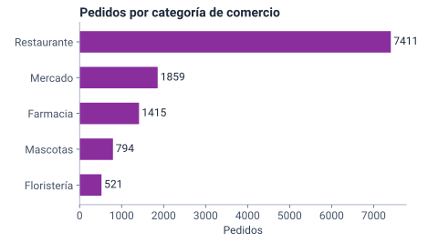
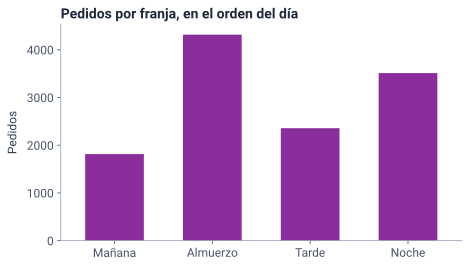
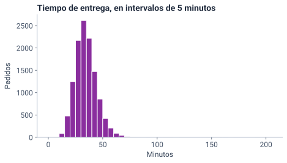
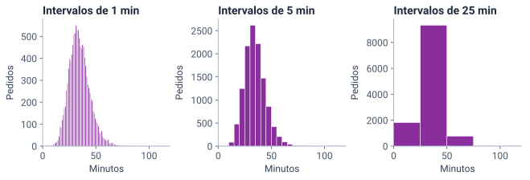
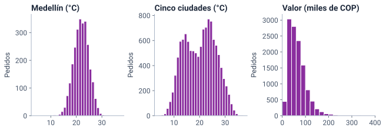
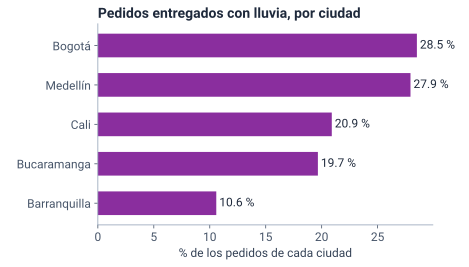

<!--
  Sesión 2 (2 h): apertura 15 min · contar y graficar 60 · práctica 35 · cierre 10.
  Las diapositivas de código corresponden a las celdas del notebook (mismo
  identificador entre corchetes); las salidas y las gráficas salen de ejecutarlo
  (precalculo/salidas_sesion2.json y recursos/s2/<id>.svg), con Python 3.13 y
  pandas 2.2.3. Las cifras del texto salen de la celda [cifras].
  Los hitos de reloj y el orden de recorte están en la nota de «Dos horas en
  cuatro momentos».
-->

# Apertura {icono=fa-door-open}

> 12 000 filas no se leen: se cuentan.

???
Pedir desde ya que abran el cuaderno de la sesión 2 (portada del curso → «Abrir en Colab») y ejecuten la primera celda: crea los mismos datos de la sesión 1. Lo usaremos en la práctica.

## Dos horas en cuatro momentos

::: flujo
1. **Apertura** — 15 min: repaso y coevaluación
2. **Contar y graficar** — 60 min, con pandas
3. **Práctica guiada** — 35 min en Colab
4. **Cierre** — 10 min
:::

La primera pregunta de la gerencia era cuánto tarda un pedido **típico**. Antes de responderla con un número, hay que ver **cómo se reparten** los tiempos.

???
Hitos de reloj: la diapositiva 7 en el minuto 15; la 12, en el 23; la 20, en el 39; la 29, en el 59; la 36, en el 75, y la 38, en el 110. Durante la exposición solo miran; ejecutan todo en la práctica. Si a los 30 min no se ha llegado a «En una ordinal, la tabla va en el orden de la escala», recortar en este orden: (1) «La acumulada encuentra la mitad de los datos»: decir su primera viñeta en la diapositiva anterior (−2 min); (2) «Una discreta se tabula valor por valor, y su cola se agrupa»: solo el título y la cola de 44 (−2 min); (3) en «¿Cuál de los tres histogramas es el correcto?», revelar sin pasar por el chat (−1,5 min); (4) en «Una tabla cruzada admite tres porcentajes», leer solo las dos primeras filas (−1 min). No se recortan las dos preguntas de «¿sobre qué total?» ni la práctica: son el centro de la sesión.

## Dos ideas de la sesión 1, con más precisión

::: tarjetas
### El estrato no se promedia
No porque 3,3 «no exista», sino porque nada garantiza que del estrato 1 al 2 haya la misma distancia que del 5 al 6: los números son etiquetas con orden.
### La lluvia viene con la ciudad
Con lluvia, los pedidos tardaron 7,8 min más; pero llueve más en Bogotá, donde los pedidos ya tardan más. Hoy lo vemos con una tabla cruzada.
:::

???
Dos minutos. La primera corrige un argumento débil: el promedio de hijos tampoco es un número posible de hijos, y aun así se usa; lo que falla en el estrato es que las distancias entre categorías no son iguales. La segunda la retomamos al final de la exposición, con la tabla cruzada de ciudad y lluvia. Si a alguien el verificador del ejercicio 1 de la sesión 1 le mostró un error, que vuelva a abrir ese cuaderno desde la portada: ya está corregido, y basta con copiar su diccionario.

## Otra persona del curso revisa tus dos preguntas con tres criterios

::: flujo
1. **Intercambia** — en parejas, comparte tus dos preguntas del ejercicio 4
2. **Revisa** — las de la otra persona, con los tres criterios · 5 min
3. **Devuelve** — una sugerencia concreta por pregunta · 2 min
:::

| Criterio | Pregunta |
|---|---|
| **Pertinencia** | ¿La tabla de pedidos la puede responder? |
| **Variables** | ¿Qué columnas usa y de qué tipo son? |
| **Alcance** | ¿Basta con describir los 12 000 pedidos o hay que inferir? |

???
Es la coevaluación que pide el syllabus, y cumple lo prometido al cierre de la sesión 1. En salas de grupos, de a dos; ocho minutos en total. Al volver, pedir dos voluntarios que lean una pregunta y la sugerencia que recibieron. Señalar las que empiezan por «¿cuántos pedidos…?» o «¿qué parte…?»: se responden hoy, con una tabla de frecuencias.

# Distribuciones de frecuencias {icono=fa-table-list}

> ¿Qué valores toma una variable y cuántas veces aparece cada uno? Esa es su distribución.

???
Volver al lema de la sesión 1: antes de calcular, clasifica. El de hoy lo continúa: antes de resumir, cuenta.

## Una distribución dice qué valores aparecen y cuántas veces

::: definicion Distribución de frecuencias
La lista de los valores, categorías o intervalos que toma una variable, con cuántas veces aparece cada uno. Su forma más simple es una **tabla de frecuencias**.
:::

- Las 12 000 filas de `categoria` caben en una tabla de **5 filas**
- La tabla no pierde nada de lo que importa para preguntar **cuántos de cada uno**

???
Lo que la tabla sí pierde es el orden de las filas y el resto de las columnas: por eso cada tabla responde una pregunta, no todas. Transición: veamos qué columnas lleva una tabla de frecuencias.

## Cuatro columnas responden cuatro preguntas distintas

| Columna | Símbolo | Responde | Calificación de 4 estrellas |
|---|---|---|---|
| Frecuencia absoluta | \(n_i\) | ¿Cuántos? | 2959 pedidos |
| Frecuencia relativa | \(f_i\) | ¿Qué parte del total? | 41,7 % |
| Absoluta acumulada | \(N_i\) | ¿Cuántos hasta aquí? | 4445 pedidos |
| Relativa acumulada | \(F_i\) | ¿Qué parte hasta aquí? | 62,6 % |

Sobre los 7099 pedidos calificados: «hasta aquí» quiere decir «de 1 a 4 estrellas».

???
Las cifras salen de la tabla de la calificación que veremos en Python en unos minutos. La absoluta acumulada casi no se usa en la práctica: la relativa acumulada dice lo mismo en porcentaje, que es como lo lee la gerencia.

## Las relativas dividen entre el total; las acumuladas suman hasta la categoría

$$ \begin{aligned} f_i &= \frac{n_i}{n} && \text{relativa} \\[6pt] N_i &= n_1 + n_2 + \cdots + n_i && \text{absoluta acumulada} \\[6pt] F_i &= \frac{N_i}{n} && \text{relativa acumulada} \end{aligned} $$

\(n\) es el total de datos e \(i\) numera las categorías en su orden. Las \(n_i\) suman \(n\), y las \(f_i\) suman 1 (el 100 %).

???
Cómo se lee en voz alta: «f sub i es n sub i entre n». Multiplicar por 100 solo cambia la escala: 0,417 es el 41,7 %. Comprobar que las relativas sumen 1 es el primer control de calidad de una tabla.

## Acumular exige un orden {.idea}

«Hasta aquí» necesita un antes y un después: se acumulan las ordinales y las cuantitativas, nunca las nominales.

???
Preguntar: ¿qué querría decir «Restaurante o menos»? Nada: las categorías de comercio no tienen orden. Por eso la tabla de una nominal lleva solo absolutas y relativas.

# Variables cualitativas {icono=fa-chart-bar}

> En una nominal, el orden de la tabla lo eliges tú; en una ordinal, ya viene dado.

## La tabla de una nominal: conteo y porcentaje {columnas=2:1}

```python [nominal]
conteo = pedidos["categoria"].value_counts()
porcentaje = pedidos["categoria"].value_counts(normalize=True) * 100
tabla = pd.DataFrame({"pedidos": conteo, "%": porcentaje.round(1)})
tabla
#>              pedidos     %
#> categoria
#> Restaurante     7411  61.8
#> Mercado         1859  15.5
#> Farmacia        1415  11.8
#> Mascotas         794   6.6
#> Floristería      521   4.3
```

|||

- `value_counts()`: las \(n_i\), de mayor a menor
- `normalize=True`: las \(f_i\); por 100, en %
- La **moda** es la categoría más frecuente: Restaurante

???
Es la celda [nominal]. La celda [cargar], antes, declara las escalas como en la práctica de la sesión 1: franja, estrato y calificación como categorías ordenadas. Durante la exposición solo miran; ejecutan todo en la práctica. Seis de cada diez pedidos son de restaurante: eso pesa en todo lo que digamos del tiempo de entrega.

## En una nominal, las barras van de mayor a menor {columnas=3:2}

{alto=420}

|||

- Barras **separadas**: son categorías, no un continuo
- El eje empieza en **cero**: la longitud es la cantidad
- Sin orden natural, se ordenan **por tamaño**

???
El código está en la celda [barras_nominal]: plot.barh y bar_label para poner el número al final de cada barra. Los colores y las letras de las gráficas los fija la primera celda del cuaderno.

## ¿Torta o barras? {.pregunta}

Para comparar las cinco categorías de comercio de Tingua, ¿qué gráfico conviene?

::: respuesta
**Barras.** Comparar longitudes sobre un mismo eje es más preciso que comparar ángulos o áreas: Mercado (15,5 %) y Farmacia (11,8 %) se distinguen al instante en barras y cuesta más en una torta. La torta solo sirve para mostrar una parte contra el todo, con dos o tres porciones.
:::

???
Treinta segundos; en el chat, «torta» o «barras». La razón tiene respaldo experimental: Cleveland y McGill (1984), *Graphical perception: Theory, experimentation, and application to the development of graphical methods*, Journal of the American Statistical Association, 79(387), 531–554, midieron que las personas comparan posiciones y longitudes con mucho menos error que ángulos y áreas.

## En una ordinal, la tabla va en el orden de la escala {columnas=3:2}

```python [ordinal] {resaltar=2,7}
# sort=False: en el orden de la escala (1 a 5), no por tamaño
estrellas = pedidos["calificacion"].value_counts(sort=False)
n = estrellas.sum()          # solo los pedidos calificados
tabla = pd.DataFrame({
    "pedidos": estrellas,
    "%": (estrellas / n * 100).round(1),
    "% acumulado": (estrellas.cumsum() / n * 100).round(1),
})
tabla
#>               pedidos     %  % acumulado
#> calificacion
#> 1                  72   1.0          1.0
#> 2                 240   3.4          4.4
#> 3                1174  16.5         20.9
#> 4                2959  41.7         62.6
#> 5                2654  37.4        100.0
```

|||

- `sort=False`: de 1 a 5, no por tamaño
- `cumsum()`: suma hasta cada fila
- El **20,9 %** de las calificaciones es de 3 estrellas o menos

???
La acumulada se calcula sobre los conteos y se redondea al final: si se acumulan los porcentajes ya redondeados, los errores de redondeo se suman. Ordenada por tamaño, la tabla quedaría 4, 5, 3, 2, 1 y la acumulada no significaría nada.

## «El 37,4 % de los pedidos tiene 5 estrellas»: ¿es cierto? {.pregunta}

Mira la tabla anterior: ¿sobre qué total se calculó ese 37,4 %?

::: respuesta
**No.** Es el 37,4 % de los pedidos **calificados**. Sobre todos los pedidos es el 22,1 %, porque el 40,8 % no tiene calificación.

```python [total]
todas = pedidos["calificacion"].value_counts(
    normalize=True, sort=False, dropna=False)
(todas * 100).round(1)
#> calificacion
#> 1       0.6
#> 2       2.0
#> 3       9.8
#> 4      24.7
#> 5      22.1
#> NaN    40.8
#> Name: proportion, dtype: float64
```
:::

???
Treinta segundos para pensarlo antes de revelar. value_counts deja fuera los faltantes sin avisar: es una decisión sobre el total que hay que hacer explícita. Ninguna de las dos cifras es «la correcta»: la primera describe a quienes califican; la segunda, a todos los pedidos. Lo que no se puede es leer la primera como si fuera la segunda.

## La acumulada encuentra la mitad de los datos

| Estrellas | % acumulado |
|---|---|
| 3 o menos | 20,9 % |
| 4 o menos | 62,6 % |

- La acumulada llega al 50 % en las **4 estrellas**: es la calificación **mediana**
- La satisfacción se resume con la mediana o con una proporción: el **79,1 %** de los pedidos calificados tiene 4 o 5 estrellas

???
Es un adelanto de la sesión 3: la mediana es la medida de centro que admite una ordinal, porque solo usa el orden. Responde a medias la segunda pregunta de la gerencia, siempre sobre los pedidos calificados. Promediar las estrellas, como hacen las apps, supone distancias iguales entre ellas: lo mismo que discutimos con el estrato.

## En una ordinal, las barras van en el orden de la escala {columnas=3:2}

{alto=420}

|||

- Por tamaño quedarían Almuerzo, Noche, Tarde, Mañana: se perdería el recorrido del día
- En su orden se ven **dos picos**: el almuerzo y la noche

???
La celda [barras_ordinal] usa value_counts(sort=False) sobre la franja, que ya es una categoría ordenada. Barras verticales: el eje horizontal es el orden del día.

# Variables cuantitativas {icono=fa-chart-column}

> Un tiempo toma cientos de valores distintos: una fila por valor no resume nada.

## Una discreta se tabula valor por valor, y su cola se agrupa {columnas=2:1}

```python [discreta]
productos = pedidos["n_productos"].value_counts().sort_index()
print("Valores distintos:", len(productos),
      "· del", productos.index.min(), "al", productos.index.max())
productos.head(6)
#> Valores distintos: 32 · del 1 al 44
#> n_productos
#> 1    3306
#> 2    3533
#> 3    2186
#> 4     980
#> 5     543
#> 6     370
#> Name: count, dtype: int64
```

|||

- `sort_index()`: en el orden de los valores, no por tamaño
- El **83,4 %** de los pedidos lleva de 1 a 4 productos
- La cola llega a 44: en una tabla se agrupa como «10 o más»

???
Los pedidos de 10 o más productos son 299: 283 de Mercado y 16 de Restaurante, estos con muchos productos, que parecen encargos corporativos. Agrupar la cola en una última fila abierta no pierde nada para la gerencia y ahorra veinte filas casi vacías.

## Una continua tiene demasiados valores distintos para tabularlos uno a uno {columnas=3:2}

```python [distintos]
tiempo = pedidos["tiempo_entrega_min"]
print("Valores distintos:", tiempo.nunique(), "de", len(tiempo))
print("Del", tiempo.min(), "al", tiempo.max(), "minutos")
#> Valores distintos: 649 de 12000
#> Del 6.0 al 200.9 minutos
```

|||

- Una fila por valor serían **649 filas**: no resume nada
- Se agrupa en **intervalos** (clases) que no se traslapan y cubren todos los datos

???
El tiempo se registra con un decimal; con más precisión, casi ningún valor se repetiría. Transición: ¿cuántos intervalos y de qué ancho?

## La regla de Sturges da un punto de partida para el número de intervalos

$$ \begin{aligned} k &\approx 1 + \log_2 n && \text{número de intervalos} \\[6pt] c &\approx \frac{\text{máximo} - \text{mínimo}}{k} && \text{amplitud de cada uno} \end{aligned} $$

Con \(n = 12\,000\): \(k \approx 14{,}6\), unas 15 clases, de \(c \approx 13{,}4\) min. Es una guía, no una ley: para la tabla preferimos una amplitud redonda, **10 min**, y una última clase **abierta** para la cola.

???
Sturges, H. A. (1926), *The choice of a class interval*, Journal of the American Statistical Association, 21(153). Cómo se lee: «k es aproximadamente uno más el logaritmo en base dos de n». El logaritmo en base 2 cuenta cuántas veces se puede partir n por la mitad: crece muy despacio, así que 12 000 datos piden apenas unas 15 clases. La celda [sturges] lo calcula con math.log2. Con muchos datos, Sturges se queda corto: da pocas clases y suaviza de más (Hyndman, 1995, *The problem with Sturges' rule for constructing histograms*). Por eso el histograma usa 5 min, más fino que los 13 que sugiere; la tabla usa 10 porque se lee mejor.

## Con intervalos de 10 minutos, 649 valores caben en 9 filas {columnas=3:2}

```python [intervalos] {resaltar=1-2}
cortes = [0, 10, 20, 30, 40, 50, 60, 70, 80, float("inf")]
clases = pd.cut(tiempo, bins=cortes, right=False)   # [a, b)
tabla = clases.value_counts(sort=False).to_frame("pedidos")
tabla["%"] = (tabla["pedidos"] / len(tiempo) * 100).round(1)
acumulado = tabla["pedidos"].cumsum() / len(tiempo) * 100
tabla["% acumulado"] = acumulado.round(1)
tabla
#>                     pedidos     %  % acumulado
#> tiempo_entrega_min
#> [0.0, 10.0)               8   0.1          0.1
#> [10.0, 20.0)            563   4.7          4.8
#> [20.0, 30.0)           3418  28.5         33.2
#> [30.0, 40.0)           4835  40.3         73.5
#> [40.0, 50.0)           2330  19.4         93.0
#> [50.0, 60.0)            627   5.2         98.2
#> [60.0, 70.0)            133   1.1         99.3
#> [70.0, 80.0)             21   0.2         99.5
#> [80.0, inf)              65   0.5        100.0
```

|||

- \([a, b)\) incluye \(a\) y excluye \(b\): cada tiempo cae en **un solo** intervalo
- `float("inf")`: la última clase queda **abierta**
- El **40,3 %** tardó de 30 a menos de 40 min; el 93,0 %, menos de 50

???
pd.cut con right=False arma intervalos cerrados a la izquierda. Un pedido de exactamente 40,0 min va a [40, 50), no a [30, 40). La marca de clase, el punto medio de cada intervalo (35 para [30, 40)), representa al intervalo cuando solo se tiene la tabla: la usaremos en la sesión 3.

## El histograma muestra la forma: un pico entre 30 y 35 minutos y una cola a la derecha {columnas=3:2}

{alto=420}

|||

- Barras **pegadas**: el eje es continuo
- Con intervalos de **igual ancho**, la altura es la frecuencia
- La cola llega a 201 min: 65 pedidos de 80 min o más, que casi no se ven

???
Es la misma idea de la tabla agrupada, con intervalos de 5 minutos en lugar de 10: [30, 35) tiene 2619 pedidos, el más alto. Si los anchos fueran distintos, la altura tendría que ser frecuencia dividida entre ancho (densidad), para que el área siga siendo proporcional a la frecuencia. La cola a la derecha es la que hará que la media (35,1 min) quede por encima de la mediana (33,7 min): sesión 3.

## ¿Cuál de los tres histogramas es el correcto? {.pregunta}

{alto=280}

::: respuesta
**Ninguno es «el» correcto.** Con 25 min, la forma desaparece en tres barras; con 1 min se ve la misma forma, pero con dientes que son azar (con menos datos solo habría ruido); con 5 min se ve limpia. Conviene probar dos o tres anchos y decir cuál se usó.
:::

???
En el chat, 1, 5 o 25. Los tres paneles se recortan en 120 min para ver la forma; la cola sigue hasta 201. La pregunta de fondo: el histograma depende de una decisión del analista, y hay que decirla al presentarlo.

## Tres variables de Tingua, tres formas

{alto=280}

::: tarjetas {columnas=3}
### Simétrica
La temperatura en Medellín: a cada lado del centro hay casi lo mismo.
### Bimodal
Dos jorobas: Bogotá, con 13,9 °C de media, y las otras cuatro, de 21,9 a 28,8 °C. Hay dos grupos mezclados.
### Asimétrica a la derecha
El valor del pedido: la mayoría, bajo; unos pocos, muy altos. 16 pasan de 400 mil pesos.
:::

???
El panel del valor se corta en 400 mil pesos; la cola llega a 1,75 millones (un pedido de restaurante con 37 productos). Una distribución bimodal casi siempre avisa que hay dos grupos: aquí, el clima frío de Bogotá frente al cálido del resto. Resumirla con un solo promedio escondería a los dos.

## Antes de resumir con un número, mira la forma {.idea}

La forma dice si un promedio representa a los datos o si hay grupos mezclados. Es la primera conclusión de un análisis exploratorio.

???
Es el lema de la sesión dicho de otra manera: antes de resumir, cuenta. La sesión 3 resume el centro y la dispersión, y la forma decide qué medida usar.

# Tablas cruzadas {icono=fa-table-cells}

> Dos variables a la vez: ¿llueve igual en todas las ciudades?

## Una tabla cruzada cuenta los pedidos de cada combinación {columnas=3:2}

```python [cruzada]
pd.crosstab(pedidos["ciudad"], pedidos["lluvia"],
            margins=True, margins_name="Total")
#> lluvia          No    Sí  Total
#> ciudad
#> Barranquilla  1318   156   1474
#> Bogotá        3365  1342   4707
#> Bucaramanga    956   234   1190
#> Cali          1555   411   1966
#> Medellín      1919   744   2663
#> Total         9113  2887  12000
```

|||

- Filas: `ciudad` · columnas: `lluvia`
- `margins=True`: el total de cada fila y de cada columna
- Cada celda es un conteo: 1342 pedidos de Bogotá con lluvia

???
También se llama tabla de contingencia. Sirve para dos variables cualitativas; si una es cuantitativa, se agrupa primero en intervalos, como hicimos con el tiempo.

## Una tabla cruzada admite tres porcentajes, según el total que se use

| Porcentaje | Divide entre | Responde |
|---|---|---|
| Por fila · `normalize="index"` | el total de la ciudad | ¿Qué parte de los pedidos de Bogotá tuvo lluvia? |
| Por columna · `normalize="columns"` | el total con lluvia (o sin ella) | ¿Qué parte de los pedidos con lluvia fue de Bogotá? |
| Del total · `normalize="all"` | los 12 000 pedidos | ¿Qué parte de todos fue de Bogotá con lluvia? |

???
Las dos primeras suenan casi igual en voz alta, y responden cosas muy distintas. Pedir que repitan en sus palabras la diferencia entre la primera y la segunda antes de pasar.

## «En Bogotá llueve en el 46,5 % de los pedidos»: ¿es cierto? {.pregunta}

```python [por_columna]
# normalize="columns": cada columna suma 100 %
por_lluvia = pd.crosstab(pedidos["ciudad"], pedidos["lluvia"],
                         normalize="columns")
(por_lluvia * 100).round(1)
#> lluvia          No    Sí
#> ciudad
#> Barranquilla  14.5   5.4
#> Bogotá        36.9  46.5
#> Bucaramanga   10.5   8.1
#> Cali          17.1  14.2
#> Medellín      21.1  25.8
```

::: respuesta
**No.** El 46,5 % es la parte de los pedidos **con lluvia** que fue de Bogotá (por columna). Pesa tanto porque Bogotá tiene el 39,2 % de todos los pedidos y, además, allí llueve más que en el resto. Para saber cuánto llueve **en Bogotá** hay que dividir por fila.
:::

???
Un minuto; en el chat, sí o no. Es el error más común al leer una tabla cruzada: confundir «de los pedidos con lluvia, cuántos son de Bogotá» con «de los pedidos de Bogotá, cuántos tuvieron lluvia».

## Por fila: llueve en el 28,5 % de los pedidos de Bogotá {columnas=3:2}

{alto=400}

|||

- `normalize="index"`: cada ciudad suma 100 %
- En Barranquilla llueve en el **10,6 %** de los pedidos
- La gráfica muestra solo la columna «Sí»

???
La celda [por_fila] da la tabla completa, con «No» y «Sí», con pd.crosstab(..., normalize="index"); la gráfica toma «Sí», la ordena y pone el porcentaje al final de cada barra. Las cifras de la gráfica van con punto decimal porque las escribe Python.

## Por eso los 7,8 minutos de la lluvia no son solo de la lluvia

::: tarjetas
### Bogotá
Llueve en el **28,5 %** de sus pedidos. Sin lluvia, ya tardan **37,5 min** de media.
### Barranquilla
Llueve en el **10,6 %** de sus pedidos. Sin lluvia, tardan **29,0 min** de media.
:::

La lluvia se concentra donde los pedidos ya tardan más. Comparando **dentro de cada ciudad**, la diferencia por lluvia baja a unos **6,9 min**.

???
Es la precisión de la apertura, ahora con datos. Las medias sin lluvia evitan un argumento circular: la media de todos los pedidos de Bogotá ya incluye los que tuvieron lluvia. Las medias son de la sesión 3, pero la idea se entiende ya: una tabla cruzada muestra si dos variables van juntas. Comparar dentro de cada grupo es la primera forma de «controlar» por una variable; la regresión múltiple lo hará con todas a la vez.

## Antes de leer un porcentaje, pregunta: ¿sobre qué total? {.idea}

El 37,4 % y el 22,1 % de cinco estrellas; el 46,5 % y el 28,5 % de Bogotá: los mismos datos, totales distintos, conclusiones distintas.

???
Es la idea que más se olvida al leer reportes y tableros. Al presentar un porcentaje a la gerencia, decir siempre sobre qué total se calculó.

# Práctica y cierre {icono=fa-keyboard}

> Treinta y cinco minutos con el cuaderno (*notebook*): cuatro tablas que se revisan solas.

## Práctica guiada: cuatro ejercicios en el notebook

::: flujo
1. **Una nominal** — frecuencias de `medio_pago` · 7 min
2. **Una ordinal, acumulada** — `estrato`, del 1 al 6 · 8 min
3. **Una continua, en intervalos** — `distancia_km`, de 2 en 2 km · 12 min
4. **Una tabla cruzada** — qué se pide en cada franja · 8 min
:::

[Abrir el notebook de la sesión 2 en Colab](https://colab.research.google.com/github/JotaMao1985/ANaLISIS-ESTADiSTICO-DE-LA-INFORMACIoN_Ucomp/blob/main/notebooks/sesion-2-de-las-filas-a-la-distribucion.ipynb). Antes del ejercicio 1: clic en [ej1] → **Entorno de ejecución → Ejecutar anteriores**.

???
Cada ejercicio termina con un verificador que da pistas sin la respuesta. Dar un minuto para «Ejecutar anteriores»: sin [cargar], el ejercicio 1 falla con NameError. Si Colab avisa que el notebook no es de Google, elegir «Ejecutar de todos modos». En el 2, hablar de pedidos, no de personas: «pedidos a direcciones de estrato 3 o menos». Clave: el valor exacto es 61,45 %, un empate de redondeo; aceptar 61,4 o 61,5 (y 38,5 o 38,6 para «4 o más»). El 3 tiene una trampa a propósito: con cortes hasta 14 se quedan por fuera los 20 pedidos de exactamente 14 km (con [a, b), el 14 no entra en [12, 14)); el verificador da la pista. Su gráfica muestra un salto en 14 km: es el tope de registro de la app (diccionario de datos), un dato censurado que retomaremos en datos atípicos. En el 4, Mercado pesa más en la mañana y Restaurante al almuerzo.

## ¿Qué tabla o gráfico usarías? {.pregunta}

1. Cuántos pedidos se pagan con cada medio de pago
2. Qué parte de los pedidos tarda menos de 50 minutos
3. Cómo se reparten los valores de los pedidos
4. Si la proporción de pedidos de suscriptores cambia con el estrato de la dirección

::: respuesta
**1** tabla de frecuencias y barras ordenadas por tamaño · **2** el % **acumulado** de la tabla agrupada del tiempo · **3** un histograma · **4** una tabla cruzada con porcentajes **dentro de cada estrato** (por fila, si el estrato va en las filas)
:::

???
Es la autoevaluación de cierre: un minuto, y en el chat las cuatro respuestas en una línea. La 2 ya está en la tabla de hoy: el 93,0 % tardó menos de 50 minutos. La 4 se puede calcular en un minuto en el cuaderno, como reto.

## Lo que te llevas hoy {.cierre}

- Una **distribución** dice qué valores aparecen y cuántas veces
- Las **relativas** dividen entre el total; las **acumuladas** solo tienen sentido con orden
- Una **continua** se agrupa en intervalos \([a, b)\), y el **histograma** muestra su forma
- La **forma** es la primera conclusión: simétrica, asimétrica o con dos jorobas
- Antes de leer un porcentaje, pregunta: **¿sobre qué total?**

???
Leer las cinco en voz alta y preguntar cuál les costó más. Cerrar con el lema: antes de resumir, cuenta.

## La sesión 3 resume el centro y la dispersión

- **Termina** la práctica: los cuatro ejercicios se revisan solos
- **Lee** *OpenIntro Statistics* (4.ª edición), capítulo 2: la 2.1.3 (histogramas y forma) y la 2.2 repasan lo de hoy; el resto de la 2.1 prepara la sesión 3
- **Escribe** tres frases para la gerencia sobre el tiempo de entrega: su forma, dónde se concentra y su cola. Otra persona del curso las revisará

**Próxima sesión:** medidas de tendencia central y de dispersión.

???
La sección 2.1 de OpenIntro trata los datos numéricos (media, varianza, cuartiles, histogramas y cajas) y la 2.2, los categóricos (tablas de contingencia y barras), en inglés. La 2.2.5 trae «la única torta del libro», que conecta con la pregunta de la torta. Las tres frases abren la sesión 3 con otra coevaluación: así se ve si la forma quedó.
