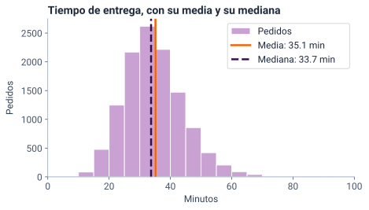
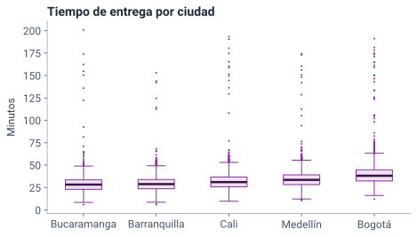

<!--
  Sesión 3 (2 h): apertura 15 min · centro 25 · dispersión 30 · práctica 35 ·
  cierre 10 · holgura 5. Las diapositivas de código corresponden a las celdas
  del notebook (mismo identificador entre corchetes); las salidas y las gráficas
  salen de ejecutarlo (precalculo/salidas_sesion3.json y recursos/s3/<id>.svg),
  con Python 3.13 y pandas 2.2.3. Las cifras del texto salen de la celda [cifras].
  Los hitos de reloj y el orden de recorte están en la nota de «Dos horas en
  cinco momentos».
-->

# Apertura {icono=fa-door-open}

> ¿Cuánto tarda un pedido típico, y qué tan variable es?

???
Es la primera pregunta de la gerencia, la que quedó abierta en la sesión 1. Pedir desde ya que abran el cuaderno de la sesión 3 (portada del curso → «Abrir en Colab») y ejecuten la primera celda y [cargar]: crean los mismos datos y declaran las escalas. Lo usaremos en la práctica.

## Dos horas en cinco momentos

::: flujo
1. **Apertura** — 15 min: coevaluación y diagnóstico
2. **El centro** — 25 min: media, mediana y moda
3. **La dispersión** — 30 min: desviación, cuartiles y cajas
4. **Práctica guiada** — 35 min en Colab
5. **Cierre** — 10 min
:::

Hoy respondemos la primera pregunta de la gerencia: cuánto tarda un pedido **típico** y qué tan **variable** es.

???
Hitos de reloj: la diapositiva 8 en el minuto 15; la 14, en el 27; la 20, en el 40; la 27, en el 54; la 31, en el 63; la 35, en el 70; la 37, en el 105, y la 39, en el 112. Quedan 5 minutos de holgura. Durante la exposición solo miran; ejecutan todo en la práctica. Si a los 27 min no se ha llegado a «La media sigue a los extremos; la mediana, no», o a los 54 no se ha llegado a «Los cuartiles parten los pedidos en cuatro partes iguales», recortar en este orden lo que todavía no se haya pasado: (1) en «La media sigue a los extremos; la mediana, no», saltar la tarjeta del valor del pedido (−1,5 min); (2) en «Los cuartiles parten los pedidos en cuatro partes iguales», no leer la salida de describe(): basta con Q1, Q3 y el RIC (−1,5 min); (3) el coeficiente de variación, en una frase: decirla en «La media va con la desviación; la mediana, con el RIC» y saltar la diapositiva del CV (−2 min). No se recortan la pregunta de pandas y numpy, la robustez ni la práctica: son el centro de la sesión. La media de datos agrupados no se expone: está en la celda [agrupada] del notebook, para profundizar.

## Otra persona del curso revisa tus tres frases con tres criterios

::: flujo
1. **Intercambia** — en parejas, comparte tus tres frases sobre el tiempo de entrega
2. **Revisa** — las de la otra persona, con los tres criterios · 5 min
3. **Devuelve** — una sugerencia concreta por frase · 2 min
:::

| Criterio | Pregunta |
|---|---|
| **Exactitud** | ¿Lo que dice la frase se ve en la tabla o en el histograma? |
| **Precisión** | ¿Da una cifra y dice sobre qué total se calculó? |
| **Claridad** | ¿La entendería alguien de la gerencia que no sabe estadística? |

???
Es la coevaluación prometida al cierre de la sesión 2: tres frases sobre la forma del tiempo de entrega, dónde se concentra y su cola. En salas de grupos, de a dos; ocho minutos en total. Al volver, pedir dos voluntarios que lean la frase de la cola y la sugerencia que recibieron. Señalar las que describen el centro sin una cifra o sin decir sobre qué total: hoy aprendemos a poner un número al centro y otro a la variabilidad.

## Dos preguntas del diagnóstico se responden hoy con datos {.pregunta etiqueta="Diagnóstico · 2 y 3"}

1. Cinco pedidos tardan 20, 22, 25, 27 y 150 min. ¿Qué describe mejor el tiempo típico: la media (48,8 min) o la mediana (25 min)?
2. Dos ciudades con media de 35 min: en A, la desviación es de 4 min; en B, de 15. ¿Qué cambia?

::: respuesta
**1, la mediana**: el 150 arrastra la media. **2, en B los tiempos son menos predecibles**: la media dice dónde está el centro; la desviación, cuánto se alejan de él los pedidos.
:::

???
Son las preguntas 2 y 3 del diagnóstico de la sesión 1. Un minuto: que recuerden qué respondieron y lo escriban en el chat antes de revelar. Las dos respuestas son la sesión de hoy en pequeño: la primera es el centro; la segunda, la dispersión.

## Para prometer una hora de llegada hacen falta dos números

::: tarjetas
### Lo típico
Un número que represente a los 12 000 pedidos: las **medidas de tendencia central**, como la media, la mediana y la moda.
### Lo variable
Cuánto se alejan los pedidos de ese número: las **medidas de dispersión**, como el rango, la desviación estándar y el rango intercuartílico.
:::

???
Ejemplo para la clase: prometer «llega en tantos minutos» no es lo mismo si casi todos los pedidos llegan cerca de ese número que si unos llegan mucho antes y otros mucho después. La primera mitad de la exposición es el centro; la segunda, la dispersión. Transición: empecemos por la medida que ya conocen, la media.

# El centro {icono=fa-bullseye}

> Un número para representar a 12 000 pedidos: ¿cuál?

???
Volver a la forma que vimos en la sesión 2: el tiempo tiene un pico entre 30 y 35 minutos y una cola a la derecha. La forma decide qué centro conviene.

## La media es el punto de equilibrio de los datos

$$ \begin{aligned} \bar{x} &= \frac{1}{n}\sum_{i=1}^{n} x_i && \text{media} \\[6pt] \sum_{i=1}^{n} \left(x_i - \bar{x}\right) &= 0 && \text{punto de equilibrio} \end{aligned} $$

Con los cinco tiempos del diagnóstico, \(\bar{x} = 48{,}8\): el pedido de 150 queda 101,2 min por encima, y los otros cuatro suman 101,2 min por debajo.

???
Es la fórmula de la sesión 1, ahora con su interpretación. Cómo se lee en voz alta: «x barra es la suma de los x sub i, de i igual a 1 hasta n, dividida entre n»; y la segunda: «la suma de las distancias de cada x sub i a x barra es cero». Imagen: los datos son pesos sobre una regla y la media es el punto donde la regla queda en equilibrio. Por eso un solo pedido lejano mueve la media: tiene mucho brazo de palanca.

## La mediana deja la mitad de los pedidos a cada lado

::: definicion Mediana
El valor del medio cuando los datos se ordenan de menor a mayor. Con un número par de datos, el promedio de los dos del medio.
:::

- Cinco tiempos ordenados: 20, 22, **25**, 27, 150
- No usa los valores, solo el **orden**: el 150 podría ser 300 y la mediana seguiría en 25
- En una tabla de frecuencias, es donde el % acumulado llega al 50 %

???
Con n impar, la mediana es el dato que ocupa la posición (n + 1)/2: con 5 datos, el tercero. La tercera viñeta es la que usaremos con las ordinales en unos minutos, y la que vieron en la sesión 2 con la calificación.

## En Tingua, la media es 35,1 min y la mediana, 33,7 {columnas=3:2}

```python [centro]
tiempo = pedidos["tiempo_entrega_min"]
print(f"Media:   {tiempo.mean():.1f} min")
print(f"Mediana: {tiempo.median():.1f} min")
#> Media:   35.1 min
#> Mediana: 33.7 min
```

|||

- `mean()` suma y divide; `median()` ordena y toma el del medio
- La media queda **1,4 min** por encima de la mediana
- Python escribe el decimal con punto (35.1); en el texto va con coma (35,1)

???
Es la celda [centro]. Con 12 000 datos, un número par, median() promedia los dos del medio. Antes, la celda [cargar] declara las escalas como en la sesión 2: franja, estrato y calificación como categorías ordenadas. La diferencia de 1,4 min es pequeña frente a la del diagnóstico, pero tiene la misma causa: la cola a la derecha. La vemos en un histograma en dos diapositivas.

## En una continua, la moda es una clase, no un valor {columnas=2:1}

```python [moda]
moda = tiempo.mode()[0]
print("Moda de los valores:", moda, "min,",
      "en", (tiempo == moda).sum(), "pedidos")
clases = pd.cut(tiempo, bins=range(0, 210, 5), right=False)
conteo = clases.value_counts(sort=False)
print("Clase modal:", conteo.idxmax(), "con", conteo.max(), "pedidos")
#> Moda de los valores: 31.3 min, en 73 pedidos
#> Clase modal: [30, 35) con 2619 pedidos
```

|||

- 31,3 min se repite en 73 pedidos, el 0,6 %: lo decide el azar del redondeo
- La **clase modal**, \([30, 35)\), reúne 2619 pedidos: el 21,8 %
- `mode()` sí sirve en una nominal o en una discreta con pocos valores

???
La moda es el valor más frecuente. En una variable continua casi ningún valor se repite: si el tiempo se registrara con dos decimales, la «moda» sería otra. Lo que sí describe a los datos es el intervalo más poblado, que es el pico del histograma. Se omitieron los comentarios de la celda.

## La cola a la derecha empuja la media por encima de la mediana {columnas=3:2}

{alto=420}

|||

- El pico está en \([30, 35)\): ahí cae la mediana
- Los pedidos lentos de la cola tiran de la media hacia la derecha
- Con una cola a la derecha, la **media supera a la mediana**

???
El eje se corta en 100 minutos para ver la forma; la cola sigue hasta 200,9 min. Las cifras de la leyenda van con punto porque las escribe Python. Para profundizar, el notebook trae la celda [agrupada]: si solo se tiene la tabla de intervalos de 5 minutos, la media se aproxima con las marcas de clase (los puntos medios) y da 35,17 min, frente a 35,13 con los 12 000 tiempos. La tabla de 10 minutos de la sesión 2 no sirve para eso: su última clase es abierta y no tiene punto medio.

## La media sigue a los extremos; la mediana, no

::: tarjetas {columnas=3}
### Cinco tiempos
Media **48,8** · mediana **25** min. Un solo pedido de 150 deja la media lejos de los otros cuatro.
### El tiempo de Tingua
Media **35,1** · mediana **33,7** min. La cola apenas mueve la media: la diferencia es de 1,4 min.
### El valor del pedido
Media **65 964** · mediana **58 000** pesos. Una cola larga, que llega a 1 751 600 pesos.
:::

???
La tercera tarjeta es solo un ejemplo de asimetría fuerte: el valor lo veremos con más calma en datos atípicos. Pregunta para el chat: ¿qué número le darías a la gerencia como «valor típico» de un pedido? La mediana: la media la inflan unos pocos pedidos muy grandes.

## Si el pedido de 150 minutos hubiera tardado 300, ¿qué les pasa a la media y a la mediana? {.pregunta}

::: respuesta
**La media sube de 48,8 a 78,8 min; la mediana sigue en 25.** La mediana solo usa el orden, y el pedido más lento sigue siendo el último.

```python [cinco]
cinco = pd.Series([20, 22, 25, 27, 150])
print("Media:", cinco.mean(), "· mediana:", cinco.median())
cinco[4] = 300
print("Media:", cinco.mean(), "· mediana:", cinco.median())
#> Media: 48.8 · mediana: 25.0
#> Media: 78.8 · mediana: 25.0
```
:::

???
Treinta segundos; en el chat, «sube», «baja» o «igual» para cada una. Es la idea de robustez, que medimos en la segunda parte: una medida es robusta si unos pocos datos extremos no la mueven. cinco[4] = 300 cambia el quinto valor, porque pandas cuenta desde 0.

## El tipo de variable decide qué centro tiene sentido

| Tipo de variable | Centro | En Tingua |
|---|---|---|
| Nominal | La moda | El medio de pago más usado |
| Ordinal | La mediana (y la moda) | La franja o la calificación mediana |
| Cuantitativa, simétrica | La media o la mediana | La temperatura en Medellín |
| Cuantitativa, con cola | La mediana, sin olvidar la media | El valor del pedido |

???
Es la regla de la sesión 1 llevada al centro: antes de calcular, clasifica. En una nominal no hay orden, así que no hay mediana. En una ordinal hay orden pero no distancias, así que no hay media: por eso la satisfacción se resume con la mediana o con el % de 4 y 5 estrellas, nunca con el promedio de estrellas. En una cuantitativa valen las dos, y la forma decide cuál representa mejor.

## La mediana de una ordinal tiene sentido, pero pandas no la calcula {columnas=3:2}

```python [mediana_ordinal]
try:
    pedidos["franja"].median()
except TypeError as error:
    print("TypeError:", error)
#> TypeError: 'Categorical' with dtype category
#>   does not support reduction 'median'
```

|||

- En la sesión 1, `mean()` se negaba porque promediar una ordinal **no tiene sentido**
- Aquí la mediana **sí** lo tiene, pero pandas no la implementa
- Un error de la herramienta no es un error del concepto

???
El try/except solo está para que la celda no se detenga: lo que importa es el mensaje. La salida del error está partida en dos líneas para que quepa. Es lo contrario de la sesión 1: allí pandas tenía razón al negarse; aquí la limitación es de pandas. Si alguien pregunta por otras funciones de pandas para lograrlo, decir que la forma segura es la acumulada, que es la siguiente diapositiva.

## La mediana de una ordinal se lee en la acumulada: la franja mediana es el almuerzo {columnas=2:1}

```python [acumulada_franja]
franja = pedidos["franja"].value_counts(sort=False, normalize=True)
(franja.cumsum() * 100).round(1)
#> franja
#> Mañana       15.1
#> Almuerzo     51.1
#> Tarde        70.7
#> Noche       100.0
#> Name: proportion, dtype: float64
```

|||

- La acumulada llega al 50 % en el **Almuerzo**: es la primera que lo alcanza
- El 51,1 % de los pedidos se hizo en el almuerzo o antes
- En la práctica harás lo mismo con el estrato y la calificación

???
Es la tabla ordinal de la sesión 2 con la acumulada: sort=False la deja en el orden del día y cumsum() acumula. Leer la mediana así funciona porque la franja es una categoría ordenada: sin el orden, «la primera que llega al 50 %» no significaría nada.

## La media usa los valores; la mediana, solo el orden {.idea}

Por eso la mediana resiste a los extremos y sirve para las ordinales; la media aprovecha toda la información cuando la forma lo permite.

???
Pedir que lo repitan con sus palabras antes de pasar. Transición: con el centro elegido, falta la otra mitad de la respuesta a la gerencia: cuánto se alejan los pedidos de él.

# La dispersión {icono=fa-arrows-left-right}

> El mismo centro puede esconder pedidos muy parecidos o muy distintos.

???
Volver a la pregunta 3 del diagnóstico: dos ciudades con la misma media y distinta desviación. Hoy la desviación deja de ser una palabra y se vuelve un número en minutos.

## El rango solo mira los dos pedidos más extremos {columnas=3:2}

```python [rango]
print("Mínimo:", tiempo.min(), "· máximo:", tiempo.max())
print(f"Rango: {tiempo.max() - tiempo.min():.1f} min")
#> Mínimo: 6.0 · máximo: 200.9
#> Rango: 194.9 min
```

|||

- \(\text{Rango} = \text{máximo} - \text{mínimo}\)
- Depende de **dos** pedidos entre 12 000
- Con los cinco tiempos del diagnóstico, el rango es de 130 min, y casi todo lo pone el 150

???
Cómo se lee: «el rango es el máximo menos el mínimo». Es útil para detectar errores de registro (un tiempo negativo, una distancia imposible), pero no para resumir: un solo pedido raro lo cambia todo. Hace falta una medida que use todos los pedidos.

## Las distancias a la media siempre suman cero

| Tiempo | 20 | 22 | 25 | 27 | 150 |
|---|---|---|---|---|---|
| Distancia a la media | \(-28{,}8\) | \(-26{,}8\) | \(-23{,}8\) | \(-21{,}8\) | \(+101{,}2\) |

Su promedio no sirve: siempre da cero. Por eso se elevan **al cuadrado** antes de promediar: el cuadrado las vuelve positivas y pesa más las grandes.

???
Es el punto de equilibrio de la media visto desde el otro lado: lo que sobra por encima compensa lo que falta por debajo. Otra salida sería promediar los valores absolutos; se usa poco porque el cuadrado tiene mejores propiedades matemáticas, que aparecerán en la regresión.

## La varianza promedia los cuadrados; la desviación vuelve a minutos

$$ \begin{aligned} \sigma^2 &= \frac{1}{N}\sum_{i=1}^{N} \left(x_i - \mu\right)^2 && \text{población: divide entre } N \\[6pt] s^2 &= \frac{1}{n-1}\sum_{i=1}^{n} \left(x_i - \bar{x}\right)^2 && \text{muestra: divide entre } n - 1 \end{aligned} $$

La **desviación estándar** es la raíz: \(\sigma = \sqrt{\sigma^2}\) y \(s = \sqrt{s^2}\), otra vez en minutos.

???
Cómo se lee en voz alta: «sigma al cuadrado es la suma de los cuadrados de x sub i menos mu, dividida entre N»; «s al cuadrado es lo mismo con x barra, dividida entre n menos 1». Y la raíz: «sigma es la raíz cuadrada de sigma al cuadrado». Son las letras de la sesión 1: griegas para la población, latinas para la muestra. Por qué n − 1: una muestra se queda corta de variabilidad porque sus datos están cerca de su propia media; dividir entre un número menor lo corrige. Lo retomaremos en la sesión 6.

## Con 12 000 pedidos, dividir entre N o entre n − 1 casi no cambia nada {columnas=3:2}

```python [desviacion]
print(f"Varianza:       {tiempo.var():.1f} min²")
print(f"s, entre n - 1: {tiempo.std():.3f} min")
print(f"σ, entre N:     {tiempo.std(ddof=0):.3f} min")
#> Varianza:       160.2 min²
#> s, entre n - 1: 12.658 min
#> σ, entre N:     12.657 min
```

|||

- La varianza está en **minutos al cuadrado**: no se lee
- `std()` divide entre \(n - 1\); con `ddof=0`, entre \(N\)
- Si la pregunta es sobre el semestre, los 12 000 pedidos son la población; aun así, la diferencia no se nota

???
Los 12 000 pedidos del semestre son la población de la gerencia, así que la fórmula que corresponde es σ, entre N. Con N tan grande, dividir entre 12 000 o entre 11 999 da lo mismo a la tercera cifra decimal. Con pocos datos, no: la siguiente pregunta.

## pandas y numpy no dan la misma desviación para cinco tiempos: ¿cuál se equivocó? {.pregunta}

Con los cinco tiempos del diagnóstico, pandas da 56,64 min y numpy, 50,66 min.

::: respuesta
**Ninguno.** pandas divide entre \(n - 1\) y numpy, entre \(n\): `ddof` dice cuánto se le resta a \(n\). Con 5 datos la diferencia es grande; con 12 000, desaparece.

```python [ddof]
cinco = [20, 22, 25, 27, 150]
print(f"pandas: {pd.Series(cinco).std():.2f}")
print(f"numpy:  {np.std(cinco):.2f}")
print(f"pandas con ddof=0: {pd.Series(cinco).std(ddof=0):.2f}")
#> pandas: 56.64
#> numpy:  50.66
#> pandas con ddof=0: 50.66
```
:::

???
Un minuto; en el chat, «pandas», «numpy» o «ninguno». Es una trampa clásica al pasar código de una librería a otra, o de Python a Excel (DESVEST.M divide entre n − 1 y DESVEST.P, entre n). Antes de comparar dos desviaciones, revisar con qué fórmula se calculó cada una. La celda importa numpy como np; esa línea se omite aquí.

## El 81,7 % de los pedidos está a menos de una desviación de la media {columnas=3:2}

```python [dentro]
media, s = tiempo.mean(), tiempo.std()
cerca = tiempo.between(media - s, media + s)
print(f"De {media - s:.1f} a {media + s:.1f} min:",
      f"{cerca.mean() * 100:.1f} % de los pedidos")
#> De 22.5 a 47.8 min: 81.7 % de los pedidos
```

|||

- Una desviación de 12,7 min alrededor de 35,1: de 22,5 a 47,8 min
- `between` marca cada pedido con True o False
- La media de True y False es la **proporción** de True

???
Así se le explica la desviación a la gerencia: «la mayoría de los pedidos llega a menos de 12,7 minutos del promedio». La proporción exacta depende de la forma de los datos; por eso aquí se calcula, en lugar de suponerla. Las reglas que dan porcentajes fijos son para la distribución normal, que veremos en la sesión 6; el tiempo de entrega, con su cola, no lo es.

## Los cuartiles parten los pedidos en cuatro partes iguales {columnas=3:2}

```python [cuartiles]
q1 = tiempo.quantile(0.25)
q3 = tiempo.quantile(0.75)
print(f"Q1 = {q1:.1f} · Q3 = {q3:.1f} · RIC = {q3 - q1:.1f} min")
tiempo.describe().round(1)
#> Q1 = 27.9 · Q3 = 40.4 · RIC = 12.5 min
#> count    12000.0
#> mean        35.1
#> std         12.7
#> min          6.0
#> 25%         27.9
#> 50%         33.7
#> 75%         40.4
#> max        200.9
#> Name: tiempo_entrega_min, dtype: float64
```

|||

- \(Q_1\) deja debajo el 25 %; \(Q_2\), la mediana, el 50 %, y \(Q_3\), el 75 %
- \(\text{RIC} = Q_3 - Q_1\): la mitad central de los pedidos tarda de 27,9 a 40,4 min
- Mínimo, \(Q_1\), mediana, \(Q_3\) y máximo: el **resumen de cinco números**

???
Cómo se lee: «RIC es Q tres menos Q uno». quantile(0.25) recibe una proporción, no un porcentaje. describe() da el resumen de cinco números junto con el conteo, la media y la desviación: es lo primero que se mira de una variable cuantitativa. El rango intercuartílico (RIC) mide la dispersión del cuerpo de los datos e ignora el 25 % de cada extremo.

## El diagrama de caja dibuja los cuartiles de cada ciudad y aparta los pedidos lejanos {columnas=3:2}

{alto=420}

|||

- La **caja** va de \(Q_1\) a \(Q_3\); la línea es la mediana
- Los **bigotes** llegan hasta el pedido más lejano que está a no más de 1,5 RIC de la caja
- Los **puntos**: candidatos a atípicos, el tema de la sesión 4

???
Esta caja no es exactamente el resumen de cinco números: el mínimo y el máximo son el extremo del bigote o el punto más lejano. Las ciudades van de menor a mayor mediana: Bogotá tiene la caja más alta. La celda [cajas] usa groupby("ciudad") para separar los pedidos de cada ciudad y ax.boxplot para dibujarlos con los colores del curso. Por encima de los bigotes hay entre 27 pedidos (Bucaramanga) y 86 (Bogotá). También hay unos pocos puntos por debajo del bigote inferior: pedidos muy rápidos, igual de candidatos a atípicos. Si alguien pregunta si son errores, no responder todavía: es exactamente la pregunta de la sesión 4.

## Sin el 0,5 % más lento, la desviación cae un 23 % y la mediana no se mueve {columnas=2:1}

```python [robustez]
corte = tiempo.quantile(0.995)
sin_cola = tiempo[tiempo <= corte]
print(f"Salen {len(tiempo) - len(sin_cola)} pedidos,",
      f"de más de {corte:.1f} min")
print(f"Media:      {tiempo.mean():.1f} → {sin_cola.mean():.1f}")
print(f"Desviación: {tiempo.std():.1f} → {sin_cola.std():.1f}")
print(f"Mediana:    {tiempo.median():.1f} → {sin_cola.median():.1f}")
#> Salen 60 pedidos, de más de 94.1 min
#> Media:      35.1 → 34.6
#> Desviación: 12.7 → 9.7
#> Mediana:    33.7 → 33.7
```

|||

- 60 pedidos entre 12 000 bajan la desviación de 12,7 a 9,7 min
- La media baja de 35,1 a 34,6; la mediana no cambia
- Una medida que no se mueve con unos pocos extremos es **robusta**

???
quantile(0.995) es el percentil 99,5: deja por encima el 0,5 % de los pedidos. Quitar pedidos para «limpiar» los datos no es lo que se propone aquí: es un experimento para ver qué medidas dependen de la cola. Qué hacer con esos pedidos es la sesión 4.

## Barranquilla y Bucaramanga: casi la misma media, casi el mismo RIC y distinta desviación {columnas=2:1}

```python [dos_ciudades]
dos = pedidos[pedidos["ciudad"].isin(["Barranquilla", "Bucaramanga"])]
grupos = dos.groupby("ciudad")["tiempo_entrega_min"]
resumen = pd.DataFrame({
    "media": grupos.mean(),
    "desviación": grupos.std(),
    "RIC": grupos.quantile(0.75) - grupos.quantile(0.25),
})
resumen.round(1)
#>               media  desviación   RIC
#> ciudad
#> Barranquilla   29.8        10.5  10.3
#> Bucaramanga    29.7        13.3  10.6
```

|||

- `groupby("ciudad")` calcula lo mismo en cada ciudad
- Media: 29,8 y 29,7 min · RIC: 10,3 y 10,6 min
- Desviación: **10,5 y 13,3** min

???
isin deja solo los pedidos de las dos ciudades; groupby los separa y calcula la media, la desviación y el RIC de cada grupo. Es el patrón del ejercicio 3, con las cinco ciudades. Antes de pasar, preguntar: si la caja central es casi igual, ¿de dónde sale la diferencia de desviación?

## El cuerpo es igual; Bucaramanga tiene más demoras extremas {.idea}

La desviación las siente y el RIC no. El 1 % más lento de Bucaramanga tarda más de 63,4 min; el de Barranquilla, más de 54,9. Su pedido más lento: 200,9 frente a 152,9 min.

???
Los percentiles 99 y los máximos salen de la celda [cifras]. No decir que «en Bucaramanga los tiempos típicos varían más»: el 50 % central de las dos ciudades es casi igual de ancho. Lo que cambia son unas pocas demoras muy largas: el 0,76 % de los pedidos de Bucaramanga pasa de 80 min, frente al 0,41 % de Barranquilla. ¿Esos pedidos son normales o hay que investigarlos? Es el puente a la sesión 4. Si alguien recuerda que en las cajas Bucaramanga tenía menos puntos por encima del bigote (27, frente a 34 de Barranquilla): es cierto y no contradice la idea. Lo que la distingue no es cuántos pedidos pasan del bigote, sino cuánto se alejan: más de 80 min, hasta 200,9.

## La media va con la desviación; la mediana, con el RIC

| Centro | Dispersión | Con unos pocos datos extremos |
|---|---|---|
| Media | Desviación estándar | Se mueven |
| Mediana | Cuartiles y RIC | Casi no se mueven |

Con una cola larga, informa la mediana y el RIC; con una forma simétrica, la media y la desviación.

???
Cada centro tiene su medida de dispersión natural: la desviación mide distancias a la media; el RIC, el ancho alrededor de la mediana. Mezclarlas («la mediana es 33,7 con desviación 12,7») confunde. Si hubo que recortar, decir aquí la frase del coeficiente de variación: compara la variabilidad en proporción a la media, y solo vale para variables de razón.

## El coeficiente de variación: el valor varía más del doble que el tiempo {columnas=3:2}

```python [cv]
valor = pedidos["valor_pedido"]
print(f"Tiempo: CV = {tiempo.std() / tiempo.mean():.2f}")
print(f"Valor:  CV = {valor.std() / valor.mean():.2f}")
#> Tiempo: CV = 0.36
#> Valor:  CV = 0.77
```

|||

- \(\text{CV} = s / \bar{x}\): no tiene unidades, así que compara minutos con pesos
- En proporción a su media, el valor varía **2,1 veces** lo que varía el tiempo
- Solo para variables de **razón** con media positiva: nunca para la temperatura

???
Cómo se lee en voz alta: «CV es s entre x barra». La temperatura es de intervalo: su cero es arbitrario. Las mismas temperaturas de Tingua tienen un CV de 0,30 en grados Celsius y de 0,16 en Fahrenheit: si cambiar de unidad cambia el resultado, el número no significa nada. El tiempo, el valor, la distancia y los productos son de razón: ahí el CV sí vale.

## Ningún centro sin su dispersión {.idea}

«35,1 minutos» no le sirve a la gerencia sin su desviación, 12,7, ni la mediana, 33,7, sin su RIC, 12,5: el centro dice cuánto tarda un pedido típico, y la dispersión, cuánto se alejan de él los demás.

???
Es el lema de la sesión. Un número solo, en un tablero, invita a prometer de más. Llevar esta frase a la práctica: en el ejercicio 3, las ciudades se comparan con las dos cosas a la vez.

# Práctica y cierre {icono=fa-keyboard}

> Treinta y cinco minutos con el cuaderno (*notebook*): cuatro ejercicios con verificador.

## Práctica guiada: cuatro ejercicios en el notebook

::: flujo
1. **Una discreta** — media, mediana y moda de `n_productos` · 7 min
2. **Dos ordinales** — la mediana de `estrato` y de `calificacion` · 8 min
3. **Por ciudad** — media, desviación y RIC del tiempo · 12 min
4. **La distancia** — cuartiles y diagrama de caja · 8 min
:::

[Abrir el notebook de la sesión 3 en Colab](https://colab.research.google.com/github/JotaMao1985/ANaLISIS-ESTADiSTICO-DE-LA-INFORMACIoN_Ucomp/blob/main/notebooks/sesion-3-lo-tipico-y-lo-variable.ipynb). Antes del ejercicio 1: clic en [ej1] → **Entorno de ejecución → Ejecutar anteriores**.

???
Cada ejercicio termina con un verificador que da pistas sin la respuesta. Dar un minuto para «Ejecutar anteriores»: sin [cargar], el ejercicio 1 falla con NameError. Clave del 1: media 2,98, mediana 2 y moda 2; al pedido típico lo representan mejor la mediana o la moda, porque la media la empujan unos pocos pedidos grandes (hasta 44 productos), y el 57,0 % de los pedidos lleva 1 o 2. Clave del 2: estrato 3 (la acumulada pasa del 28,4 % en el 2 al 61,4 % en el 3) y calificación 4 (del 20,9 % al 62,6 %); hablar de pedidos a direcciones de estrato 3 o menos, no de personas. Quien responda 5 en la calificación sumó al total los pedidos sin calificación (así, en el 4 la acumulada llega solo al 37,0 %) o acumuló en el orden de frecuencia, sin sort=False; en el estrato, ese mismo error de orden lleva a responder 2. El verificador señala las dos causas. Clave del 3: Barranquilla tiene la menor desviación (10,5) y el menor RIC (10,3); Cali y Bucaramanga, la mayor desviación (13,3); la media no basta, porque Barranquilla y Bucaramanga tienen casi la misma. Ojo: por RIC la ventana más ancha es la de Bogotá (12,4), no la de Cali ni la de Bucaramanga: la desviación y el RIC pueden ordenar distinto a las ciudades, por la misma razón de «El cuerpo es igual». Clave del 4: Q1 2,2, Q3 4,4 y RIC 2,2 km (Q1 y el RIC valen lo mismo, por eso el verificador los recibe por nombre); el diagrama no se verifica. Por encima del bigote (7,7 km) hay 466 pedidos, y los puntos se cortan en 14 km: son los 20 pedidos con el tope de registro, un dato censurado que retomaremos en la sesión 4.

## ¿Qué medida usarías? {.pregunta}

1. El medio de pago más usado en Bucaramanga
2. La calificación típica de los pedidos calificados
3. El valor típico de un pedido, para un informe a la gerencia
4. La temperatura típica en Medellín y cuánto varía

::: respuesta
**1** la moda: es nominal · **2** la mediana (o el % de 4 y 5 estrellas): es ordinal · **3** la mediana con el RIC: tiene una cola larga · **4** la media con la desviación: es simétrica; el CV, no, porque la temperatura es de intervalo
:::

???
Es la autoevaluación de cierre: un minuto, y en el chat las cuatro respuestas en una línea. La 4 es la que más se equivoca: la media sí vale para una variable de intervalo; lo que no vale es el coeficiente de variación.

## Lo que te llevas hoy {.cierre}

- La **media** es el punto de equilibrio; la **mediana**, el valor del medio; en una continua, la moda es una **clase**
- El **tipo de variable** decide el centro: moda, mediana o media
- La **desviación** se lee en minutos; el **RIC** es el ancho de la mitad central
- La media y la desviación sienten los extremos; la mediana y el RIC, casi no
- Ningún centro sin su dispersión

???
Leer las cinco en voz alta y preguntar cuál les costó más. Cerrar con el lema: ningún centro sin su dispersión.

## La sesión 4 busca los pedidos que se salen de lo normal

- **Termina** la práctica: los verificadores revisan los cuatro ejercicios, salvo el diagrama de caja
- **Lee** *OpenIntro Statistics* (4.ª edición): en la sección 2.1, los diagramas de caja y la robustez; en la sección 4.1, el puntaje Z (*Z-score*)
- **Escribe** tres frases sobre una ciudad que elijas: su centro, su dispersión y un pedido que te parezca raro. Otra persona del curso las revisará

**Próxima sesión:** datos atípicos y exploración multidimensional.

???
La sección 2.1 de OpenIntro ya se asignó en la sesión 2; ahora se pide releer sus partes de cajas y robustez, que hoy tienen sentido. La 4.1 trata la distribución normal; basta con la parte del puntaje Z, que mide a cuántas desviaciones de la media está un dato: es una de las dos reglas para atípicos de la sesión 4. Las tres frases abren la sesión 4 con otra coevaluación: así se ve si centro y dispersión quedaron.
