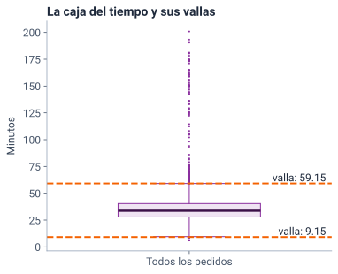
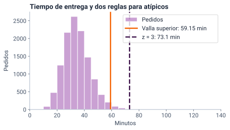
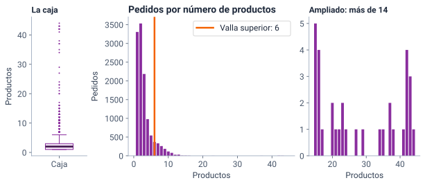
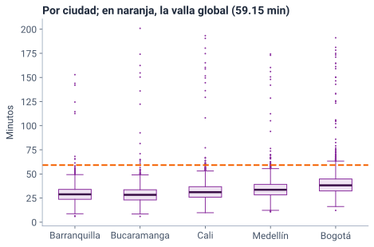
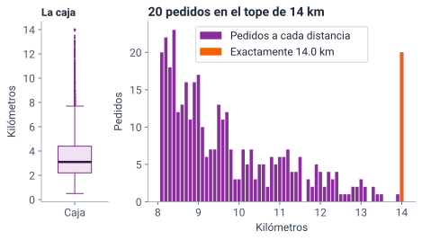

<!--
  Sesión 4 (2 h): apertura 12 min · atípicos 36 · exploración multidimensional 14 ·
  enunciado del tablero 13 · práctica 30 · cierre 7 · holgura 8. Las diapositivas
  de código corresponden a las celdas del notebook (mismo identificador entre
  corchetes); las salidas y las gráficas salen de ejecutarlo
  (precalculo/salidas_sesion4.json y recursos/s4/<id>.svg), con Python 3.13 y
  pandas 2.2.3. Las cifras del texto salen de la celda [cifras]. Los hitos de
  reloj y el orden de recorte están en la nota de «Dos horas en seis momentos».
-->

# Apertura {icono=fa-door-open}

> ¿Qué pedidos se salen de lo normal?

???
Es la segunda pregunta de la gerencia. Pedir desde ya que abran el cuaderno de la sesión 4 (portada del curso → «Abrir en Colab») y ejecuten la primera celda y [cargar]: crean los mismos datos y declaran las escalas. Lo usaremos en la práctica.

## Dos horas en seis momentos

::: flujo
1. **Apertura** — 12 min: coevaluación y una pregunta de la sesión 1
2. **Los atípicos** — 36 min: dos reglas, la caja y qué hacer con cada candidato
3. **Exploración multidimensional** — 14 min: tablas dinámicas
4. **El proyecto final** — 13 min: el enunciado del tablero
5. **Práctica guiada** — 30 min en Colab
6. **Cierre** — 7 min
:::

Hoy buscamos los pedidos que se salen de lo normal y presentamos el **proyecto final**: un tablero para la gerencia.

???
Hitos de reloj: la diapositiva 8 en el minuto 12; la 15, en el 27; la 20, en el 37; la 25, en el 48; la 31, en el 62; la 36, en el 75; la 38, en el 105, y la 40, en el 110. Quedan 8 minutos de holgura. Hito fijo: el enunciado del tablero (diapositiva 31) empieza a más tardar en el minuto 62 y nunca se recorta: el trabajo independiente del proyecto empieza hoy. Si a los 60 min no se ha terminado la exploración, pasar directo a la 31: lo que falte queda en el notebook. Durante la exposición solo miran; ejecutan todo en la práctica. Si a los 27 min no se ha llegado a la 15, a los 37 no se ha llegado a la 20 o a los 48 no se ha llegado a la 25, recortar en este orden lo que todavía no se haya pasado: (1) el desglose, diapositiva 29: decir solo que lejos y con lluvia el 59,3 % de los pedidos es lento y dejar la celda [desglose] para el notebook (−3 min); (2) el borrado en cadena, en la nota de la 23 (−1 min); (3) la gráfica de n_productos, diapositiva 17: se deja la pregunta de la 16 con su respuesta (−2 min); (4) Barranquilla frente a Bucaramanga: la última viñeta de la diapositiva 21 (−1 min); (5) el 3·RIC: saltar la última viñeta de la 10 y definir los extremos al llegar a la 18 (−0,5 min). No se recortan las dos reglas, la caja del tiempo, las cajas por ciudad, el tope de 14 km, la tabla dinámica, el enunciado ni la práctica.

## Otra persona del curso revisa tus tres frases sobre una ciudad

::: flujo
1. **Intercambia** — en parejas, comparte tus tres frases: centro, dispersión y un pedido raro
2. **Revisa** — las de la otra persona, con los tres criterios · 4 min
3. **Devuelve** — una sugerencia concreta por frase · 2 min
:::

| Criterio | Pregunta |
|---|---|
| **Pareja** | ¿El centro va con su dispersión: la media con la desviación, la mediana con el RIC? |
| **Precisión** | ¿Cada frase da una cifra con su unidad y dice de qué ciudad habla? |
| **El pedido raro** | ¿Dice por qué parece raro y comparado con qué? |

???
Es la coevaluación prometida al cierre de la sesión 3. En salas de grupos, de a dos; siete minutos en total. Al volver, pedir en el chat el pedido raro de cada uno: la ciudad y los minutos. Guardarlos: en unos minutos veremos si las reglas los marcan. El tercer criterio prepara la idea de hoy: un pedido no es raro en abstracto, sino comparado con algo.

## Un pedido tardó 200,9 minutos: ¿demora real o error? {.pregunta etiqueta="Sesión 1"}

- Es el pedido más lento de Tingua: la pregunta quedó abierta en la lista de chequeo de la sesión 1
- En las cajas de la sesión 3, es el punto más alto de Bucaramanga

::: respuesta
**Todavía no lo sabemos.** Una regla puede marcarlo, pero no dice qué es. Antes de decidir hacen falta dos preguntas.
:::

???
En la sesión 1 apareció redondeado a 201 minutos, en el criterio de exactitud. Un minuto: que voten en el chat «demora real» o «error» y que guarden su respuesta; la respondemos con datos en la diapositiva 19. Lo que importa ahora es que ninguna regla basta para decidirlo.

## Ante cada pedido raro, dos preguntas: por qué está lejos y respecto a qué

::: tarjetas
### ¿Por qué está lejos?
La **causa**: un error de registro, un valor real y raro, o un dato **censurado** por un tope del registro.
### ¿Lejos respecto a qué?
La **referencia**: todos los pedidos o los de su grupo, como su ciudad o su franja.
:::

???
Son las dos preguntas que ordenan toda la sesión. La primera decide qué se hace con el pedido; la segunda, si es atípico o no. Transición: primero, una regla para encontrar candidatos.

# Los atípicos {icono=fa-magnifying-glass}

> ¿Por qué está lejos? ¿Lejos respecto a qué?

???
Un atípico es un dato que queda lejos de los demás. Las reglas que vienen solo encuentran candidatos: no dicen qué son.

## Las vallas de Tukey se ponen a 1,5 RIC de la caja

$$ \begin{aligned} \text{valla inferior} &= Q_1 - 1{,}5\,\text{RIC} \\[6pt] \text{valla superior} &= Q_3 + 1{,}5\,\text{RIC} \end{aligned} $$

En el tiempo de entrega, \(Q_1 = 27{,}9\), \(Q_3 = 40{,}4\) y \(\text{RIC} = 12{,}5\) min: 1,5 RIC son 18,75 min, y las vallas quedan en 9,15 y 59,15 min.

???
Cómo se lee en voz alta: «la valla inferior es Q uno menos uno coma cinco veces el RIC; la superior, Q tres más uno coma cinco veces el RIC». Es la regla de los bigotes de las cajas de la sesión 3 (allí, una valla por ciudad; aquí, con todos los pedidos: la diferencia vuelve en las diapositivas 20 y 21), y la diapositiva 11 la dibuja. La regla es de John Tukey (*Exploratory Data Analysis*, 1977). El 1,5 es una convención, no una ley: con 3 RIC la valla es más exigente.

## En el tiempo, 6 pedidos quedan por debajo de la valla y 240 por encima {columnas=3:2}

```python [vallas]
tiempo = pedidos["tiempo_entrega_min"]
q1, q3 = tiempo.quantile(0.25), tiempo.quantile(0.75)
ric = q3 - q1
valla_inf = q1 - 1.5 * ric
valla_sup = q3 + 1.5 * ric
print(f"Vallas: {valla_inf:.2f} y {valla_sup:.2f} min")
# «Fuera» es estrictamente más allá: < y >, no <= ni >=
print("Por debajo:", (tiempo < valla_inf).sum(), "pedidos")
print("Por encima:", (tiempo > valla_sup).sum(), "pedidos")
#> Vallas: 9.15 y 59.15 min
#> Por debajo: 6 pedidos
#> Por encima: 240 pedidos
```

|||

- **Fuera** es estrictamente más allá de la valla: `<` y `>`
- 246 candidatos: el 2,1 % de los pedidos
- Con 3 RIC, la valla de los **extremos** queda en 77,9 min: 66 pedidos

???
Ningún tiempo cae justo en una valla, pero en el valor del pedido sí hay uno, y por eso importa el «estrictamente» (ejercicio 1). Los 6 de abajo tardan de 6,0 a 8,7 min. La última viñeta es la celda [extremos]: q3 + 3 * ric. La usamos para partir a los lentos en dos grupos.

## La caja dibuja las vallas: sus puntos sueltos son los 246 candidatos {columnas=3:2}

{alto=420}

|||

- La **caja** va de \(Q_1\) a \(Q_3\); la línea es la mediana
- Los **bigotes** llegan a 9,6 y 59,1 min: al último pedido que no pasa cada valla
- Los **puntos sueltos** son los 246 candidatos, dibujados en 164 puntos; la caja no dice qué son
- La caja no muestra la forma: para eso, el histograma

???
Es la caja de todos los pedidos juntos, ahora con las vallas dibujadas (celda [caja_tiempo]); en la sesión 3 la vimos por ciudad. A esta escala, el bigote superior y su valla se confunden: por eso las cifras van en la viñeta. Tres errores frecuentes al leer una caja: creer que los bigotes llegan hasta la valla (terminan en el último pedido que queda dentro: 9,6 y 59,1 min, no 9,15 y 59,15); creer que llegan al mínimo y al máximo (eso solo pasa del lado en que no hay puntos sueltos; y el bigote coincide con la valla solo si un pedido cae justo en ella, como en los productos, en 6), y creer que cada punto es un pedido: los 246 candidatos se dibujan como 164 puntos, porque varios tienen el mismo tiempo. La caja tampoco muestra la forma: la cola a la derecha se ve en el histograma (diapositiva 15), y los dos grupos de lentos, en la 18. Volver a los pedidos raros del chat: ¿cuáles son puntos sueltos?

## El puntaje z dice a cuántas desviaciones de la media está un pedido

$$ z = \frac{x - \bar{x}}{s} $$

Por convención, un pedido es candidato si \(|z| > 3\): si está a más de tres desviaciones de la media, por encima o por debajo.

???
Cómo se lee en voz alta: «z es x menos x barra, dividido entre s»; y la regla: «el valor absoluto de z es mayor que tres». El pedido de 200,9 min tiene z = 13,1: está a trece desviaciones de la media. La lectura de la sesión 3 presentaba z junto con la distribución normal; aquí z solo mide distancias en desviaciones. La normal, y los porcentajes que da, llegan en la sesión 6: no prometer ningún porcentaje por ahora.

## El puntaje z marca 75 pedidos, todos dentro de los 240 de la valla

```python [puntaje_z]
media, s = tiempo.mean(), tiempo.std()
z = (tiempo - media) / s
print("|z| > 3:", (z.abs() > 3).sum(), "pedidos")
marcados = tiempo[z.abs() > 3]
print("¿Todos por encima de la valla?", bool((marcados > valla_sup).all()))
print(f"Media - 3s = {media - 3 * s:.1f} min")
#> |z| > 3: 75 pedidos
#> ¿Todos por encima de la valla? True
#> Media - 3s = -2.8 min
```

- \(|z| > 3\) marca el 0,6 % de los pedidos
- \(\bar{x} - 3s\) es negativo: ningún pedido rápido puede quedar marcado
- Con una cola a la derecha, \(z\) solo marca por un lado

???
Cómo se lee la segunda viñeta: «x barra menos tres s». Un tiempo no puede ser negativo, así que el límite de abajo no sirve: los 6 pedidos rápidos que marca la valla, z no los ve. abs() es el valor absoluto. Preguntar: ¿por qué z marca 75 y la valla 240, si las dos miran los mismos pedidos? La siguiente diapositiva lo responde.

## Los atípicos inflan la desviación y así se esconden: es el enmascaramiento

```python [enmascaramiento]
fuera = (tiempo < valla_inf) | (tiempo > valla_sup)
print(f"s con todos los pedidos: {s:.2f} min")
print(f"s sin los {fuera.sum()} atípicos: {tiempo[~fuera].std():.2f} min")
#> s con todos los pedidos: 12.66 min
#> s sin los 246 atípicos: 8.96 min
```

- Los 246 candidatos suben la desviación de 8,96 a 12,66 min
- Con una \(s\) más grande, la línea de \(z = 3\) se aleja, y menos pedidos la cruzan
- Las vallas usan cuartiles, que casi no se mueven

???
El símbolo | es «o»: fuera de una valla o de la otra; ~ es «no». Es la robustez de la sesión 3: la desviación siente los extremos y el RIC, casi no. Dato para quien pregunte: con la media y la desviación calculadas sin los atípicos, z > 3 marcaría 196 pedidos. Por eso z, en datos con cola, encuentra menos de lo que hay.

## La valla corta en 59,15 min y z = 3 en 73,1: la valla ve más candidatos {columnas=3:2}

{alto=420}

|||

- Entre las dos líneas están los pedidos que la valla marca y \(z\) no
- La cola sigue hasta 200,9 min: sus barras son tan bajas que no se ven
- Con cola a la derecha, la valla, que usa cuartiles, es la regla que conviene

???
El eje se corta en 140 minutos para ver la forma. Las cifras de la leyenda van con punto porque las escribe Python. La línea de z = 3 es la media más tres desviaciones: 73,1 min. Las vallas usan cuartiles; z, la media y la desviación, que los atípicos inflan: pedir que lo digan con sus palabras. El puntaje z sirve mejor cuando la forma es simétrica y sin cola; aun así, las dos reglas marcan solo candidatos. Transición: ¿y si la regla marca demasiados?

## La regla marca 1082 pedidos por tener muchos productos: ¿son 1082 pedidos raros? {.pregunta}

- En `n_productos`, \(Q_1 = 1\) y \(Q_3 = 3\): la valla superior queda en 6
- **Fuera** quedan los pedidos de más de 6 productos

::: respuesta
**No.** Es un conteo con cola a la derecha: 370 pedidos tienen exactamente 6 productos, el valor de la valla, y los 1059 de 7 a 17 siguen la misma cola. Lo raro son **23 pedidos de 20 a 44 productos**, después de un hueco: ninguno tiene 18 ni 19.
:::

???
Un minuto; en el chat, «sí» o «no». La regla marca el 9,0 % de los pedidos: demasiados para llamarlos raros. Antes de creerle a una regla, se mira la gráfica. Los 23 son los pedidos corporativos del caso: una empresa que pide para su oficina. Son reales y raros: se conservan.

## En la caja, 1082 pedidos son 26 puntos; las barras muestran el hueco de 17 a 20

{alto=430}

???
A la izquierda, la caja: el bigote termina en 6 y por encima hay 26 puntos, uno por cada valor distinto de 7 a 44; detrás de ellos hay 1082 pedidos. En un conteo con cola, la caja siempre dibuja muchos puntos, y no son muchos errores. En el centro, todos los valores: la cola baja poco a poco y la valla la corta en 6. A la derecha, ampliados los de más de 14: después del 17 hay un hueco, y de 20 a 44 aparece otro grupo. Ese hueco es lo que la regla no ve: la valla solo mira la distancia a la caja, no la forma. El hueco de 18 y 19 no es el único: en la ampliación hay otros. Lo que distingue al grupo es que de 7 a 17 la cola baja sin saltos, y de 20 a 44 los pedidos aparecen sueltos. Es la diapositiva recortable 3: si se salta, basta con la respuesta de la anterior.

## Los 240 pedidos lentos son dos grupos: 174 moderados y 66 extremos {columnas=2:1}

```python [lentos]
lentos = pedidos[tiempo > valla_sup].copy()
lentos["grupo"] = pd.cut(lentos["tiempo_entrega_min"],
                         bins=[valla_sup, valla_ext, 250],
                         labels=["moderado", "extremo"])
lentos["llueve"] = (lentos["lluvia"] == "Sí") * 100      # 100 o 0
lentos["bogota"] = (lentos["ciudad"] == "Bogotá") * 100
resumen = lentos.groupby("grupo", observed=True).agg(
    pedidos=("id_pedido", "count"),
    km_mediana=("distancia_km", "median"),
    pct_lluvia=("llueve", "mean"),
    pct_bogota=("bogota", "mean"))
resumen.round(2)
#>           pedidos  km_mediana  pct_lluvia  pct_bogota
#> grupo
#> moderado      174        9.60       52.30       77.01
#> extremo        66        3.35       16.67       40.91
```

|||

- **Moderados**, de 59,15 a 77,9 min: 9,6 km de mediana, 52,3 % con lluvia y 77,0 % en Bogotá
- **Extremos**, más de 77,9 min: 3,35 km y poca lluvia
- En todos los pedidos: 3,1 km de mediana y 24,1 % con lluvia

???
pd.cut parte a los lentos con las dos vallas: moderados hasta 77,9 y extremos más allá. La media de una columna de 100 y 0 es el porcentaje. Los moderados se explican por la distancia larga y la lluvia: el 77,0 % va a más de 7,7 km y el 52,3 % tuvo lluvia, frente al 3,9 % y el 24,1 % de todos los pedidos; además, el 77,0 % es de Bogotá (las dos cifras de 77,0 % coinciden por azar). Los extremos se parecen a un pedido cualquiera: decir «demoras que ni la distancia ni la lluvia explican», nunca «incidentes»: no sabemos qué pasó. La celda usa observed=True porque el grupo es una categoría.

## 47 de 48 extremos calificados tienen 1 estrella: el de 200,9 min fue una demora real {columnas=3:2}

```python [extremos_calificacion]
extremos = pedidos[tiempo > valla_ext]
calificados = extremos["calificacion"].dropna()
print("Extremos calificados:", len(calificados),
      "· con 1 estrella:", (calificados == 1).sum())
columnas = ["id_pedido", "ciudad", "distancia_km", "lluvia",
            "tiempo_entrega_min", "calificacion"]
pedidos.loc[tiempo.idxmax(), columnas]
#> Extremos calificados: 48 · con 1 estrella: 47
#> id_pedido                  P08193
#> ciudad                Bucaramanga
#> distancia_km                  7.0
#> lluvia                         No
#> tiempo_entrega_min          200.9
#> calificacion                    1
#> Name: 8192, dtype: object
```

|||

- Contamos estrellas: la calificación nunca se promedia
- Nada lo hace imposible: es un pedido **real y raro**
- Su calificación fue de 1 estrella: se conserva y se investiga

???
Es la respuesta a la pregunta de la diapositiva 6 y de la sesión 1. De los 66 extremos, 18 no se calificaron. Entre todos los pedidos calificados, solo el 1,0 % tiene 1 estrella: en los extremos es casi la regla. idxmax da la fila del tiempo más alto, y .loc la muestra con las columnas elegidas.

## Con la valla global, Bogotá aporta 161 de los 240 pedidos lentos {columnas=2:1}

```python [valla_ciudad]
ciudad = pedidos["ciudad"]
grupos = tiempo.groupby(ciudad)
q1c, q3c = grupos.quantile(0.25), grupos.quantile(0.75)
valla_c = q3c + 1.5 * (q3c - q1c)
lento_global = tiempo > valla_sup
lento_propia = tiempo > ciudad.map(valla_c)
pd.DataFrame({
    "valla propia": valla_c,
    "lentos (global)": lento_global.groupby(ciudad).sum(),
    "lentos (propia)": lento_propia.groupby(ciudad).sum(),
}).round(2)
#>               valla propia  lentos (global)  lentos (propia)
#> ciudad
#> Barranquilla         49.45               10               34
#> Bogotá               63.40              161               86
#> Bucaramanga          49.46               14               27
#> Cali                 53.15               25               40
#> Medellín             55.55               30               59
```

|||

- La valla **global** compara con todos; la **propia**, con los de su ciudad
- En Barranquilla, 55 min es atípico: su valla es de 49,45
- En el total, 55 min es normal: **24** pedidos de Barranquilla son atípicos solo en su ciudad

???
map le pone a cada pedido la valla de su ciudad. Bogotá es más lenta en general, así que con la valla global parece la ciudad de los atípicos; con su propia valla tiene 86. La celda [solo_ciudad] cuenta los 24 pedidos de Barranquilla que solo son atípicos en su ciudad. ¿Cuál usar? Depende de la pregunta: para comparar ciudades, la global; para el jefe de operación de Barranquilla, la propia. En el tablero, un filtro por ciudad cambia la referencia.

## Cada caja usa la valla de su ciudad; la línea naranja es la valla global {columnas=3:2}

{alto=420}

|||

- Cada caja calcula su valla: 49,45 min en Barranquilla y 63,4 en Bogotá
- La línea naranja, 59,15 min, es la misma para todas
- Barranquilla y Bucaramanga: el mismo 2,3 % de pedidos sobre su valla; los de Bucaramanga llegan más lejos

???
Son las cajas de la sesión 3 con la valla global encima (celda [cajas_ciudad]), ordenadas de la valla más baja a la más alta. En Barranquilla, los puntos entre el bigote superior y la línea naranja son los 24 pedidos atípicos solo en su ciudad. En Bogotá pasa al revés: su bigote llega a 63,3 min, por encima de la línea, y 75 pedidos son atípicos con la valla global y normales en su ciudad. La última viñeta es la recortable 4, y la celda [alejan] la mide: pasan su valla 34 de 1474 pedidos en Barranquilla y 27 de 1190 en Bucaramanga (2,3 % en las dos), pero se alejan de ella 5,0 y 11,7 min en mediana, y el más lejano, 103,5 y 151,4 min. Contar puntos no basta: hay que ver cuánto se alejan. Es la idea de la sesión 3: el cuerpo es igual; Bucaramanga tiene demoras más extremas.

## 20 pedidos tienen exactamente 14,0 km: «14» significa «14 o más» {columnas=3:2}

{alto=420}

|||

- La app registra hasta 14 km: es un **dato censurado**
- La mediana y los cuartiles siguen siendo exactos
- La media pasa a ser un **piso**: la verdadera es igual o mayor
- En la caja, los 20 pedidos de 14 km son un solo punto: la caja no muestra la censura

???
A la izquierda, la caja de la distancia: 466 pedidos fuera de los bigotes, que se dibujan como solo 58 puntos, y los 20 pedidos de 14 km se dibujan como un único punto, igual que si fuera uno solo. Por eso la censura se busca contando valores repetidos, no mirando la caja. La celda [tope] lo muestra en texto: distancia.value_counts().sort_index().tail() deja ver 13,9 km con 1 pedido y 14,0 con 20. Lo dice el diccionario de datos: una ruta más larga queda como 14. Censurado quiere decir que solo sabemos que el valor es 14 o más. No afirmar que los tiempos de esos pedidos prueban que eran más lejanos: en estos datos el tiempo se calculó con la distancia ya topada, y un tiempo largo tiene muchas causas. El ejercicio 3 mide cuánto se movería la media. El tiempo también tiene un piso: 6,0 min, en 2 pedidos.

## Qué hacer con cada candidato depende de su causa

| Pregunta | Si la respuesta es sí | Qué se hace |
|---|---|---|
| ¿Es imposible? | Un **error** | Se corrige en la fuente o se marca como faltante |
| ¿Está en el tope del registro? | Un dato **censurado** | Se marca: no se borra ni se trata como exacto |
| ¿Es real y raro? | Un atípico **real** | Se conserva, se investiga y se informa con medidas robustas |

En Tingua no hay valores imposibles: 0 filas repetidas, 0 códigos repetidos y 0 valores ≤ 0 (celda [errores]).

???
Las preguntas van en ese orden. Un tiempo negativo o una distancia de 0 km serían imposibles: errores. Los 14 km son censurados. El pedido de 200,9 min y los 23 corporativos son reales y raros. Recortable 2, el borrado en cadena (celda [cadena]): si se borran los 246 candidatos y se recalculan las vallas con lo que queda (9,65 y 58,05 min), aparecen 34 candidatos nuevos. Por eso nunca se «limpia» un conjunto de datos aplicando una regla de atípicos.

## Un atípico es una pregunta, no un error {.idea}

La regla señala candidatos; la causa y la referencia deciden qué son. El pedido de 200,9 min no era un error: era la demora que la gerencia necesita ver.

???
Es el lema de la sesión. Pedir que lo repitan. Transición: hasta ahora miramos una variable a la vez, a veces separada por ciudad; ahora cruzamos varias dimensiones al tiempo.

# Exploración multidimensional {icono=fa-cubes}

> ¿Dónde y cuándo tardan más los pedidos?

???
Es la exploración multidimensional del syllabus (etapa 3, visualización de datos): lo que hacen las tablas dinámicas y las herramientas de inteligencia de negocios.

## Un cubo cruza dimensiones con medidas

::: tarjetas {columnas=3}
### Dimensiones
Por dónde se corta: la **ciudad**, la **franja**, la **lluvia**, la semana.
### Medidas
Lo que se resume: el **tiempo**, el **valor**, cuántos pedidos.
### Operaciones
**Filtrar** una parte, **desglosar** en más detalle y **pivotar** filas y columnas.
:::

Es lo que hacen las tablas dinámicas de Excel, Power BI y Looker Studio.

???
Imagen: un cubo con la ciudad en un eje, la franja en otro y la lluvia en el tercero; en cada celda, la mediana del tiempo. Filtrar es quedarse con una rebanada (solo Bogotá); desglosar, bajar a más detalle (de ciudad a ciudad y lluvia); pivotar, cambiar qué va en filas y qué en columnas. El tablero final hace exactamente esto.

## La tabla dinámica: en cada ciudad, la lluvia suma de 6,2 a 7,9 min a la mediana {columnas=3:2}

```python [dinamica]
tabla = pd.pivot_table(pedidos, values="tiempo_entrega_min",
                       index="ciudad", columns="lluvia",
                       aggfunc="median", observed=True,
                       margins=True, margins_name="Total")
tabla.round(1)
#> lluvia          No    Sí  Total
#> ciudad
#> Barranquilla  28.0  35.8   28.8
#> Bogotá        36.1  43.5   38.2
#> Bucaramanga   27.0  33.2   28.4
#> Cali          29.8  36.0   31.1
#> Medellín      31.9  38.4   33.6
#> Total         31.9  40.0   33.7
```

|||

- `values`: la medida · `index` y `columns`: las dimensiones
- `aggfunc="median"`: la mediana, como texto
- `margins=True`: la fila y la columna «Total»

???
La celda [efecto_lluvia] resta las columnas: la lluvia suma 7,9 min en Barranquilla, 7,4 en Bogotá, 6,2 en Bucaramanga y en Cali y 6,5 en Medellín; en la fila Total, 8,1 (no confundirlo con los 8,1 min que Bogotá le saca a Barranquilla sin lluvia, en la diapositiva siguiente). Las restas con la tabla redondeada pueden diferir en una décima. observed=True evita un aviso de pandas cuando una dimensión es categórica. Con medias, como en la sesión 1, la lluvia suma 7,8 min en el total y 6,9 dentro de cada ciudad: la ciudad confunde el efecto de la lluvia.

## Bogotá le saca 9,4 min a Barranquilla en el total y 8,1 sin lluvia: ¿por qué? {.pregunta}

Las dos diferencias salen de la misma tabla dinámica, con la mediana: columna «Total» y columna «No».

::: respuesta
**Por la composición.** En Bogotá llueve en el 28,5 % de los pedidos y en Barranquilla en el 10,6 %: la columna «Total» de Bogotá lleva más pedidos con lluvia, que son más lentos.

```python [composicion]
con_lluvia = (pedidos["lluvia"] == "Sí").groupby(ciudad).mean()
(con_lluvia * 100).round(1)
#> ciudad
#> Barranquilla    10.6
#> Bogotá          28.5
#> Bucaramanga     19.7
#> Cali            20.9
#> Medellín        27.9
#> Name: lluvia, dtype: float64
```
:::

???
Las dos diferencias salen de la tabla dinámica, con la misma mediana: 38,2 − 28,8 en «Total» y 36,1 − 28,0 en «No». Un minuto en el chat antes de revelar. Es la regla del curso: llueve más en Bogotá que en Barranquilla, así que comparar los totales mezcla la ciudad con la lluvia. Comparar dentro de la misma columna (sin lluvia) es más justo.

## Desglosar: lejos y con lluvia, el 59,3 % de los pedidos es lento {columnas=2:1}

```python [desglose]
tramo = pd.cut(distancia, bins=[0, 4.4, 7.7, 14], right=True,
               labels=["hasta 4,4 km", "4,4 a 7,7 km", "más de 7,7 km"])
lento = (tiempo > valla_sup) * 100
pd.pivot_table(pedidos.assign(tramo=tramo, lento=lento),
               values="lento", index="tramo", columns="lluvia",
               aggfunc="mean", observed=True).round(1)
#> lluvia           No    Sí
#> tramo
#> hasta 4,4 km    0.6   0.6
#> 4,4 a 7,7 km    1.1   4.2
#> más de 7,7 km  20.7  59.3
```

|||

- Los cortes van explícitos: 4,4 km es \(Q_3\) y 7,7, la valla de la distancia
- Con `right=True`, los 26 pedidos de 7,7 km exactos no cuentan como lejanos
- Cerca, la lluvia casi no cambia nada; lejos, los lentos pasan del 20,7 al 59,3 %

???
Es la diapositiva recortable 1. Un pedido es «lento» si pasa la valla de 59,15 min; la media de una columna de 100 y 0 es el porcentaje. Desglosar es bajar de «la lluvia suma minutos» a «dónde los suma». Con cortes automáticos, pandas pondría los bordes donde quisiera; aquí cada borde significa algo. Los lejanos con lluvia son 108 pedidos: pocos, pero casi seis de cada diez son lentos.

## Un total mezcla grupos: antes de comparar, desglosa {.idea}

Bogotá y Barranquilla se acercan de 9,4 a 8,1 min cuando se comparan sin lluvia.

???
Es la segunda idea clave y la que más usarán en el tablero: cada cifra de un total depende de qué mezcla tiene. Transición: con atípicos y tablas dinámicas tenemos las herramientas del proyecto final.

# El proyecto final {icono=fa-chart-column}

> ¿Cómo va la operación cada semana?

???
Desde hoy empieza el trabajo independiente del curso. El enunciado completo, con la rúbrica, está en su página: enlazarla en el chat.

## El proyecto final es un tablero semanal para la gerencia de Tingua

- **Quiénes:** en parejas; un trío solo si el grupo es impar
- **Con qué datos:** solo `pedidos.csv`, el archivo de todo el curso
- **Con qué herramienta:** Streamlit, Shiny (en Python o en R), Power BI o Looker Studio
- **Cuándo:** se entrega por la plataforma del curso antes de la sesión 8 y se presenta en ella; el formato de las presentaciones se anuncia en la sesión 7

[Enunciado completo y rúbrica del tablero](https://jotamao1985.github.io/ANaLISIS-ESTADiSTICO-DE-LA-INFORMACIoN_Ucomp/proyecto-tablero.html)

???
La página trae las notas para cargar el archivo en cada herramienta (Looker Studio no lee la URL: hay que subir el archivo; Power BI Desktop solo funciona en Windows; Streamlit se construye en el computador, no en Colab, y se entrega publicado en Community Cloud). La IA se permite si se declara en la nota sobre los datos, y cada pareja debe poder explicar cada cifra. No decir cuánto vale en la nota: el enunciado no lo dice.

## La lista mínima: cuatro indicadores semanales, cada uno con su definición {.arriba}

### Cuatro indicadores

1. Los pedidos de la semana
2. El tiempo típico y su dispersión: mediana y RIC
3. El % de pedidos por encima de una promesa justificada (por ejemplo, 45 min), con n
4. La satisfacción: % de 4 y 5 estrellas entre los calificados, con cuántos se calificaron

|||

### Y además

- Un filtro por ciudad, un selector de semana y una comparación
- Un texto para la gerencia: tres hallazgos con cifras y una recomendación
- Una nota sobre los datos: fuente, calidad, atípicos, tope de 14 km, semanas incompletas, grupos pequeños e IA

???
Sin la lista mínima, el tablero no se evalúa. La celda [semanas] del notebook da el primer paso: agrupa por semana ISO (de lunes a domingo) y marca las incompletas: la 1 tiene 4 días y la 27, 2. El indicador 4 es el % de 4 y 5 estrellas, nunca el promedio de estrellas. Mostrar n importa porque, por ciudad y semana, hay grupos de 34 pedidos y de solo 18 calificados: un porcentaje sobre tan pocos se mueve mucho de una semana a otra.

## ¿Qué gráfica responde cada pregunta de la gerencia? {.pregunta}

1. ¿Cómo cambia el número de pedidos semana a semana?
2. ¿En qué ciudad se tarda más?
3. ¿Cómo se reparten los tiempos de entrega?
4. ¿Cómo se reparten por medio de pago los pedidos de cada ciudad?
5. ¿Los pedidos más lejanos tardan más?

::: respuesta
**1** tendencia: una línea · **2** comparación: barras · **3** distribución: histograma o caja · **4** composición: barras apiladas al 100 % · **5** relación: un diagrama de dispersión
:::

???
Son las categorías de visualización del syllabus. Dos minutos: que respondan en el chat con el número y el tipo de gráfica. Si usan una caja en el tablero, que digan qué regla usa: Power BI, Excel o Looker Studio pueden llevar los bigotes al mínimo y al máximo o calcular los cuartiles de otra forma. Reglas que se evalúan: las barras empiezan en cero, los títulos afirman (como los de estas diapositivas) y no se convierte el ruido en noticia: una semana con 2 puntos más no es una tendencia.

## El tablero avanza en cuatro hitos y se evalúa desde tres miradas

::: flujo
1. **Después de hoy** — pareja, herramienta y tres preguntas
2. **Sesiones 5 y 6** — un prototipo
3. **Sesión 7** — comparaciones y el texto
4. **Sesión 8** — la presentación
:::

| Quién evalúa | Cómo |
|---|---|
| **Tú** (autoevaluación) | Tu desempeño y tu aporte a la pareja |
| **Otra pareja** (coevaluación) | Un formulario de tres criterios |
| **El docente** (heteroevaluación) | La rúbrica: datos y medidas, técnicas y herramienta, visualización, interpretación y funcionamiento |

???
Son las tres formas de evaluación del syllabus. La rúbrica tiene cinco criterios con cuatro niveles (Inicial, En desarrollo, Logrado, Destacado) y descriptores que se pueden observar en el tablero; está completa en la página del proyecto. No se penalizan las pequeñas diferencias de cuartiles entre herramientas: cada una los calcula a su manera.

# Práctica y cierre {icono=fa-keyboard}

> Treinta minutos con el cuaderno (*notebook*): tres ejercicios con verificador.

## Práctica guiada: tres ejercicios en el notebook

::: flujo
1. **El valor del pedido** — vallas, \(|z| > 3\) y su caja · 12 min
2. **Una tabla dinámica** — ciudad por franja · 12 min
3. **Opcional: el tope** — ¿y si fueran 30 km? · 6 min o en casa
:::

[Abrir el notebook de la sesión 4 en Colab](https://colab.research.google.com/github/JotaMao1985/ANaLISIS-ESTADiSTICO-DE-LA-INFORMACIoN_Ucomp/blob/main/notebooks/sesion-4-lo-que-se-sale-de-lo-normal.ipynb). Antes del ejercicio 1: **Entorno de ejecución → Ejecutar anteriores**. Las respuestas escritas van en «Tus respuestas», que no se verifica.

???
Cada ejercicio termina con un verificador que da pistas sin la respuesta. Clave del 1: vallas de −35 600 y 155 600 pesos; 340 pedidos fuera y 72 con |z| > 3 (con cualquiera de las dos fórmulas de la desviación). Un pedido vale exactamente 155 600 pesos: quien use ≥ cuenta 341, y el verificador se lo señala. La valla inferior es negativa y no se cambia por cero. z marca menos por lo mismo que en el tiempo: los pedidos grandes inflan la desviación. La caja del ejercicio 1 no tiene verificador: el bigote superior termina justo en 155 600 pesos, porque un pedido vale exactamente la valla y «fuera» es estrictamente fuera: queda dentro, y el bigote llega hasta él. El inferior termina en 4 400 pesos, el pedido más barato, porque la valla inferior es negativa. Por encima quedan 340 pedidos, que se dibujan como 273 puntos. Clave del 2: el almuerzo es la franja más lenta en las cinco ciudades. Clave del 3: la mediana sigue en 3,1 km y la media sube de 3,543 a 3,570 km: un dato censurado mueve la media, no la mediana. Si alguien pregunta por la celda [semanas], es para el tablero y no tiene verificador.

## ¿Error, real y raro, censurado o atípico solo en su grupo? {.pregunta}

1. Un tiempo de entrega de −5 min
2. Un pedido de una empresa con 44 productos
3. Una ruta registrada con 14,0 km
4. Un pedido de 55 min en Barranquilla

::: respuesta
**1** error: es imposible · **2** real y raro: se conserva y se investiga · **3** censurado: «14 o más» · **4** atípico en su ciudad (valla de 49,45 min) y normal en el total (59,15)
:::

???
Es la autoevaluación de cierre: un minuto, y en el chat las cuatro respuestas en una línea. La 4 es la que más se equivoca: un pedido puede ser atípico respecto a su ciudad y no respecto a todos.

## Lo que te llevas hoy {.cierre}

- Ante cada candidato, dos preguntas: **¿por qué está lejos?** y **¿lejos respecto a qué?**
- Las **vallas** usan cuartiles; el **puntaje z** usa la media y la desviación, que los atípicos inflan
- «Fuera» es **estrictamente** fuera; los puntos de una caja son **candidatos**, no errores
- Un valor en el **tope** del registro es censurado: se marca, no se borra
- La **tabla dinámica** cruza dimensiones; un total mezcla grupos

???
Leer las cinco en voz alta y preguntar cuál les costó más. Cerrar con el lema: un atípico es una pregunta, no un error.

## La sesión 5 abre con las preguntas de tu tablero

- **Termina** la práctica: los verificadores revisan los tres ejercicios
- **Elige** pareja y herramienta: Streamlit, Shiny, Power BI o Looker Studio
- **Escribe** tres preguntas de la gerencia, cada una con el indicador que la responde. Otra pareja las revisará al abrir la sesión 5
- **Lee** el enunciado completo y la rúbrica en la página del proyecto

**Próxima sesión:** ¿qué tan satisfecha está la clientela? Métodos de muestreo y el sesgo de no respuesta.

???
No hay lectura nueva: la sección 1.3 de OpenIntro (principios de muestreo) ya se asignó en la sesión 1 y conviene repasarla. Las tres preguntas con sus indicadores se coevalúan al abrir la sesión 5, como las frases de hoy. Recordar que la celda [semanas] es el primer paso del tablero.
