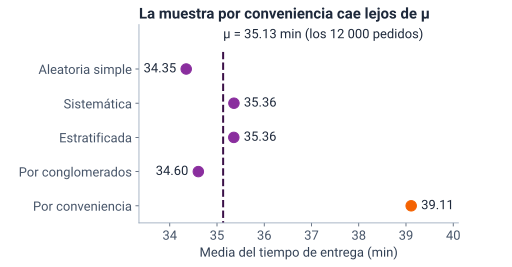
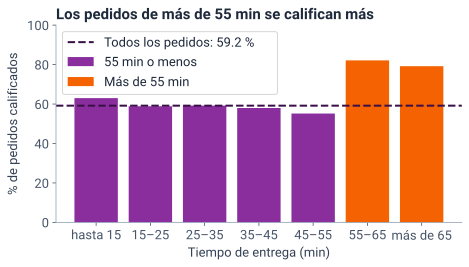
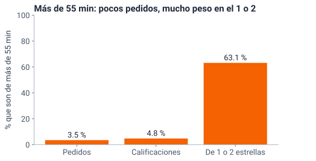

<!--
  Sesión 5 (2 h): apertura 12 min · muestreo 27 · sesgo y no respuesta 30 ·
  práctica 33 · cierre 8 · holgura 10. Las diapositivas de código corresponden a
  las celdas del notebook (mismo identificador entre corchetes); las salidas y
  las gráficas salen de ejecutarlo (precalculo/salidas_sesion5.json y
  recursos/s5/<id>.svg), con Python 3.13 y pandas 2.2.3. Las cifras del texto
  salen de la celda [cifras]. Los hitos de reloj y el orden de recorte están en
  la nota de «Dos horas en cinco momentos».
-->

# Apertura {icono=fa-door-open}

> ¿Qué tan satisfecha está la clientela?

???
Es la tercera pregunta de la gerencia. Pedir desde ya que abran el cuaderno de la sesión 5 (portada del curso → «Abrir en Colab») y ejecuten la primera celda y [cargar]: crean los mismos datos y declaran las escalas. Hoy [cargar] también importa numpy.

## Dos horas en cinco momentos, con diez minutos de holgura

::: flujo
1. **Apertura** — 12 min: coevaluación y la cifra del tablero
2. **Muestreo** — 27 min: cuatro métodos al azar y los que no lo son
3. **Sesgo y no respuesta** — 30 min: quién calificó y cómo ponderar
4. **Práctica guiada** — 33 min en Colab
5. **Cierre** — 8 min
:::

Hoy la pregunta no es solo qué dice la cifra, sino **quién respondió**.

???
Hitos de reloj: la diapositiva 8 en el minuto 12; la 15, en el 28; la 19, en el 39; la 25, en el 52; la 28, en el 61; la 32, en el 69; la 34, en el 102, y la 36, en el 108. Se termina en el minuto 110: quedan 10 de holgura. Hito fijo: la práctica (diapositiva 33) empieza a más tardar en el minuto 72. Durante la exposición solo miran; ejecutan todo en la práctica. Si a los 12 min no se ha llegado a la 8, a los 28 no se ha llegado a la 15, a los 39 no se ha llegado a la 19 o a los 52 no se ha llegado a la 25, recortar en este orden lo que todavía no se haya pasado: (1) la tasa por grupos, diapositiva 23: decir en una frase que por ciudad, suscripción o lluvia va de 57,6 a 59,9 % y dejar la celda [tasa_grupos] para el notebook (−1 min); (2) el sistemático, diapositiva 12: queda solo en el notebook (−2 min); (3) el *Literary Digest*, diapositiva 17: en un minuto, solo la idea y las dos cifras del resultado (−2 min); (4) la pregunta de clasificar métodos, diapositiva 18: solo los casos 1, 2 y 4, en el chat y sin discutirla (−1 min); (5) la pregunta de la diapositiva 29: solo en el chat, sin discutirla (−1 min). Si se recortó el sistemático, al llegar a la 18 definirlo en una frase: «un inicio al azar y, desde ahí, uno de cada k». No se recortan la ponderación, la comprobación, «Para tu tablero» ni la práctica.

## Otra pareja revisa las tres preguntas de tu tablero

::: flujo
1. **Intercambia** — con otra pareja, comparte tus tres preguntas y sus indicadores
2. **Revisa** — las de la otra pareja, con los tres criterios · 4 min
3. **Devuelve** — una sugerencia concreta por pregunta · 2 min
:::

| Criterio | Pregunta |
|---|---|
| **La gerencia** | ¿La haría la gerencia y se responde con `pedidos.csv`? |
| **El indicador** | ¿Dice qué cuenta y sobre qué total? |
| **Cada semana** | ¿Se puede calcular semana a semana? |

???
Es la coevaluación prometida al cierre de la sesión 4, en parejas cruzadas: en salas de grupos, una pareja con otra; siete minutos en total. Al volver, pedir en el chat la herramienta de cada pareja (Streamlit, Shiny, Power BI o Looker Studio) para saber cuántas hay de cada una. El segundo criterio es el de hoy: «¿sobre qué total?» se vuelve «¿de quiénes?» en la diapositiva siguiente.

## ¿Qué cifra pondrías en el tablero para decir qué tan satisfecha está la clientela? {.pregunta}

En `pedidos.csv`, la columna `calificacion` trae de 1 a 5 estrellas. Escribe en el chat la cifra que pondrías.

::: respuesta
**El 79,1 % de 4 o 5 estrellas**, como pide la lista mínima. Pero ¿79 % **de quiénes**? De los 7099 pedidos que se calificaron: el 59,2 % de los 12 000. Los demás no dijeron nada.
:::

???
Un minuto en el chat antes de revelar. Si alguien propone el promedio de estrellas, recordar la regla del curso: la satisfacción se resume con una proporción, nunca con la media de las estrellas. Si alguien propone la mediana (4 estrellas), es válida según esa regla; la lista mínima pide el %, porque se lee mejor semana a semana. La repregunta es la de la sesión: una cifra sin «de quiénes» está incompleta. Faltan 4901 calificaciones, el 40,8 %.

## Antes de la cifra, pregunta quién respondió {.idea}

Las calificaciones de la app son una muestra que nadie diseñó: **se eligió sola**. Es la pregunta 4 del diagnóstico de la sesión 1: quien opina puede no parecerse al resto.

???
Es el lema de la sesión. En la sesión 1, la respuesta correcta a «juzgar la satisfacción solo con las reseñas» fue la A: quienes escriben reseñas pueden no parecerse al resto. Hoy lo medimos en Tingua. Transición: primero, cómo se diseña una muestra que no se elige sola.

# Muestreo {icono=fa-shuffle}

> Si la gerencia llamara a 400 pedidos, ¿a cuáles?

???
La gerencia quiere llamar a 400 pedidos para preguntar por su satisfacción. Es el muestreo del syllabus: la puerta de entrada a la estadística inferencial.

## Para llamar a 400 pedidos hace falta un marco, y el de Tingua solo trae los entregados

::: tarjetas {columnas=3}
### El marco
La lista de la que se sortea: `pedidos.csv`. Solo trae los pedidos **entregados**: un pedido cancelado nunca saldría. Es un problema de **cobertura**.
### La unidad
El **pedido**, no el cliente: la tabla no dice quién pidió. Cada pedido es una fila.
### El blanco
Comparamos los métodos con el **tiempo de entrega**, que conocemos para todos: \(\mu = 35{,}13\) min.
:::

???
En la vida real, μ no se conoce: aquí sí, y por eso sirve para ver qué tan cerca cae cada método. Es la idea de la sesión 1: un parámetro es fijo y casi nunca se conoce. Si alguien pregunta por clientes: sin `id_cliente`, una persona que pidió diez veces tiene diez filas; muestrear pedidos no es muestrear personas. Si preguntan por qué no se comparan con la calificación: le faltan 4901 valores, y ese es justo el problema de la segunda parte.

## En un muestreo probabilístico, cada pedido tiene una probabilidad conocida de entrar

::: tarjetas
### Probabilístico
Cada pedido tiene una probabilidad **conocida y mayor que cero** de entrar. Eso permite inferir: \(\bar x\) estima \(\mu\), y en la sesión 6 mediremos cuánto puede alejarse.
### No probabilístico
Se elige lo que está a la mano o se deja que cada quien decida si entra. Nadie sabe la probabilidad de entrar, y no hay forma de medir cuánto puede alejarse \(\bar x\) de \(\mu\).
:::

???
«Mayor que cero» importa: si un grupo no puede salir nunca (los cancelados), la muestra no dice nada de él, por grande que sea. Si las probabilidades son distintas, como en un estratificado con el mismo número por ciudad, \(\bar x\) estima \(\mu\) con pesos: lo veremos al ponderar. Transición: cuatro maneras de sortear, una celda cada una; en la práctica las ejecutan.

## Aleatorio simple: cualquier grupo de 400 pedidos tiene la misma probabilidad de salir

```python [mas]
semilla = 1
mu = pedidos["tiempo_entrega_min"].mean()
mas = pedidos.sample(n=400, random_state=semilla)
x_mas = mas["tiempo_entrega_min"].mean()
print(f"μ = {mu:.2f} min · x̄ = {x_mas:.2f} min")
print("De Bucaramanga:", (mas["ciudad"] == "Bucaramanga").sum(), "pedidos")
#> μ = 35.13 min · x̄ = 34.35 min
#> De Bucaramanga: 35 pedidos
```

- La **semilla** permite repetir la misma muestra
- \(\bar x = 34{,}35\) min, cerca de \(\mu\)
- Trae 35 pedidos de Bucaramanga: con otra semilla, otro número

???
Es la celda de la sesión 1, ahora con 400 pedidos. Con las semillas de tres cifras, de 100 a 999, la aleatoria simple trae entre 22 y 59 pedidos de Bucaramanga: el azar no garantiza la parte de cada ciudad. Lo retomamos en el estratificado.

## Sistemático: un inicio al azar y, desde ahí, uno de cada 30 {columnas=3:2}

```python [sistematico]
paso = len(pedidos) // 400
inicio = np.random.default_rng(semilla).integers(paso)
sistematica = pedidos.iloc[inicio::paso]
x_sis = sistematica["tiempo_entrega_min"].mean()
print("Inicio:", inicio, "· pedidos:", len(sistematica))
print(f"x̄ = {x_sis:.2f} min")
#> Inicio: 14 · pedidos: 400
#> x̄ = 35.36 min
```

|||

- El paso es \(12\,000 / 400 = 30\)
- Solo se sortea el inicio, entre 0 y 29
- \(\bar x = 35{,}36\) min, cerca de \(\mu\)

???
Es la diapositiva recortable 2: si falta tiempo, queda en el notebook. iloc[inicio::paso] toma la fila del inicio y una de cada 30. El riesgo es un ciclo en el archivo: si la lista tuviera un patrón que se repite cada 30 filas (por ejemplo, ordenada por turno y que cada turno ocupara 30 filas), el sistemático tomaría siempre el mismo momento del ciclo. pedidos.csv está ordenado por fecha y franja, sin ese ciclo. Es el método de «1 de cada 50 facturas».

## El estratificado garantiza la parte de cada ciudad

```python [estratificado]
estratificada = pedidos.groupby("ciudad").sample(
    frac=1/30, random_state=semilla)
print("Pedidos:", len(estratificada))
pd.DataFrame({"estratificada": estratificada["ciudad"].value_counts(),
              "aleatoria simple": mas["ciudad"].value_counts()})
#> Pedidos: 401
#>               estratificada  aleatoria simple
#> ciudad
#> Bogotá                  157               144
#> Medellín                 89                97
#> Cali                     66                77
#> Barranquilla             49                47
#> Bucaramanga              40                35
```

- La misma fracción en cada ciudad: 401 pedidos, porque cada ciudad redondea, y siempre 40 de Bucaramanga
- Un **estrato** es el grupo que se sortea por separado: aquí, la ciudad, **no** la columna `estrato`

???
groupby("ciudad").sample(frac=1/30) sortea 1 de cada 30 pedidos en cada ciudad. Bucaramanga tiene 1190 pedidos: 1190/30 da 39,7, que redondea a 40 (con el 2 % del ejercicio 1, 23,8 redondea a 24). La aleatoria simple de la misma semilla trajo 35. El aviso de la última viñeta evita una confusión frecuente: la columna estrato es el estrato socioeconómico de la dirección. Puente a la segunda parte: si se sacara el mismo número de pedidos por ciudad (por ejemplo, 80 de cada una), Bucaramanga quedaría sobrerrepresentada y habría que ponderar para estimar el total.

## Por conglomerados se sortean días enteros, y el tamaño depende de cuáles salen {columnas=3:2}

```python [conglomerados]
fechas = pedidos["fecha"].drop_duplicates()
dias = fechas.sample(n=6, random_state=semilla)
conglomerados = pedidos[pedidos["fecha"].isin(dias)]
print("Pedidos:", len(conglomerados))
conglomerados["fecha"].value_counts().sort_index()
#> Pedidos: 404
#> fecha
#> 2026-02-05    47
#> 2026-02-24    58
#> 2026-04-04    86
#> 2026-04-24    76
#> 2026-04-28    65
#> 2026-06-12    72
#> Name: count, dtype: int64
```

|||

- Un **conglomerado** es un grupo que entra entero: se sortean 6 días y entran **todos** sus pedidos
- Con las semillas de tres cifras, salen de 312 a 499 pedidos
- Sirve cuando hay una lista de grupos y no una de unidades

???
isin deja los pedidos cuya fecha está entre los 6 días sorteados. Un día tiene de 42 a 107 pedidos: de viernes a domingo hay más. Advertencia de la vida real: lo que comparte un grupo lo vuelve más parecido por dentro; en una ciudad real, si un día llueve, llueve para muchos de sus pedidos a la vez, y 6 días informan menos que 400 pedidos sueltos. En Tingua, la lluvia se sorteó pedido por pedido. Si dentro de cada día sorteado se eligieran después algunos pedidos, sería un muestreo multietapa. Contraste para la pregunta de la 18: en el estratificado se sortea dentro de **todos** los grupos; por conglomerados se sortean **algunos** grupos, que entran enteros.

## Las cuatro muestras al azar caen cerca de μ; la de conveniencia, en 39,11 min {columnas=3:2}

{alto=420}

|||

- **Por conveniencia:** los primeros 400 pedidos de Bogotá, los más a la mano
- En Bogotá los pedidos tardan más: la muestra hereda ese **sesgo**, un error que empuja siempre hacia el mismo lado
- Una sola muestra no dice qué método es **más preciso**: eso, con muchas muestras, en la sesión 6

???
La celda [comparar] arma la tabla: 400 pedidos en la aleatoria simple y en la sistemática, 401 en la estratificada, 404 en la de conglomerados y 400 en la de conveniencia. La media de los pedidos de Bogotá es 39,52 min. Las cifras de la gráfica van con punto porque las escribe Python. La sistemática y la estratificada coinciden en 35,36 por azar (35,358 y 35,356): son muestras distintas, y con otra semilla se separan. Que las cuatro al azar caigan cerca no prueba que siempre lo hagan: con las semillas de tres cifras, la más lejana de las cuatro quedó a 2,45 min de μ, y alguna pasa de 1 min en el 33 % de las semillas; la de conveniencia está siempre a 3,98, porque no depende de la semilla. Cuánto se mueven es justo lo que mide la sesión 6. Si hay tiempo, que cada quien ponga su semilla de tres cifras, ejecute hasta [comparar] y escriba en el chat su \(\bar x\) aleatoria y la de conveniencia: todos verán 39,11 en la segunda.

## Por conveniencia, voluntario o por cuotas: sin azar, el error no se puede medir

::: tarjetas {columnas=3}
### Por conveniencia
Lo que está a la mano: los primeros 400 pedidos de Bogotá.
### Voluntario
Responde quien quiere: una encuesta abierta en la web.
### Por cuotas
Se llenan cupos por grupo, pero dentro de cada cupo se elige a mano.
:::

La calificación de la app es una muestra **voluntaria**.

???
Por cuotas se parece al estratificado (un cupo por ciudad), pero sin sorteo dentro del cupo: quien encuesta elige a quién. Volver al lema: las calificaciones son una muestra que se eligió sola. Transición: ¿y si la muestra voluntaria es enorme?

## Más datos no corrigen un sesgo {.idea}

En 1936, la revista *Literary Digest* envió 10 millones de cuestionarios y recibió 2 376 523 respuestas: el 57 % de los votos por Landon o Roosevelt fue para Landon. En la elección, Landon sacó el 36,5 % del voto popular y Roosevelt, el 60,8 %.

???
Es la diapositiva recortable 3: en un minuto, solo la idea y el resultado. Fuentes: Squire, P. (1988). Why the 1936 Literary Digest poll failed. *Public Opinion Quarterly*, 52(1), 125–133: el sesgo del marco y la no respuesta se sumaron, y con respuesta completa el *Digest* habría acertado el ganador. Lusinchi, D. (2012). «President» Landon and the 1936 Literary Digest poll: Were automobile and telephone owners to blame? *Social Science History*, 36(1), 23–54: discute la explicación de siempre, que las listas de teléfonos y automóviles dejaban fuera a los votantes de Roosevelt. Respondió menos de 1 de cada 4 (el 23,8 %): también fue un problema de no respuesta, el de la segunda parte. Un paralelo reciente: Bradley *et al.* (2021). Unrepresentative big surveys significantly overestimated US vaccine uptake. *Nature*, 600, 695–700: en mayo de 2021, una encuesta en línea con unas 250 000 respuestas por semana sobrestimó en 17 puntos la vacunación en EE. UU., y un panel de unas 1000 personas por semana, bien diseñado, se acercó más. Lo que se lleva el grupo: millones de respuestas no corrigen un sesgo; lo que importa es quién respondió.

## ¿Qué método es cada uno? ¿Cuáles son probabilísticos? {.pregunta}

1. 80 pedidos sorteados en cada ciudad
2. Una encuesta en la app que sortea un bono entre quienes respondan
3. Las facturas 7, 57, 107…: una de cada 50, desde una sorteada
4. En cada ciudad, el encuestador llama a los que quiera hasta completar 80
5. 20 barrios sorteados, con todas sus viviendas

::: respuesta
**1** estratificado: para el total, cada ciudad pesa según su tamaño · **2** voluntario: el sorteo es del premio, no de la muestra · **3** sistemático · **4** por cuotas: cupos sin sorteo · **5** por conglomerados. Probabilísticos: 1, 3 y 5
:::

???
La 3 arranca en una factura sorteada entre las primeras 50. Es la diapositiva recortable 4: si falta tiempo, que respondan en el chat los casos 1, 2 y 4 y se pasa sin discutir. Un minuto; en el chat, cinco respuestas en una línea. La palabra «sorteo» no decide: en la 2 también hay sorteo, pero del premio, y quien responde se elige solo. La 1 y la 4 son el contraste de la sesión: los mismos cupos por ciudad, con sorteo dentro de cada uno (estratificado) o sin él (cuotas). En la 1, Bucaramanga, con menos pedidos, queda sobrerrepresentada: para estimar el total, cada pedido tiene que pesar según su ciudad. Esa idea, ponderar, es la que usaremos con la calificación.

# Sesgo y no respuesta {icono=fa-user-check}

> ¿Quién calificó?

???
Volvemos a la pregunta de la apertura: el 79,1 % de 4 o 5 estrellas viene de una muestra voluntaria. ¿Se parece a todos los pedidos?

## El error muestral baja cuando crece n; el sesgo, no

::: tarjetas
### Error muestral
Es **azar**: cada muestra cae en un lugar distinto alrededor de \(\mu\). Baja cuando crece \(n\). Medirlo es el tema de la sesión 6.
### Sesgo
Es **sistemático**: empuja siempre hacia el mismo lado. **No** baja cuando crece \(n\): el *Literary Digest* tenía más de dos millones de respuestas.
:::

???
Imagen: tirar al blanco. El error muestral es la dispersión de los tiros; el sesgo, la mira desviada. Más tiros juntan los disparos, pero no los acercan al centro si la mira está mal. La muestra por conveniencia de Bogotá tiene sesgo; las cuatro al azar, solo error muestral.

## Cuatro sesgos, cuatro preguntas que hacerle a una muestra

| Sesgo | Pregunta | En Tingua |
|---|---|---|
| **Cobertura** | ¿El marco deja fuera a alguien? | Los pedidos cancelados no están en `pedidos.csv` |
| **Selección o autoselección** | ¿Quien entra se parece al resto? | Los primeros 400 de Bogotá; la calificación voluntaria |
| **No respuesta** | ¿Quien no responde se parece a quien sí? | El 40,8 % de los pedidos no tiene calificación |
| **Medición** | ¿Se mide bien lo que se quiere medir? | El tope de 14 km de la distancia (sesión 4) |

La app pide calificar a **todos**, y de todos sabemos el tiempo: la calificación la tratamos como **no respuesta**.

???
Las cuatro preguntas sirven para la nota sobre los datos del tablero. Autoselección y no respuesta se parecen: en la primera, cada quien decide si entra; en la segunda, alguien que fue elegido no responde. En la calificación de Tingua se mezclan, y la tratamos como no respuesta porque de todos los pedidos sabemos el tiempo: veremos de qué depende y cómo corregirla. El tope de 14 km es un problema de medición porque el registro no guarda el valor real.

## Los pedidos de más de 55 min se califican más {columnas=3:2}

{alto=420}

|||

- En los dos tramos de más de 55 min se califica el 82,1 y el 79,2 %
- Del resto: de 55,2 a 63,0 %
- Todos los pedidos: 59,2 %

???
pd.cut parte el tiempo con cortes explícitos; cada tramo incluye su borde de arriba: «55–65» son los pedidos de más de 55 y hasta 65 minutos. Las barras empiezan en cero. Los tramos de las puntas tienen pocos pedidos: 100 hasta 15 min, 291 de 55 a 65 y 125 de más de 65; con tan pocos, el 63,0 % del primer tramo se mueve mucho por azar. Por qué 55: es donde la tasa salta, y por eso los grupos de hoy son «55 min o menos» y «más de 55 min». No llamarlos «lentos»: en la sesión 4, lento era pasar la valla de 59,15 min. La baja a 55,2 % en 45–55 (1259 pedidos) también puede ser azar: no conviertas ruido en noticia. Ya se asomó en la sesión 4: de los 66 extremos se calificaron 48, y 47 con 1 estrella. Preguntar: ¿por qué calificaría más quien esperó más?

## Por ciudad, suscripción o lluvia, la tasa de calificación casi no cambia {columnas=2:1}

```python [tasa_grupos]
tasa_grupos = pd.concat({
    columna: califico.groupby(pedidos[columna]).mean() * 100
    for columna in ["ciudad", "suscriptor", "lluvia"]})
tasa_grupos.round(1)
#> ciudad      Barranquilla    59.5
#>             Bogotá          59.7
#>             Bucaramanga     59.2
#>             Cali            59.8
#>             Medellín        57.6
#> suscriptor  No              58.9
#>             Sí              59.9
#> lluvia      No              59.1
#>             Sí              59.5
#> Name: calificacion, dtype: float64
```

|||

- Va de 57,6 a 59,9 %; por tramo de tiempo, de 55,2 a 82,1 %
- `califico` es True si el pedido tiene calificación
- La media de True y False es una proporción

???
Es la diapositiva recortable 1: si falta tiempo, basta con el título. El título dice lo que se ve en estas tres columnas; que nada más mueva la tasa no se puede comprobar. pd.concat junta las tres tasas en una sola serie con dos niveles. De estas tres columnas, ninguna mueve la tasa como el tiempo. Si alguien pregunta por la distancia: también la mueve, pero a través del tiempo, porque los pedidos lejanos tardan más y más de ellos pasan de 55 min. Eso no prueba que no haya otra cosa detrás: solo podemos revisar lo que está en la tabla.

## Tres tipos de faltantes: al azar, según lo que vemos o según lo que no vemos

::: tarjetas {columnas=3}
### Completamente al azar
Solo se pierde \(n\): los calificados se parecen a todos.
### Según algo que vemos
En Tingua, el tiempo: con el mismo tiempo, los calificados se parecen a los demás. Se **pondera**: funciona porque el tiempo se conoce **también** para los no calificados.
### Según lo que no vemos
Por ejemplo, que con el mismo tiempo se califiquen más los pedidos de clientes muy molestos. Hay que salir a preguntar.
:::

Que no dependa de lo que no vemos es un **supuesto**: en la vida real no se puede comprobar.

???
En inglés se llaman MCAR (*missing completely at random*), MAR (*missing at random*) y MNAR (*missing not at random*). La tasa de calificación muestra de qué variable observada depende la no respuesta; lo que no vemos, por definición, no aparece en ninguna columna. Salir a preguntar es hacer seguimiento: sortear algunos pedidos sin calificación y llamarlos hasta obtener su respuesta.

## Los de más de 55 min: 3,5 % de los pedidos y 63,1 % de las calificaciones de 1 o 2 {columnas=3:2}

{alto=420}

|||

- Son 416 pedidos; sus 338 calificaciones son el 4,8 % de las 7099
- De las 312 calificaciones de 1 o 2 estrellas, 197 son suyas
- Como se califican más, pesan de más en la **insatisfacción**, el % de 1 o 2 estrellas: por eso la miramos desde aquí

???
Es la clave de la sesión: la no respuesta pesa más en lo raro. Un grupo pequeño que se califica más infla poco el total de calificaciones (de 3,5 a 4,8 %), pero domina las de 1 o 2 estrellas, que son pocas. Ojo: las dominan sobre todo porque esperar más de 55 min trae calificaciones bajas; que se califiquen más les suma unos puntos de más, y esos puntos son el sesgo que la ponderación quita. Con cifras: si se calificaran en la misma proporción en los dos grupos (ponderado), serían el 55,2 % de las de 1 o 2; calificar más les suma unos 8 puntos. La gerencia preguntó por el 4 o 5, pero el sesgo se ve en el 1 o 2, que es raro. Transición: ¿cómo devolverle a cada grupo su peso real?

## Ponderar: cada calificación cuenta por los pedidos que representa en su grupo

$$ \hat p_w = \frac{\sum w_i \, y_i}{\sum w_i} \qquad w_i = \frac{\text{pedidos de su grupo}}{\text{calificados de su grupo}} $$

La suma va **solo sobre los calificados**; \(w_i\) es el peso del grupo del pedido \(i\), y \(y_i = 1\) si el pedido tiene 1 o 2 estrellas (si no, 0). Con estos pesos, los de más de 55 min vuelven a pesar lo que pesan entre los pedidos: el 3,5 %, no el 4,8 % de las calificaciones.

???
Cómo se lee en voz alta: «p sombrero sub w es la suma de w sub i por y sub i, dividida entre la suma de los w sub i»; y el peso: «pedidos de su grupo entre calificados de su grupo». La suma recorre solo los pedidos calificados, y y sub i vale 1 si el pedido tiene 1 o 2 estrellas. El peso es el inverso de la tasa de calificación del grupo: con una tasa de 58,36 % en «55 min o menos», cada calificación representa a 1,71 pedidos; con 81,25 % en «más de 55 min» (338 de 416), a 1,23. Es la misma idea del estratificado con el mismo número por ciudad: cada unidad pesa según cuántas representa. Los dos grupos son una decisión del analista: si alguien propone ponderar por los siete tramos de la gráfica, también vale, y da 3,75 % en el 1 o 2 y 79,70 % en el 4 o 5; el supuesto pasa a ser «dentro de cada tramo».

## Ponderar baja la insatisfacción de 4,4 % a 3,7 %: un 17 % menos, en proporción {columnas=2:1}

```python [ponderar]
datos = pedidos
grupo = pd.Series(np.where(datos["tiempo_entrega_min"] > 55,
                           "más de 55 min", "55 min o menos"),
                  index=datos.index)
calificado = datos["calificacion"].notna()
peso = grupo.value_counts() / grupo[calificado].value_counts()
print("Pesos:", peso.round(2).to_dict())
w = grupo[calificado].map(peso)
estrellas = datos.loc[calificado, "calificacion"]
y = (estrellas <= 2).astype(int)
sin_ponderar = y.mean() * 100
ponderado = (w * y).sum() / w.sum() * 100
print(f"1 o 2 estrellas: {sin_ponderar:.2f} % → {ponderado:.2f} %")
#> Pesos: {'55 min o menos': 1.71, 'más de 55 min': 1.23}
#> 1 o 2 estrellas: 4.39 % → 3.66 %
#> 4 o 5 estrellas: 79.07 % → 80.09 %
```

|||

- El 4 o 5 (dos líneas más, en el cuaderno o *notebook*) sube de 79,1 a 80,1 %: un punto sobre 79
- En proporción, la no respuesta pesa más en lo raro
- Es una **estimación**: vale si, dentro de cada grupo de tiempo, los pedidos sin calificación se parecen a los calificados

???
El grupo se arma con np.where: un texto por pedido. La línea datos = pedidos va sola a propósito: en el ejercicio 2 solo cambia esa. Las dos líneas que calculan el 4 o 5 están en el notebook. Nunca np.average sobre la calificación: devuelve, sin avisar, la media de las estrellas. La baja de 4,39 a 3,66 es de 0,73 puntos; en proporción, un 17 %. En el 4 o 5 la corrección es de 1,02 puntos, poca en proporción, porque casi todos califican bien. Transición: ¿se acercó a la verdad? En la vida real no lo sabríamos; en Tingua, sí.

## Solo en un caso ficticio se puede comprobar: ponderar acercó el 1 o 2 a la verdad

```python [comprobacion]
completa = pedidos["id_pedido"].map(calificacion_completa())
print(f"1 o 2: {sin_ponderar:.2f} % sin ponderar · "
      f"{ponderado:.2f} % ponderado · "
      f"{(completa <= 2).mean() * 100:.2f} % de verdad")
#> 1 o 2: 4.39 % sin ponderar · 3.66 % ponderado · 3.80 % de verdad
```

- La verdad es 3,80 %: ponderar pasó de 4,39 a 3,66 % y quedó más cerca
- En el 4 o 5 no la acercó, algo poco común: el azar de quién calificó empujaba al lado contrario del sesgo. **Ponderar quita el sesgo, no el azar** (sesión 6)
- En la vida real esta celda no existe: **no la uses en el tablero**

???
Tingua es inventado, así que el generador sabe qué calificación habría dado cada pedido; calificacion_completa(), en la celda oculta, la recupera y se cruza por código con map. Se usa solo aquí. La celda [comprobacion_45] hace lo mismo con el 4 o 5: 79,07 % sin ponderar, 80,09 % ponderado y 79,23 % de verdad. Este resultado es poco común: el ponderado se aleja de la verdad mucho más de lo habitual (para el docente: unos 2,9 errores estándar; el término es de la sesión 6, no decirlo en clase), por el azar de quién calificó dentro del grupo de 55 min o menos. Por ciudad, ponderar acerca el 1 o 2 en 4 de 5 ciudades (en Medellín, por muy poco) y el 4 o 5 en 3 de 5. No decir que la ponderación «arregla» la cifra: quita el sesgo que depende del tiempo, si el supuesto se cumple, y deja el azar.

## La gerencia propone sortear 400 pedidos y mirar su calificación: ¿qué le respondes? {.pregunta}

La muestra se sortea como en la primera parte, y la calificación sale de `pedidos.csv`. ¿Eso arregla la no respuesta?

::: respuesta
**No.** Cerca del 41 % no tendrá calificación, y los que sí la tienen siguen siendo voluntarios. El sorteo decide quién **entra** a la muestra, no quién **responde**. Lo que sí ayuda: llamar a los 400 sorteados e insistir hasta que respondan, o ponderar por lo que se ve.
:::

???
Un minuto en el chat. El 40,8 % de los pedidos no tiene calificación. Sortear arregla el sesgo de selección, no el de no respuesta. Llamar a los 400 sorteados e insistir hasta obtener respuesta es el seguimiento de la diapositiva 24: así se juntan las dos partes de la sesión. Además, 400 pedidos tienen más azar que los 7099 calificados: eso se mide en la sesión 6.

## Para tu tablero: el indicador no cambia; la tasa de calificación lo acompaña

- El indicador sigue siendo el **% de 4 o 5 estrellas entre los calificados**, con su \(n\): cuántos se calificaron
- **Recomendado:** mostrar la tasa de calificación de cada semana y advertir en la nota sobre los datos que el % es solo de los calificados
- **Opcional:** ponderar, que no siempre se puede: en 13 de las 135 combinaciones de ciudad y semana hay pedidos de más de 55 min y ninguno calificado

???
Sin pedidos calificados en un grupo, su peso queda indefinido: no hay a quién darle el peso. La celda [semanas_calificacion] del notebook calcula la tasa de calificación por semana ISO y marca las semanas 1 y 27, que están incompletas; va de 53,9 a 63,0 % según la semana. Decir en voz alta: «no conviertas ruido en noticia»; una semana con unos puntos menos de tasa no es una tendencia. La calificación oculta nunca va en el tablero.

## Estimamos que cerca de 8 de cada 10 pedidos tendrían 4 o 5 estrellas {.idea etiqueta="La respuesta a la gerencia"}

…si, dentro de cada grupo de tiempo, los pedidos sin calificación se parecen a los calificados. La insatisfacción es **menor** de lo que dicen las calificaciones.

???
Así se contesta la pregunta de la gerencia: una estimación (80,1 %, ponderada), su supuesto dicho en voz alta y la conclusión práctica. «Estimamos» y el «si…» no son debilidad: son la parte honesta de la cifra. La segunda frase sale del 1 o 2: de 4,4 a 3,7 %. Si preguntan por qué se usa la ponderada si en el 4 o 5 se alejó de la verdad: en la vida real la verdad no se conoce; la ponderada quita el sesgo que vemos, y su azar se mide en la sesión 6. Por eso «cerca de 8 de cada 10» y no «80,1 %». Transición: en la práctica, la misma ponderación, solo con los pedidos de Bogotá.

# Práctica y cierre {icono=fa-keyboard}

> Treinta y tres minutos con el cuaderno (*notebook*): tres ejercicios con verificador.

## Práctica guiada: tres ejercicios en el notebook

::: flujo
1. **Estratificada proporcional** — el 2 % de cada ciudad, con tu semilla · 12 min
2. **La insatisfacción de Bogotá** — ponderada, cambiando una sola línea · 14 min
3. **Opcional: conglomerados** — 6 días con tu semilla · 7 min o en casa
:::

[Abrir el notebook de la sesión 5 en Colab](https://colab.research.google.com/github/JotaMao1985/ANaLISIS-ESTADiSTICO-DE-LA-INFORMACIoN_Ucomp/blob/main/notebooks/sesion-5-la-muestra-que-se-eligio-sola.ipynb). Antes del ejercicio 1: **Entorno de ejecución → Ejecutar anteriores**. Las respuestas escritas van en «Tus respuestas», que no se verifica.

???
Cada ejercicio termina con un verificador que da pistas sin la respuesta. Clave del 1: con frac=0.02, 94 pedidos de Bogotá, 53 de Medellín, 39 de Cali, 29 de Barranquilla y 24 de Bucaramanga (el verificador acepta ±1 por ciudad, y rechaza los primeros pedidos de cada ciudad o uno de cada tantos desde el primero: no hay sorteo); siempre 24 de Bucaramanga porque cada ciudad redondea su propio 2 %. Con una aleatoria simple de 240 se esperan 23,8, pero con las semillas de tres cifras salen de 12 a 40, y exactamente 24 solo en el 9 %. frac=2, n=0.02 o frac junto con n hacen fallar a pandas antes del verificador: la plantilla lo advierte. Clave del 2: en Bogotá, 7,51 % sin ponderar y 6,14 % ponderado, con sus propios pesos (1,72 y 1,17); con ≥ 55 da 6,16 y también vale. En puntos, la corrección de Bogotá (1,37) casi duplica la del total (0,73) porque allí los pedidos de más de 55 min son el 6,1 % de sus pedidos, frente al 3,5 % en el total (287 de los 416 son suyos); en proporción, las dos se parecen: 18 % y 17 %. w.sum() da 4707, los pedidos de Bogotá: cada calificación representa a los pedidos de su grupo, y entre todas suman todos. Si la plantilla corre sin cambiar la línea datos =, el verificador avisa que son las cifras de todos los pedidos. Clave del 3: el tamaño depende de los días que salgan (de 312 a 499 pedidos con las semillas de tres cifras). La distancia de su \(\bar x\) a μ es error muestral: cambia con la semilla y se achica con más días; los 3,98 min de la de conveniencia son sesgo: no cambian con la semilla ni con más pedidos de Bogotá. El verificador rechaza 6 días seguidos o a paso fijo desde el primero. «Tus respuestas» trae además la pregunta de qué quita la ponderación y la autoevaluación, para quien estudia en casa.

## En otra app de domicilios, ¿qué tipo de faltante es cada uno, y qué harías? {.pregunta}

1. Los pedidos que llegan con algo dañado casi nunca se califican; la app no registra daños
2. De noche se califica menos que de día
3. Una falla borró las calificaciones de los pedidos cuyo código termina en 7
4. Quien paga en efectivo califica menos que quien usa tarjeta

::: respuesta
**1** según lo que no vemos: hay que salir a preguntar · **2** según algo que vemos, la franja: se pondera por ella · **3** completamente al azar: solo se pierde \(n\) · **4** según algo que vemos, el medio de pago: se pondera por él
:::

???
Es la autoevaluación de cierre: dos minutos, y en el chat las cuatro respuestas en una línea. La 1 es la difícil: el daño explica por qué no califican, pero no está en ninguna columna, así que ponderar no lo corrige. En la 3, el último dígito del código no tiene que ver con la satisfacción. Hay dos casos de «según algo que vemos»: no se resuelve por descarte. Se dice «otra app» porque en Tingua la tasa casi no cambia con la franja (de 58,5 a 60,7 %) ni con el medio de pago (de 58,6 a 60,1 %). Está también en «Tus respuestas» del notebook.

## Lo que te llevas hoy {.cierre}

- Antes de la cifra, **¿de quiénes?**: el 79,1 % es de los pedidos que se calificaron
- En un muestreo **probabilístico**, cada pedido tiene una probabilidad conocida de entrar
- El **error muestral** baja con \(n\); el **sesgo**, no
- Si la no respuesta depende de algo que **vemos**, se **pondera**; que no dependa de lo que no vemos es un supuesto
- Ponderar quita el sesgo de lo que vemos, **no el azar**

???
Leer las cinco en voz alta y preguntar cuál les costó más. Cerrar con el lema: antes de la cifra, pregunta quién respondió.

## La sesión 6 abre con el prototipo de tu tablero

- **Termina** la práctica: los verificadores revisan los tres ejercicios
- **Construye** un prototipo con los cuatro indicadores semanales y su \(n\): otra pareja lo revisará al abrir la sesión 6
- **Lee** la sección 5.1 de *OpenIntro Statistics* (4.ª ed.), «Point estimates and sampling variability»; la 5.2 es opcional

**Próxima sesión:** ¿cuánto confiar en una muestra? La distribución muestral, el error estándar y los intervalos de confianza.

???
El prototipo es el hito «sesiones 5 y 6» del proyecto. La sección 5.1 de OpenIntro (Diez, Çetinkaya-Rundel y Barr, 4.ª edición, de acceso abierto) separa el error muestral del sesgo con el lenguaje de hoy; la 5.2 empieza los intervalos de confianza. Lo que la sesión 6 recibe: el n del indicador de satisfacción es el número de pedidos calificados, no el de pedidos, y un intervalo de confianza mide el azar, no el sesgo.
