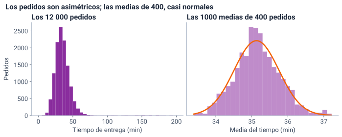
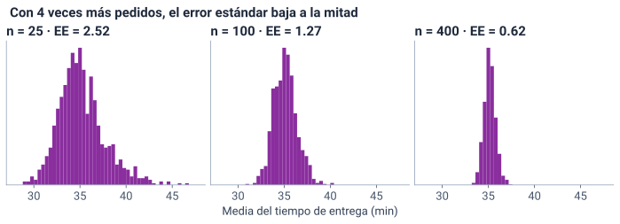
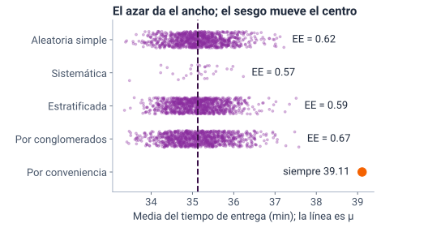
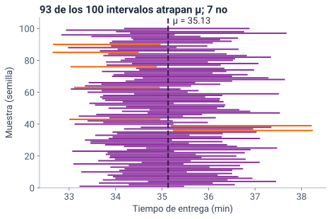
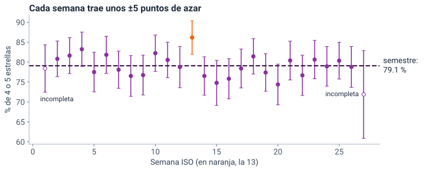

<!--
  Sesión 6 (2 h): apertura 17 min · distribución muestral 26 · intervalos 32 ·
  práctica 30 · cierre 8 · holgura 7. Las diapositivas de código corresponden a
  las celdas del notebook (mismo identificador entre corchetes); las salidas y
  las gráficas salen de ejecutarlo (precalculo/salidas_sesion6.json y
  recursos/s6/<id>.svg), con Python 3.13 y pandas 2.2.3. Las cifras del texto
  salen de las celdas [cifras] y [verdad_s5]. Los hitos de reloj y el orden de
  recorte están en la nota de «Dos horas en cinco momentos».
-->

# Apertura {icono=fa-door-open}

> ¿Cuánto confiar en una muestra?

???
Es la cuarta pregunta de la gerencia. Pedir desde ya que abran el cuaderno de la sesión 6 (portada del curso → «Abrir en Colab») y ejecuten la primera celda y [cargar]: crean los mismos datos y declaran las escalas.

## Dos horas en cinco momentos, con siete minutos de holgura

::: flujo
1. **Apertura** — 17 min: el prototipo en salas y la pregunta de entrada
2. **Distribución muestral** — 26 min: mil muestras, el error estándar y la normal
3. **Intervalos** — 32 min: el margen, qué dice el 95 % y lo que va al tablero
4. **Práctica guiada** — 30 min en Colab
5. **Cierre** — 8 min
:::

Hoy cada cifra llega con su **margen**: cuánto puede moverse solo por azar.

???
Hitos de reloj: la diapositiva 8 en el minuto 17; la 13, en el 28; la 18, en el 43; la 22, en el 51; la 26, en el 60; la 30, en el 69; la 34, en el 75, y la 35, en el 105. Se termina en el minuto 113: quedan 7 de holgura. Hito fijo: la práctica (diapositiva 34) empieza a más tardar en el minuto 75. Las diapositivas 1 a 5 se pasan en un minuto, antes de abrir las salas; los 12 min de salas incluyen abrirlas y cerrarlas; el lema (diapositiva 7) se dice en una frase al cerrar la votación. Durante la exposición solo miran; ejecutan todo en la práctica. Si a los 28 min no se ha llegado a la 13, a los 43 no se ha llegado a la 18 o a los 60 no se ha llegado a la 26, recortar en este orden lo que todavía no se haya pasado: (1) la comparación de métodos, diapositiva 17, en una frase: «en Tingua, los cuatro métodos al azar tienen casi la misma precisión; la de conveniencia cae siempre en el mismo punto» (−2 min); (2) los tres tamaños, diapositiva 14, en una frase: «con 4 veces más pedidos, el error estándar baja a la mitad» (−1 min); (3) el tamaño de muestra, diapositiva 30: queda solo en el ejercicio 3 (−3 min). No se recortan las salas, el intervalo, qué dice el 95 %, el sesgo, la semana 13, «Para tu tablero» ni la práctica.

## Otra pareja revisa el prototipo de tu tablero

::: flujo
1. **Muestra** — tu prototipo, con la pantalla compartida · 3 min por pareja
2. **Responde** — la otra pareja, a las tres preguntas · 2 min por pareja
3. **Anota** — la mejora más útil que recibiste
:::

1. ¿Están los cuatro indicadores semanales, cada uno con su definición escrita y su \(n\)?
2. ¿Se entiende sin que la pareja lo explique? (títulos que afirman, ejes con unidades)
3. ¿Qué cambiarían primero?

???
El docente arma las salas antes de la clase: dos parejas cruzadas por sala y, si se puede, de herramientas distintas (Streamlit, Shiny, Power BI o Looker Studio); si el número de parejas es impar, queda una sala de tres. Doce minutos: cada pareja muestra 3 min y recibe 2 min de respuesta; la otra hace lo mismo. Sin prototipo, la pareja muestra su boceto o una captura. Es el hito «sesiones 5 y 6» del proyecto. Al volver, mientras se vota la pregunta siguiente, cada sala escribe en el chat la mejora más útil que recibió. La primera pregunta retoma la sesión 5: el n del indicador de satisfacción es el número de calificados.

## ¿Premiamos al equipo de la semana 13? {.pregunta}

En la semana 13, el 86,2 % de los pedidos calificados tuvo 4 o 5 estrellas, la mejor del semestre. Vota en el chat: **sí**, **no** o **depende**.

::: respuesta
**Lo respondemos más adelante, en la parte de intervalos**, con el margen de esa semana. Por ahora: el 86,2 % sale de los pedidos que se calificaron esa semana. Es una **estimación puntual**: con otros pedidos habría salido otra cifra.
:::

???
Cinco minutos, con la votación y las mejoras de las salas. Guardar el conteo de la votación: se vuelve a él en la diapositiva 29. Retoma la lectura 5.1 de *OpenIntro*: una cifra de una muestra es una estimación puntual (*point estimate*) y cambia de muestra en muestra. No adelantar la respuesta.

## Ninguna cifra sin su margen {.idea}

En la sesión 3 fue «Ningún centro sin su dispersión»: la dispersión de los **pedidos**. Hoy es la de las **cifras** que salen de una muestra: cuánto pueden moverse solo por azar.

???
Es el lema de la sesión, y hace eco del de la sesión 3. Allá, la desviación estándar decía cuánto varía un pedido; hoy mediremos cuánto varía una cifra que sale de una muestra, como la media o el % de 4 o 5 estrellas. Transición: ¿cuánto puede alejarse una muestra de la verdad?

# Distribución muestral {icono=fa-chart-area}

> ¿Cuánto puede alejarse una muestra?

???
En la sesión 5, las cuatro muestras al azar cayeron cerca de 35,13 min. Hoy repetimos el sorteo muchas veces para ver cuánto se mueven. Es lo que la sesión 5 dejó pendiente: «en la sesión 6 mediremos cuánto puede alejarse».

## Mil muestras de 400 pedidos: sus medias van de 33,38 a 37,22 min

```python [mil_muestras]
tiempo = pedidos["tiempo_entrega_min"]
mu = tiempo.mean()
medias = []
for i in range(1000):
    muestra = pedidos.sample(n=400, random_state=i)
    medias.append(muestra["tiempo_entrega_min"].mean())
medias = pd.Series(medias)
print(f"μ = {mu:.2f} min")
print(f"Las 1000 medias: de {medias.min():.2f} a {medias.max():.2f} min,",
      f"con media {medias.mean():.2f}")
#> μ = 35.13 min
#> Las 1000 medias: de 33.38 a 37.22 min, con media 35.16
```

- Cada vuelta del `for` sortea otra muestra: la semilla cambia con `i`
- Ninguna media cayó a más de unos 2 min de \(\mu = 35{,}13\)

???
El bucle tiene cinco líneas: una lista vacía, el for, la muestra, el append de su media y la conversión a serie. Es la celda [mas] de la sesión 5, repetida 1000 veces. En la vida real no se sacan 1000 muestras: se saca una. Esto se hace aquí solo porque conocemos los 12 000 pedidos, y sirve para ver cómo se comporta una muestra. Las cifras van con punto porque las escribe Python.

## Los pedidos son asimétricos; las medias de 400, casi normales

{alto=390}

- Las 1000 medias forman la **distribución muestral** de \(\bar x\): una campana estrecha alrededor de \(\mu\)

???
Fijarse en los ejes: los pedidos van de 0 a 200 min, con su cola hasta 200,9; las medias, de 33 a 38. La curva naranja es una normal centrada en μ y con la misma desviación que las medias; en el código sale de statistics.NormalDist, sin librerías nuevas. Preguntar: ¿por qué las medias no tienen la cola de los pedidos? Porque en una muestra de 400 los pedidos muy lentos son pocos y se diluyen entre los demás.

## La desviación estándar describe los pedidos; el error estándar, la media de una muestra

```python [error_estandar]
sigma = tiempo.std(ddof=0)
ee = medias.std()
print(f"Desviación estándar de los pedidos:  σ  = {sigma:.2f} min")
print(f"Error estándar de las medias de 400: EE = {ee:.2f} min")
print(f"La fórmula: σ / √400 = {sigma / np.sqrt(400):.2f} min")
#> Desviación estándar de los pedidos:  σ  = 12.66 min
#> Error estándar de las medias de 400: EE = 0.62 min
#> La fórmula: σ / √400 = 0.63 min
```

| | Dice cuánto varía | En Tingua |
|---|---|---|
| **Desviación estándar** | un pedido (sesión 3) | 12,66 min |
| **Error estándar** (EE) | la media de una muestra de 400 | 0,62 min |

???
El error estándar es la desviación de una cifra entre muchas muestras: no es un «error» en el sentido de equivocación. Por eso no se dice «error» a secas. La desviación de los pedidos es la de la sesión 3, con ddof=0 porque los 12 000 son la población. Con la corrección por población finita, la fórmula da 0,622, casi lo mismo que la simulación: 400 pedidos son pocos frente a 12 000.

## El error estándar sale sin simular: σ entre la raíz de n

$$ \mathrm{EE} = \frac{\sigma}{\sqrt{n}} $$

\(\sigma\) es la desviación de los pedidos, 12,66 min, y \(n\) el tamaño de la muestra, 400. Como \(\sqrt{400} = 20\), queda \(12{,}66 / 20 = 0{,}63\) min. La simulación dio 0,62.

???
Cómo se lee en voz alta: «el error estándar es sigma dividido entre la raíz cuadrada de n». Un n más grande achica el EE, pero a través de la raíz: no en proporción directa. Esa es la pregunta que sigue. La fórmula vale para muestras al azar en que cada pedido entra por sorteo, sin que uno arrastre a otro: es la condición de independencia, que se cumple al sortear.

## 1600 pedidos en vez de 400: ¿el EE baja a la mitad o a la cuarta parte? {.pregunta}

Si la gerencia toma 1600 pedidos en vez de 400, ¿qué le pasa al error estándar? Predice antes de seguir: escribe en el chat «mitad» o «cuarta parte».

::: respuesta
**A la mitad.** El tamaño se multiplica por 4, pero el EE se divide entre \(\sqrt 4 = 2\): de 0,63 a 0,32 min. Para partir el error estándar por la mitad hacen falta **cuatro veces** más datos.
:::

???
Un minuto en el chat. Muchos dirán «a la cuarta parte», porque piensan en proporción directa. Para el docente: con los 12 000 pedidos y la corrección por población finita, sale algo menos de la mitad, 0,295 min (0,47 veces el 0,62), porque 1600 ya son el 13 % de los pedidos; con una población muy grande, sería la mitad exacta. La diapositiva siguiente lo confirma con la simulación.

## Con 4 veces más pedidos, el error estándar baja a la mitad

{alto=340}

- El EE es 2,52, 1,27 y 0,62 min con 25, 100 y 400 pedidos; la fórmula da 2,53, 1,27 y 0,63
- Con 25 pedidos, las medias todavía se inclinan a la derecha (asimetría 0,77); con 400, casi nada (0,21)

???
Es la diapositiva recortable 2: si falta tiempo, basta con decir que con 4 veces más pedidos el EE baja a la mitad. Los tres paneles tienen el mismo eje, de 28 a 48 min: así se ve cómo se angosta la campana. El código de [tres_n] está en el notebook; usa tiempo.sample, que sortea los mismos pedidos que pedidos.sample con la misma semilla. La asimetría de las medias de 100 es 0,31. Con n pequeño y datos con cola, la normal todavía no describe bien las medias: el teorema pide n grande.

## Con n grande, las medias son casi normales: el teorema del límite central

::: tarjetas {columnas=3}
### El teorema del límite central
Con \(n\) grande, las medias de las muestras se reparten casi como una **normal**, aunque los datos no lo sean.
### La regla del 68–95
En una normal, el 68 % queda a menos de una desviación del centro, y el 95 % a menos de 1,96. En las 1000 medias: 69,6 % a 1 EE y 94,9 % a 1,96 EE.
### Los pedidos, no
A una desviación de la media hay un 81,7 % de los pedidos (sesión 3): no son normales, y la regla no les aplica.
:::

???
Es lo que prometieron la sesión 3 («las reglas que dan porcentajes fijos son para la distribución normal, que veremos en la sesión 6») y la sesión 4 («la normal, y los porcentajes que da, llegan en la sesión 6»). Los porcentajes de la normal son 68 % a una desviación y 95 % a 1,96 desviaciones; el 69,6 y el 94,9 % de las medias se calcularon con su error estándar simulado. El teorema habla de las medias, no de los datos: los pedidos siguen igual de asimétricos. Necesita que las muestras sean al azar e independientes.

## El z de la sesión 4 también vale para una cifra

$$ z = \frac{\bar x - \mu}{\mathrm{EE}} $$

Dice a cuántos errores estándar de \(\mu\) cayó una media. Como las medias son casi normales, en el 95 % de las muestras \(|z| \le 1{,}96\): de ahí sale el intervalo de confianza.

???
Cómo se lee en voz alta: «z es x barra menos mu, dividido entre el error estándar». En la sesión 4, z medía a cuántas desviaciones estaba un pedido de la media y no prometía porcentajes; ahora mide una media, y como las medias son casi normales, sí da porcentajes: el 95 % a menos de 1,96. Transición: antes de pasar a una sola muestra, la pregunta que dejó la sesión 5, ¿qué método es más preciso?

## Los cuatro métodos al azar, casi igual de precisos; la conveniencia, siempre lejos {columnas=3:2}

{alto=420}

|||

- 1000 réplicas por método; la sistemática, sus 30 inicios posibles
- EE: aleatoria simple 0,62, sistemática 0,57, estratificada 0,59 y por conglomerados 0,67
- La de conveniencia cae siempre en 39,11

???
Es la diapositiva recortable 1: si falta tiempo, decirlo en una frase. Es lo que prometió la sesión 5: qué método es más preciso, con muchas muestras. El ancho de cada franja es el azar (su EE); el centro corrido de la conveniencia es el sesgo. Las centésimas de diferencia son en parte ruido de la simulación: cada EE simulado trae unos ±0,014. El sistemático gana un poco porque el archivo está ordenado por fecha y franja, y uno de cada 30 funciona como un estratificado por fecha. Los conglomerados de 6 días traen de 312 a 499 pedidos. En la vida real, los conglomerados suelen perder más (sesión 5: lo que comparten los pedidos de un día). La celda [metodos_precision] tarda unos segundos.

# Intervalos {icono=fa-ruler-horizontal}

> En la vida real hay una sola muestra: ¿cuánto confiar en ella?

???
Hasta aquí conocíamos μ y podíamos sacar mil muestras. En la vida real hay una muestra y no se conoce μ: el intervalo de confianza resuelve justo eso.

## En la vida real hay una sola muestra, y σ se reemplaza por s

```python [una_muestra]
muestra = pedidos.sample(n=400, random_state=1)
x_barra = muestra["tiempo_entrega_min"].mean()
s = muestra["tiempo_entrega_min"].std()
ee_1 = s / np.sqrt(400)
print(f"x̄ = {x_barra:.2f} min · s = {s:.2f} min · EE = {ee_1:.3f} min")
#> x̄ = 34.35 min · s = 11.47 min · EE = 0.574 min
```

- No conocemos \(\mu\) ni \(\sigma\): el error estándar se estima con \(\mathrm{EE} \approx s/\sqrt{n}\)
- Es la aleatoria simple de la sesión 5, la de la semilla 1
- `std()` divide entre \(n - 1\), como en la sesión 3

???
Es lo que quedó pendiente en la sesión 3: por qué n − 1. Una muestra se queda corta de variabilidad porque sus datos están cerca de su propia media; dividir entre n − 1 lo corrige, y por eso s es la que se usa para estimar σ. Con 400 pedidos da casi igual; con muestras chicas se nota: en 1000 muestras de 25 pedidos, la varianza que divide entre n queda en promedio en el 96,5 % de σ², y la que divide entre n − 1, en el 100,5 %. La s de esta muestra, 11,47, es algo menor que σ = 12,66: s también cambia de muestra en muestra, como x̄.

## El intervalo de 95 % va de 33,22 a 35,47 min: la media ± 1,96 errores estándar

$$ \bar x \pm 1{,}96\,\mathrm{EE} $$

```python [intervalo]
margen = 1.96 * ee_1
inferior, superior = x_barra - margen, x_barra + margen
print(f"Margen: ±{margen:.2f} min")
print(f"Intervalo de 95 %: [{inferior:.2f}; {superior:.2f}] min")
print(f"¿Contiene a μ = {mu:.2f}? {inferior <= mu <= superior}")
#> Margen: ±1.12 min
#> Intervalo de 95 %: [33.22; 35.47] min
#> ¿Contiene a μ = 35.13? True
```

El 1,96 deja el 95 % central de la normal. El **margen** es \(1{,}96\,\mathrm{EE}\): en las encuestas lo llaman «margen de error».

???
Cómo se lee en voz alta: «x barra más o menos uno coma noventa y seis errores estándar». La idea: si en el 95 % de las muestras x̄ cae a menos de 1,96 EE de μ, entonces en el 95 % de las muestras μ cae a menos de 1,96 EE de x̄. En la vida real no sabríamos si este intervalo contiene a μ; aquí sí. Para el docente: *OpenIntro* (sección 7.1) usa la t de Student siempre que se estima σ con s; con 399 grados de libertad su multiplicador es 1,966, casi 1,96, así que con n = 400 no cambia nada visible. Con n pequeño sí importa, y no lo veremos.

## 93 de los 100 intervalos atrapan μ: el 95 % es del método {columnas=3:2}

{alto=430}

|||

- Las semillas 1 a 100: 100 muestras, 100 intervalos
- 7 fallan, en naranja: 5 por debajo y 2 por encima
- La de la semilla 1, la de la diapositiva anterior, está entre las que atrapan \(\mu\)

???
La celda [cien_intervalos] repite la anterior con 100 semillas. Que sean 93 y no 95 es azar: con 100 intervalos, lo esperable va de 91 a 99 (en el 96,6 % de los casos). Con 20 000 intervalos, la cobertura es de 94,5 %, y la mayoría de los que fallan quedan por debajo (880 frente a 228): sin demoras largas, x̄ y s salen pequeñas a la vez, el intervalo queda corto y por debajo de μ. Con σ conocida, la cobertura sube a 95,2 %. Es el efecto de la cola de los pedidos sobre s.

## ¿Qué dice el 95 % del intervalo [33,22; 35,47]? ¿Cuáles frases son correctas? {.pregunta}

1. «Con otra muestra, el intervalo cambiaría; \(\mu\) no»
2. «Hay un 95 % de probabilidad de que \(\mu\) esté entre 33,22 y 35,47 min»
3. «Si se repitiera el muestreo muchas veces, cerca del 95 % de los intervalos contendría a \(\mu\)»

::: respuesta
**1** y **3**. La **2** es el error más común: \(\mu\) es fijo y este intervalo ya está calculado: lo atrapa o no. El 95 % es del **método**, no de un intervalo.
:::

???
Un minuto en el chat. La 2 suena natural y es la que más se repite, también en la prensa. Lo que tiene probabilidad es el procedimiento antes de sacar la muestra; después, el intervalo concreto atrapa a μ o no. En la gráfica anterior, cada barra lo atrapa o no: ninguna lo atrapa «un 95 %».

## Para una proporción, el error estándar usa la proporción de la muestra y los calificados

$$ \mathrm{EE} = \sqrt{\frac{\hat p\,(1-\hat p)}{n}} $$

\(\hat p\) es la proporción de la muestra (el % de 4 o 5 estrellas, en tanto por uno) y \(n\), el número de pedidos **calificados**, no el de pedidos. El margen sigue siendo \(1{,}96\,\mathrm{EE}\), y la fórmula pide al menos 10 éxitos y 10 fracasos.

???
Cómo se lee en voz alta: «el error estándar es la raíz de p sombrero por uno menos p sombrero, dividido entre n». Es la misma idea de σ/√n: para una variable de True y False, la desviación es la raíz de p(1 − p). La condición de 10 éxitos y 10 fracasos es la de *OpenIntro*, sección 5.1.3 («success-failure condition»): con menos, la proporción no se reparte como una normal y la fórmula falla. La sección 5.2 trata estos intervalos. El n que la sesión 5 entregó a la 6 es el de calificados.

## El % de 4 o 5 estrellas es 79,07 % ± 0,95 puntos, con n = 7099 calificados

```python [proporcion]
calificados = pedidos[pedidos["calificacion"].notna()]
buena = calificados["calificacion"] >= 4
p_hat = buena.mean()
n = len(calificados)
ee_p = np.sqrt(p_hat * (1 - p_hat) / n)
margen_p = 1.96 * ee_p
print(f"n = {n} · éxitos: {buena.sum()} · fracasos: {(~buena).sum()}")
print(f"4 o 5 estrellas: {p_hat * 100:.2f} % ± {margen_p * 100:.2f} puntos")
print(f"Intervalo de 95 %: [{(p_hat - margen_p) * 100:.2f};",
      f"{(p_hat + margen_p) * 100:.2f}] %")
#> n = 7099 · éxitos: 5613 · fracasos: 1486
#> 4 o 5 estrellas: 79.07 % ± 0.95 puntos
#> Intervalo de 95 %: [78.12; 80.01] %
```

- `>= 4` sobre los calificados: la media de True y False es la proporción (nunca la media de las estrellas)

???
El margen está en puntos porcentuales: 79,07 % más o menos 0,95 puntos. El margen depende de n, no de cuántos pedidos hay en total. Estimamos la satisfacción de la operación, la de los pedidos que vendrán, y no solo la de estos 12 000: por eso no se usa la corrección por población finita. Nunca np.average sobre la calificación: devuelve, sin avisar, la media de las estrellas.

## El intervalo del 1 o 2 estrellas, [3,92; 4,87], deja fuera la verdad: 3,80 %

```python [sesgo_no]
mala = calificados["calificacion"] <= 2
p_mala = mala.mean()
margen_mala = 1.96 * np.sqrt(p_mala * (1 - p_mala) / n)
print(f"1 o 2 estrellas: {p_mala * 100:.2f} %",
      f"± {margen_mala * 100:.2f} puntos")
print(f"Intervalo de 95 %: [{(p_mala - margen_mala) * 100:.2f};",
      f"{(p_mala + margen_mala) * 100:.2f}] %")
#> 1 o 2 estrellas: 4.39 % ± 0.48 puntos
#> Intervalo de 95 %: [3.92; 4.87] %
```

- La verdad de la sesión 5, 3,80 %, queda **fuera**: no es mala suerte, es el sesgo de no respuesta
- Ponderar quita el sesgo de lo que vemos, pero no el azar: la cifra ponderada también lleva su margen. El intervalo no quita nada

???
La verdad viene de la comprobación de la sesión 5, que solo es posible porque Tingua es inventado; hoy no se vuelve a calcular en el notebook. En el 4 o 5, la verdad (79,23 %) sí cae dentro de [78,12; 80,01], pero por suerte: el sesgo esperado de la cifra sin ponderar es de −0,98 puntos, y el azar de quién calificó empujó al lado contrario (+0,81), como dijo la sesión 5. El ponderado de la sesión 5 (80,09 %) también tiene su margen, de unos ±0,87 puntos: ponderar no quita el azar. Ese margen va sin la corrección por población finita, como todos los de hoy; la nota de la sesión 5 hablaba de unos 2,92 errores estándar porque medía la distancia a la verdad de estos 12 000 pedidos, con la corrección.

## Un intervalo mide el azar, no el sesgo {.idea}

Más respuestas angostan el intervalo, pero alrededor de la cifra sesgada. El *Literary Digest* tenía unos 2,4 millones de respuestas (sesión 5): un margen diminuto alrededor de una cifra equivocada.

???
Fuente del dato: Squire, P. (1988). Why the 1936 Literary Digest poll failed. *Public Opinion Quarterly*, 52(1), 125–133: 2 376 523 respuestas. Con tantas respuestas, el margen era de menos de una décima de punto (como mucho ±0,06), y aun así se equivocó de ganador. El margen responde «¿cuánto puede moverse por azar?»; la pregunta de la sesión 5, «¿quién respondió?», la responde el diseño y, si se puede, la ponderación. Lo que se lleva el grupo: un margen pequeño no garantiza una cifra correcta.

## Por semana, cada % lleva su n y su margen

```python [semanal]
fecha = pd.to_datetime(pedidos["fecha"])
semana = fecha.dt.isocalendar().week.astype(int).rename("semana")
grupos = buena.groupby(semana)
por_semana = pd.DataFrame({"n": grupos.size(),
                           "% 4 o 5": grupos.mean() * 100})
por_semana["margen"] = 1.96 * np.sqrt(
    por_semana["% 4 o 5"] * (100 - por_semana["% 4 o 5"]) / por_semana["n"])
por_semana["dias"] = fecha.groupby(semana).nunique()
```

- `.astype(int)`: `isocalendar()` da enteros sin signo, y una resta daría la vuelta en silencio
- Semanas completas: de 226 a 305 calificados y márgenes de ±4,2 a ±5,7 puntos
- La semana 1 tiene 4 días y la 27, 2: están incompletas

???
La semana ISO va de lunes a domingo, como en la sesión 5. Con p en % y 100 − p, el margen sale directo en puntos. buena tiene solo los calificados, y groupby alinea la semana por el índice. La tabla completa sale en el notebook; la gráfica, en la diapositiva siguiente. La semana 1 tiene 185 calificados y la 27, 64.

## Cada semana trae unos ±5 puntos de azar: solo la 13 sale de su margen

{alto=380}

- La línea es el 79,07 % del semestre; la semana 13, en naranja, es la única cuyo intervalo no la contiene

???
Cada barra es el intervalo de 95 % de su semana; las huecas son las semanas incompletas, y la 27, con 64 calificados, tiene ±11,0. No comparar dos semanas mirando si sus barras se tocan: que dos intervalos se traslapen o no, no prueba nada; entre dos semanas, el margen de la diferencia es de unos ±6,8 puntos. Por mes (celda [mensual]), con márgenes de ±2,2 a ±2,4: abril, el mes con más lluvia (35,3 % de los pedidos) y 36,0 min de media, es el más bajo, con 77,0 %; pero febrero, con poca lluvia (18,7 %), también sale bajo (77,7 %), así que el mes solo no prueba lo de la lluvia; el más alto es marzo, con 81,4 %. En la sesión 7 mediremos cuántos minutos suma la lluvia.

## ¿Premiamos al equipo de la semana 13? Todavía no: una semana fuera de su margen pasa

- Su intervalo, [82,0; 90,4], no contiene el 79,07 % del semestre
- Pero entre 27 semanas se esperan 1 o 2 así, solo por azar
- Esa semana también fue rápida: 34,3 min de media, la segunda más rápida, con 11,5 % de pedidos de más de 45 min (14,0 % en el semestre)
- La semana 14 volvió al 76,5 %

> Mira si se repite y si el tiempo también cambió.

???
Volver a la votación de la apertura. El 5 % de 27 semanas es 1,35: que una quede fuera de su margen es lo esperable. Además, en el generador del caso no hay nada propio de esa semana: es azar, más una semana rápida. Si se repitiera varias semanas seguidas, o si viniera con tiempos más cortos de forma sostenida, ya sería una señal. Lo honesto es decir las tres cosas: está fuera de su margen, eso pasa por azar una vez cada tanto, y además fue rápida.

## Para ±3 puntos hacen falta 707 calificados; para ±5, 255

$$ n = \frac{1{,}96^2\,\hat p\,(1-\hat p)}{E^2} $$

```python [tamano]
print(f"Nacional, ±3 puntos: {tamano(p_hat, 0.03):.0f} calificados")
print(f"Nacional, ±5 puntos: {tamano(p_hat, 0.05):.0f} calificados")
tasa = len(calificados) / len(pedidos)
for llamadas in [400, 400 * tasa]:
    e = 1.96 * np.sqrt(p_hat * (1 - p_hat) / llamadas) * 100
    print(f"Con {llamadas:.0f} respuestas: ±{e:.1f} puntos")
#> Nacional, ±3 puntos: 707 calificados
#> Nacional, ±5 puntos: 255 calificados
#> Con 400 respuestas: ±4.0 puntos
#> Con 237 respuestas: ±5.2 puntos
```

- Las 400 llamadas de la sesión 5: si respondieran como en la app, unas 237 respuestas, con ±5,2 puntos, y el sesgo de no respuesta seguiría

???
Es la diapositiva recortable 3: si falta tiempo, queda en el ejercicio 3. Cómo se lee en voz alta: «n es uno coma noventa y seis al cuadrado por p sombrero por uno menos p sombrero, dividido entre E al cuadrado»; sale de despejar n del margen. La función tamano, que está en la celda y aquí se omite, redondea hacia arriba con np.ceil: con uno menos, el margen pasaría de E. 707 calificados son unas 2,6 semanas nacionales; 255, cerca de una. El 59,2 % es la parte de los pedidos que califica en la app. Si no se conoce p, se usa p = 0,5, la opción prudente: da el n más grande.

## ¿Cuánto confiar en una muestra? Lo que diga su margen {.idea etiqueta="La respuesta a la gerencia"}

El 79,1 % de 4 o 5 estrellas del semestre, con 7099 calificados, tiene un margen de ±1 punto; una semana, con unos 270, de unos ±5; y en una semana de Bucaramanga la fórmula ni aplica: se agrupa por mes o se avisa. Y el margen no cubre el sesgo: que los calificados representen a todos sigue siendo el supuesto de la sesión 5.

???
Así se contesta la pregunta de la gerencia: la cifra, su margen y su n, más lo que el margen no mide. El ±1 es el 0,95 del semestre redondeado; el ±5, el de una semana completa, que tiene en mediana 273 calificados. Que los calificados representen a todos sigue siendo un supuesto, el de la sesión 5. Transición: ¿qué cambia en el tablero?

## Para tu tablero: el indicador no cambia; muestra su n y avisa cuando el margen no aplica

- El indicador sigue siendo el % de 4 o 5 entre los calificados, **con su \(n\)**
- El margen pide al menos 10 éxitos y 10 fracasos: solo 47 de las 135 combinaciones de ciudad y semana los tienen; las de Barranquilla y Bucaramanga, ninguna
- Con pocos calificados, **avisa** o **agrupa por mes**, y vuelve a revisar la condición (por mes, 28 de 30 la cumplen)
- Frente al semestre, no anuncies cambios menores que el margen; entre dos semanas, el margen de la diferencia es de unos ±7 puntos
- Las bandas de margen son **opcionales**

???
La celda [ciudad_semana] cuenta las combinaciones. Calificados por semana, en mediana: Bucaramanga 27, Barranquilla 34, Cali 44, Medellín 60 y Bogotá 105. Cumplen la condición 27 de 27 semanas en Bogotá, 19 en Medellín, 1 en Cali y ninguna en Barranquilla ni en Bucaramanga. En Bucaramanga, 5 semanas dan 100 % con un margen de 0: la fórmula no aplica, y para tener 10 fracasos le hacen falta 97 calificados, unas 3,6 semanas. La página del proyecto pone las bandas en «Para ir más lejos (opcional)»: «intervalos de confianza para los porcentajes semanales (sesión 6)». El ±7 es el ±6,8 redondeado. Por mes casi siempre basta, pero no siempre: Bucaramanga en febrero tiene 97 calificados y solo 4 fracasos, y Barranquilla en mayo, 9 fracasos.

# Práctica y cierre {icono=fa-keyboard}

> Treinta minutos con el cuaderno (*notebook*): tres ejercicios con verificador.

???
Minuto 75 a más tardar. Pedir que abran el notebook en [ej1] y usen Entorno de ejecución → Ejecutar anteriores; mientras corre, leer el enunciado del ejercicio 1.

## Práctica guiada: tres ejercicios en el notebook

::: flujo
1. **La distribución muestral con \(n = 100\)** — 1000 medias con tu semilla · 10 min
2. **El intervalo de la semana 20** — en %, con su \(n\) · 12 min
3. **Opcional: Bucaramanga** — ¿cuántos calificados para ±5 puntos? · 8 min o en casa
:::

[Abrir el notebook de la sesión 6 en Colab](https://colab.research.google.com/github/JotaMao1985/ANaLISIS-ESTADiSTICO-DE-LA-INFORMACIoN_Ucomp/blob/main/notebooks/sesion-6-la-cifra-y-su-margen.ipynb). Antes del ejercicio 1: clic en [ej1] → **Entorno de ejecución → Ejecutar anteriores**. Lo escrito va en «Tus respuestas».

???
Cada ejercicio termina con un verificador que da pistas sin la respuesta. Ejecutar anteriores tarda unos segundos por las mil muestras. Clave del 1: la plantilla trae el bucle de la clase con n=400 y sin .mean(), para que corra; sin tocarla, el verificador pide la media, y después avisa que 400 es el tamaño de la clase. Con n = 100, el EE sale cerca de 1,27 (la solución con la semilla 314 da 1,28) y la fórmula da 1,27; con n = 400 quedaría en la mitad, unos 0,63, porque √4 = 2. El verificador acepta replace=True y rechaza n = 120 (o frac=0.01), n = 80, n = 400, la mediana, la suma y otra columna. Clave del 2: la semana 20 tiene 74,38 % de 4 o 5 entre 281 calificados (451 pedidos); el intervalo es [69,27; 79,48], y escrito con un decimal, [69,3; 79,5], también vale. No se puede decir que fuera peor que el semestre: su intervalo contiene el 79,07 %. Errores típicos con pista: p̂ sobre todos los pedidos de la semana (da [41,74; 50,94]), n = 451 ([70,35; 78,41]), z distinto de 1,96 y la semana con %W, que es la ISO 21. Clave del 3: Bucaramanga tiene 89,6 % de 4 o 5 entre 704 calificados; para ±5 puntos hacen falta 142,82, que se redondean a 143 (con 142, el margen sería ±5,01): unas 5,3 semanas, así que conviene mostrarla por mes, revisando la condición (en febrero tiene solo 4 fracasos). Con p = 0,5 serían 385: el verificador lo acepta como la opción prudente.

## ¿Verdadero, falso o qué harías? {.pregunta}

1. Bucaramanga, una semana: 4 calificaciones, todas de 4 o 5. ¿Publicas «100 % ± 0»?
2. «El 95 % de los pedidos tarda entre 33,2 y 35,5 min»
3. «Una encuesta voluntaria de 100 000 respuestas (±0,25) puede errar»
4. 12,7 min y 0,62 min (muestras de 400): ¿cuál describe un pedido y cuál la confianza en la media?
5. «Con el doble de calificados, el margen se parte por la mitad»

::: respuesta
**1** No: avisa o agrupa · **2** Falso · **3** Verdadero · **4** 12,7, un pedido; 0,62, la media · **5** Falso
:::

???
Es la autoevaluación de cierre: tres minutos, y en el chat las cinco respuestas en una línea. Los casos no siguen el orden de la clase a propósito. Al revelar, completar: en la 1, con 4 calificaciones no hay 10 éxitos y 10 fracasos, y la fórmula no aplica; en la 2, [33,2; 35,5] es un intervalo para μ, no para los pedidos; en la 3, el margen mide el azar, no el sesgo de una muestra voluntaria; en la 4, la desviación (12,7 min) dice cuánto varía un pedido y el error estándar (0,62), cuánto confiar en la media; en la 5, el margen se divide entre √2: de ±0,95 a ±0,67. En la 2 es donde más se equivocan: el intervalo de la diapositiva 20 es para la media, no para los pedidos, que tienen una desviación de 12,7 min. En la 5, para partir el margen a la mitad hacen falta cuatro veces más calificados. Están también en «Tus respuestas» del notebook.

## Lo que te llevas hoy {.cierre}

- La **desviación estándar** describe los pedidos; el **error estándar**, una cifra: \(\sigma/\sqrt{n}\)
- Con \(n\) grande, las medias son casi **normales**: el 95 % cae a menos de 1,96 EE
- El intervalo de 95 % es \(\bar x \pm 1{,}96\,\mathrm{EE}\), y el 95 % es del **método**
- En una proporción, \(n\) son los calificados, y hacen falta 10 éxitos y 10 fracasos
- Un intervalo mide el **azar**, no el **sesgo**

???
Leer las cinco en voz alta y preguntar cuál les costó más. Cerrar con el lema: ninguna cifra sin su margen.

## La sesión 7 mide cuántos minutos suma cada kilómetro y la lluvia

- **Termina** la práctica: los verificadores revisan los tres ejercicios
- **Agrega** a tu prototipo la comparación y un borrador de los tres hallazgos para la gerencia, con cifras: es el hito «comparaciones y texto»
- **Lee** la sección 8.1 de *OpenIntro Statistics* (4.ª ed.), «Fitting a line, residuals, and correlation»

**Próxima sesión:** ¿cuántos minutos más por kilómetro o con lluvia? Correlación y regresión.

???
El hito es el de la sesión 7 en la página del proyecto: las comparaciones y el texto para la gerencia. La sección 8.1 de *OpenIntro* (Diez, Çetinkaya-Rundel y Barr, 4.ª edición, de acceso abierto) presenta la recta, los residuos y la correlación. Lo que la sesión 7 recibe: una pendiente también es una estimación, con su error estándar y su margen. Desde la sesión 7, el notebook carga el CSV publicado en lugar del generador.
